<br />
<p align="center">
  
</p>

<h1 align="center">VVPost</h1>

<p align="center">
  Workspace de documentação viva para backend, local-first e preparado para agentes de IA.<br />
  <strong>A documentação do seu backend, ligada ao que executa.</strong><br />
  Endpoints, contratos, arquitetura, fluxos entre serviços e decisões ficam em arquivos do seu Git.
  Pessoas, o CI e agentes de IA leem, conferem e atualizam a mesma fonte, e ela quebra o build
  quando deixa de dizer a verdade.
</p>

<p align="center">
  <a href="https://github.com/victorverdoodt/vvpost-community/actions/workflows/ci.yml"></a>
  <a href="LICENSE"></a>
  
  
  <a href="CONTRIBUTING.md"></a>
</p>

<p align="center">
  <a href="#demonstração-em-5-minutos">Ver funcionando</a> ·
  <a href="#por-que-o-workspace-tem-tudo-isso">Por que tem tudo isso</a> ·
  <a href="#experimentar-sem-migrar">Experimentar nas suas APIs</a> ·
  <a href="docs/mcp.md">MCP</a> ·
  <a href="docs/README.md">Documentação</a>
</p>

<br />

A documentação de um backend não é só a lista de endpoints. É o contrato de cada API, a auth que
elas exigem, os eventos que mandam por WebSocket ou webhook, o caminho que um pedido percorre entre
serviços, o diagrama de contexto, as decisões de arquitetura e o guia de quem vai integrar. Hoje
cada pedaço mora num lugar: a spec num arquivo, as requisições numa coleção, a arquitetura numa
wiki, o diagrama numa imagem. Nenhum deles sabe dos outros, e todos envelhecem calados. Com boa
parte do código escrita por agentes de IA, as mudanças chegam mais rápido do que alguém consegue
revisar a documentação, e o próprio agente precisa de uma fonte confiável sobre o backend que
está alterando.

O VVPost trata essa documentação como código vivo. Conectores, endpoints, cenários de teste,
fluxos, diagramas e páginas em Markdown são arquivos do projeto, no seu Git, e se citam em vez de
se copiar. O guia de integração mostra o endpoint como ele está agora; o exemplo do guia é um
cenário que roda no CI; o fluxo entre serviços é o mesmo arquivo que executa e vira diagrama de
sequência no PDF. Um agente ligado pelo servidor MCP atualiza tudo isso no mesmo passo em que muda
o código, sem nunca ver uma credencial.

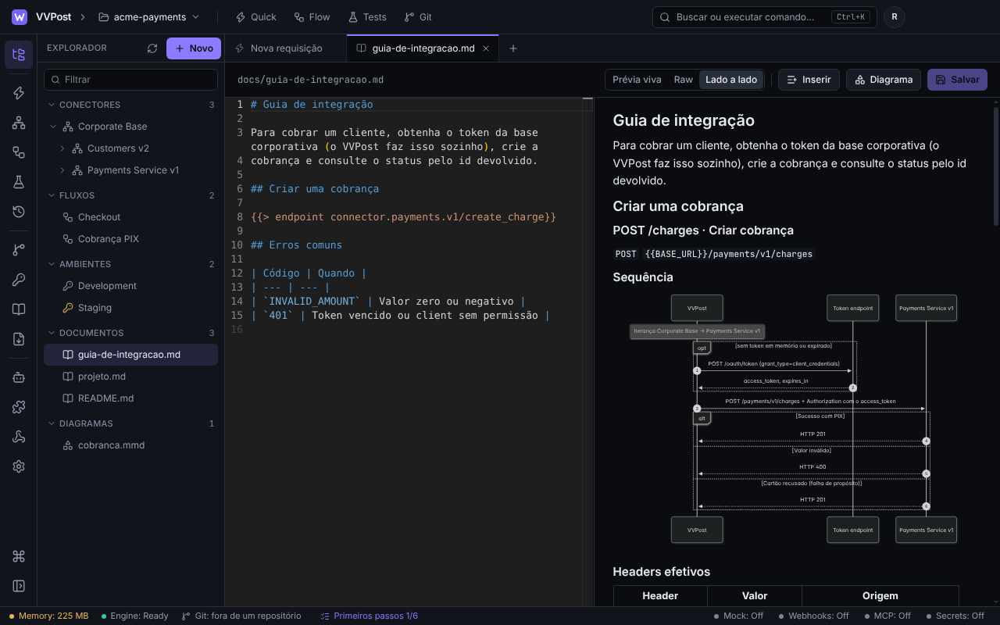

## O que faz uma documentação ser viva

1. **Ela cita o que existe, em vez de copiar.** Conectores, endpoints, cenários, fluxos, ambientes
   e páginas são arquivos relacionados no seu Git. Uma página escreve
   `{{> endpoint pagamentos/criar_cobranca}}` e mostra o endpoint como está agora; se alguém o
   renomeia, a página aponta o arquivo e a linha, e `vvpost validate` barra o PR.
2. **Ela roda.** O mesmo motor executa no app, no CLI, no CI e no agente. Cada endpoint documentado
   tem **Testar**, cada exemplo pode ser um cenário com asserções e cada fluxo descrito é um fluxo
   que executa. Documentação que não dá para executar não tem como provar que está certa.
3. **Ela muda junto com o código.** Pelo MCP, o agente que altera o backend também atualiza o
   catálogo, as páginas e os diagramas que citam o que mudou, confere que nenhuma menção ficou
   para trás e gera o PDF de novo, com operações estruturadas e credenciais que ele não lê.

## Por que o workspace tem tudo isso

Visto de fora, o VVPost tem recursos de um cliente de API, de um gerador de documentação, de um
executor de testes e de um cofre de segredos. Cada um está lá porque, sem ele, uma parte do backend
não poderia ser documentada, conferida ou entregue a um agente com segurança:

| Peça | O que ela faz pela documentação |
| --- | --- |
| **Catálogo com herança** | É a referência das APIs: cada endpoint com schema, exemplos e a auth e os headers que realmente valem, herdados da base corporativa e com a origem de cada valor. |
| **Páginas `.md`, modelos e diagramas** | Documentam o que não é endpoint: contexto e containers (C4), arc42, decisões (ADR), guias (Diátaxis) e diagramas Mermaid, com a mesma cara em todos os serviços. Saem em PDF. |
| **Cliente de requisições** | Não dá para documentar um protocolo que você não consegue chamar. REST, GraphQL com introspecção, WebSocket, SSE e Socket.IO, gRPC e Kafka por plugin, SOAP pelo WSDL importado. O **Testar** de cada endpoint confere a documentação contra a API real. |
| **Cenários de teste** | São os exemplos que se provam: o caso de sucesso e os de erro que o guia mostra rodam em matriz por ambiente, no app e no CI. |
| **Fluxos** | Documentam o caminho entre chamadas e serviços (login, cliente, cobrança) como algo que executa, e saem no documento como diagrama de sequência em vez de um desenho que envelhece. |
| **Mock server e webhooks locais** | A documentação responde antes de o backend existir: quem integra usa os exemplos documentados, e os eventos que a API manda de volta podem ser recebidos e conferidos. |
| **Cofre, Secret Sanitizer e dados pessoais** | Uma documentação que executa precisa de credenciais. Sem o cofre, elas iriam para o Git, para o PDF e para o contexto do agente. Os valores ficam fora do projeto, e o que sai para a IA vem mascarado. |
| **Ambientes protegidos e limites de disparo** | Deixam o agente testar o que documenta sem escrever em produção. |
| **Import, `sync` e export** | Começam a documentação pelo que já existe (OpenAPI, Postman, Insomnia, Bruno, HAR, WSDL), deixam a spec gerada pelo código mandar no contrato e devolvem tudo em formato aberto se o time sair. |
| **`validate`, `lint` e o CLI** | Fazem a documentação quebrar o build quando mente: referência quebrada, schema que não bate, cenário que falha, regra do time violada. |
| **Servidor MCP** | Entrega a mesma documentação ao agente, para ele consultar o backend antes de mexer e atualizar a doc no mesmo PR do código. |
| **Git, Enviar para… e plugins** | Guardam a documentação onde o código mora, publicam onde ela é lida (site HTML estático, MkDocs para o Backstage, Confluence Cloud no Enterprise) e acrescentam protocolos, passos e formatos que o core não cobre. |

Se uma peça não ajuda a descrever o backend, a provar que a descrição está certa ou a mantê-la
atualizada com segurança, ela não entra.

## Por onde começar

| Você quer | Comece por |
| --- | --- |
| Ver funcionando em poucos minutos | [Demonstração em 5 minutos](#demonstração-em-5-minutos), depois [Na prática](#na-prática) |
| Documentar as suas APIs sem mudar o fluxo do time | [Experimentar sem migrar](#experimentar-sem-migrar) e [Agentes de IA mantêm a documentação](#agentes-de-ia-mantêm-a-documentação) |
| Entender a arquitetura ou contribuir | [Para quem contribui](#para-quem-contribui) |

Também neste README: [O que a documentação cobre](#o-que-a-documentação-cobre) ·
[Como ela se prova](#como-ela-se-prova) · [O que fica protegido](#o-que-fica-protegido-e-até-onde) ·
[Arquivos seus, no seu Git](#arquivos-seus-no-seu-git) · [CLI para CI/CD](#cli-para-cicd) ·
[Community e Enterprise](#community-e-enterprise)

## Demonstração em 5 minutos

Requisitos: [Node.js](https://nodejs.org) 22.19 ou mais novo e [Git](https://git-scm.com). Os
instaladores ainda não foram publicados, então o VVPost roda a partir do código-fonte
([empacotamento](docs/packaging.md)).

```bash
git clone https://github.com/victorverdoodt/vvpost-community.git
cd vvpost-community
npm ci && npm run build
node scripts/demo-server.mjs &      # a API de mentira do projeto de demonstração, na porta 4010

# cenários e fluxos do projeto de demonstração, como no CI (um cenário falha de propósito)
VVPOST_SECRET_CLIENT_SECRET=demo-secret node out/main/cli.js run --workspace examples/demo-workspace --env env.dev

npm run dev                          # abre o app
```

No app, abra uma cópia de `examples/demo-workspace` em **Abrir workspace** e siga o
[início rápido](#início-rápido): abrir a documentação C4 do projeto, testar um endpoint a partir
dela, rodar a matriz de cenários e o fluxo de checkout e ver o documento sair em PDF.

## Na prática

O [projeto de demonstração](examples/demo-workspace) documenta o backend de pagamentos de uma
empresa fictícia. Cada API é um fluxo-base com a URL, a auth e os headers, e cada endpoint é um
fluxo de requisição que herda dele. A base de pagamentos herda da base corporativa, que tem o
OAuth2:

```json
{
  "id": "connector.payments.v1",
  "name": "Payments Service v1",
  "extends": "connector.corporate.base",
  "defaults": { "basePath": "/payments/v1", "headers": { "X-Tenant": "acme-billing" } },
  "nodes": []
}
```

O endpoint de cobrança é um fluxo de um nó só, com o schema do corpo e os cenários de teste ao lado:

```json
{
  "id": "connector.payments.v1.create_charge",
  "name": "Criar cobrança",
  "extends": "connector.payments.v1",
  "nodes": [{
    "id": "request",
    "type": "request",
    "request": {
      "method": "POST",
      "url": "/charges",
      "bodySchema": { "required": ["amount", "currency", "customer_id", "method"] }
    }
  }],
  "scenarios": [{
    "name": "Sucesso com PIX",
    "assertions": [{ "target": "status", "operator": "equals", "expected": 201 }]
  }]
}
```

O guia de integração é um `.md` comum, que cita o endpoint em vez de copiá-lo:

```markdown
## Criar uma cobrança

{{> endpoint connector.payments.v1/create_charge}}
```

Na prévia (a imagem acima), a diretiva vira a referência do endpoint como ele está agora: método,
URL, headers herdados, schema e o diagrama de sequência da auth. O documento do projeto, no modelo
C4, junta essas páginas com o diagrama de contexto, o mapa dos conectores, os fluxos e os
ambientes. Se alguém renomear o endpoint, o documento mostra o aviso com arquivo e linha em vez de
continuar descrevendo uma API que não existe mais, e o `vvpost validate` falha no CI.

No app, o endpoint abre como uma requisição comum, com a auth e os headers herdados já no envio, e
a mesma aba mostra o grafo no Canvas. [Herança entre fluxos](docs/flows.md#herança-entre-fluxos)

No pipeline, os mesmos arquivos viram testes, e o exemplo documentado que deixou de valer aparece
como falha:

```text
$ vvpost run --workspace ./acme-payments --env env.dev
Cenários · connector.payments.v1 (3, 62 ms)
  ✓ env.dev create_charge/tc_pix_ok 201 · 7 ms
  ✓ env.dev create_charge/tc_invalid_amount 400 · 9 ms
  ✗ env.dev create_charge/tc_expected_failure 402 · 10 ms
      status equals: esperado 201, recebido 402

Fluxo · flow.checkout [env.dev] ✓ (5 nós, 17 ms)
```

E um agente de IA ligado pelo servidor MCP lê esse catálogo, roda os cenários, grava a mudança num
lote validado e atômico e atualiza o guia e o PDF que citam o endpoint.

O VVPost também lê conectores com todos os endpoints num arquivo só, e `vvpost migrate` converte
um formato no outro com a mesma herança. [Converter conectores em fluxos](docs/flows.md#converter-conectores-em-fluxos)

## Experimentar sem migrar

Não é preciso mudar o fluxo do time para ver se o VVPost serve. Comece documentando uma API, numa
pasta nova, a partir do que você já tem:

```bash
# uma spec ou coleção que já existe vira um projeto do VVPost; o arquivo de origem não muda
mkdir apis && node out/main/cli.js import ./openapi.yaml --workspace ./apis

node out/main/cli.js validate --workspace ./apis                   # schemas, herança e documentação
node out/main/cli.js lint --workspace ./apis                       # estilo e erros comuns (regras no formato do Spectral)
node out/main/cli.js docs --workspace ./apis --out referencia.md   # referência gerada, com diagramas
node out/main/cli.js connect ./meu-servico --workspace ./apis      # liga o agente do repositório ao projeto
```

O import lê os formatos mais usados (coleção Postman v2.1, OpenAPI 3.x e Swagger 2.0, Insomnia,
Bruno, HAR e WSDL) e, no app, mostra a hierarquia para revisar antes de gravar
([Importar e exportar](docs/import-export.md)). A partir daí você já tem a referência gerada,
chama os endpoints com a auth herdada, escreve as páginas de arquitetura e os cenários e deixa um
agente trabalhar no projeto. Se não ficar, nada se perde: o projeto exporta de volta como coleção
ou como OpenAPI 3.1 ([exportar](docs/import-export.md#exportar-para-o-postman-e-openapi)), e uma
spec que continua mudando fora do VVPost pode ser
[reimportada](docs/import-export.md#reimportar-a-spec), com a revisão do que mudou em cada
endpoint.

### Time code-first: a spec do código manda

Se a sua OpenAPI é gerada pelo código, ela já é o contrato, e o VVPost não vira uma segunda fonte
para manter. O projeto fica vinculado à spec, e o `vvpost sync` relê a spec e aplica o que mudou:
endpoints novos, alterados e removidos seguem o código, enquanto o que a spec não diz (cenários,
exemplos de resposta, fluxos, páginas, diagramas, ambientes e a auth) fica no VVPost. No CI,
`vvpost sync --check` falha quando a documentação ficou para trás e mostra o que a mudança quebra
(o cenário cujo corpo saiu do schema novo, o fluxo que chama um endpoint removido, a página que o
cita). O agente faz o mesmo pela ferramenta MCP `sync_openapi`.

```bash
node out/main/cli.js sync --link ./openapi.yaml --connector pagamentos --workspace ./apis  # projeto que já existe
node out/main/cli.js sync --check --workspace ./apis                                         # no CI, depois de gerar a spec
```

[Como adotar num time code-first](docs/openapi-sync.md)

Existe um custo de entrada: importar a spec ou a coleção, revisar a hierarquia de conectores e
escrever as primeiras páginas e cenários. Ele é menor quando a spec já existe, e o benchmark ainda
não o mede.

### Adotar no time

- **Sem o app.** O CLI e o MCP fazem quase tudo: importar ou sincronizar com a spec do código,
  ligar o agente com `vvpost connect`, documentar e conferir no CI. Quem não quer o app continua
  no cliente HTTP que já usa.
- **Onde fica o workspace.** Num repositório central da organização, com um projeto por serviço e
  a auth comum na raiz, ou numa pasta dentro do repositório de cada serviço, revisada no mesmo PR
  do código.
- **Segredos sem o app.** `vvpost secrets set <ambiente> <VAR>` grava no cofre local, com o valor
  digitado sem eco ou vindo do stdin.
- **Política obrigatória (Enterprise).** O workspace declara o Control Plane da organização e a
  configuração vem dele depois do login, sem arquivo distribuído pela TI. Sem login ou sem o módulo
  Enterprise, o MCP desse workspace fica só leitura; as credenciais só saem do broker para quem fez
  login, e as bases corporativas herdadas resolvem no `vvpost-mcp` pelo catálogo central.

Detalhes em [Adotar no time](docs/adocao.md).

## O que a documentação cobre

### O workspace

O **explorador** (`Ctrl+Shift+E`) mostra a documentação do backend inteira: conectores com os
endpoints e cenários, fluxos, ambientes, páginas `.md` e diagramas `.mmd`. Cada item abre numa aba
da mesma barra, com o editor do tipo dele:

- um `.md` abre com a prévia montada a partir do projeto, o texto puro ou os dois lado a lado;
- um endpoint abre na documentação dele, com **Testar**, **Schema do corpo** e **Rodar cenários**;
- uma requisição abre no cliente, e um conector, um cenário, um fluxo ou um diagrama, no editor
  próprio.

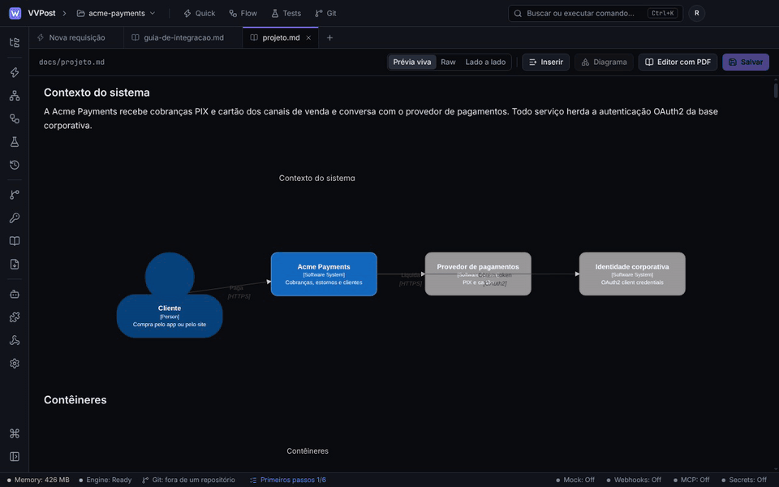

**Novo** (`Ctrl+Shift+N`) cria qualquer peça a partir de um só lugar: página, diagrama, conector,
endpoint, cenário, fluxo, ambiente, requisição ou um projeto inteiro a partir de um modelo.
[Interface](docs/interface.md)

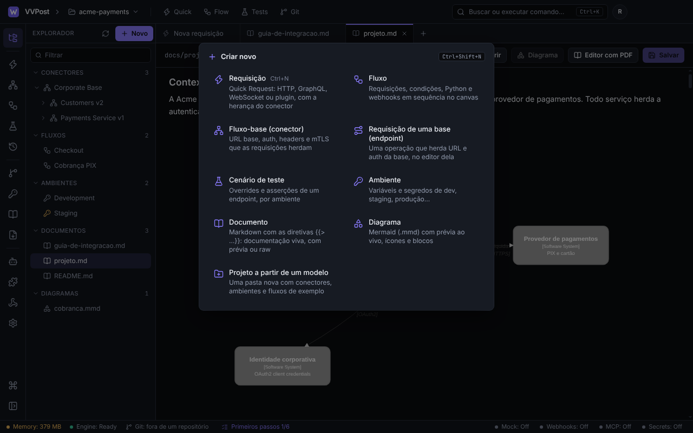

### O documento do projeto

Em **Documentação → Editor**, o Markdown fica de um lado e o PDF do outro, remontado enquanto você
digita. **Inserir** coloca diretivas de endpoint, conector, mapa do projeto, fluxos, ambientes e
trechos de outros documentos; o botão **Estilo da documentação** abre a metodologia (C4, arc42,
Diátaxis, ADR), logo, capa, sumário, cabeçalho, rodapé, cores e página. **Visualizar** mostra o
documento montado com **Testar** em cada endpoint, que abre a requisição pronta. Sai em PDF e em
`.md`, como site HTML estático (com busca e a página Mudanças, também no CI com `vvpost docs
export`), e **Enviar para…** publica onde o time lê. [Guia](docs/documentation.md)

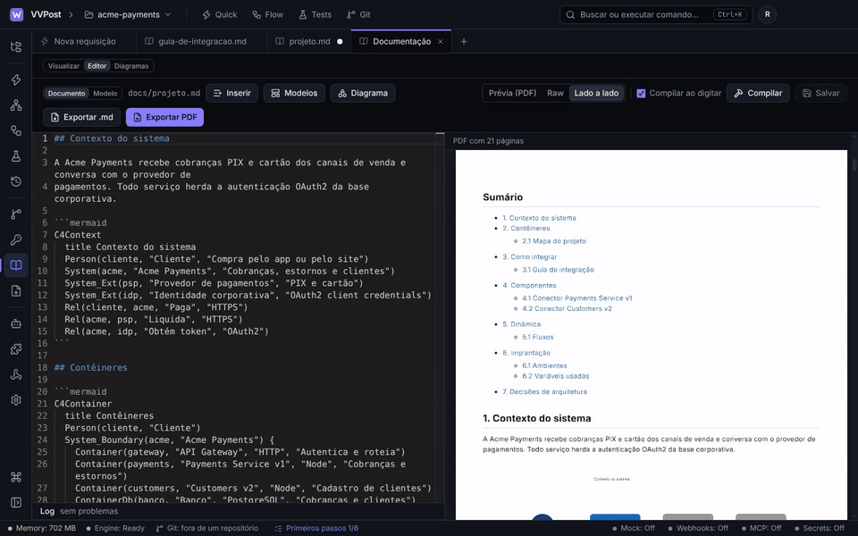

### Arquitetura e decisões, não só endpoints

Comece de um modelo pronto (guia de API, C4 com `C4Context` e `C4Container`, arc42, Diátaxis ou
ADR) ou salve o do seu time como modelo do projeto, versionado em `docs/templates/`. Aplicar um
modelo troca a estrutura e o formato e mantém título, organização, versão e logo, então a
documentação de cada serviço sai com a mesma estrutura e a mesma cara.
[Modelos](docs/documentation.md#modelos-de-documentação)

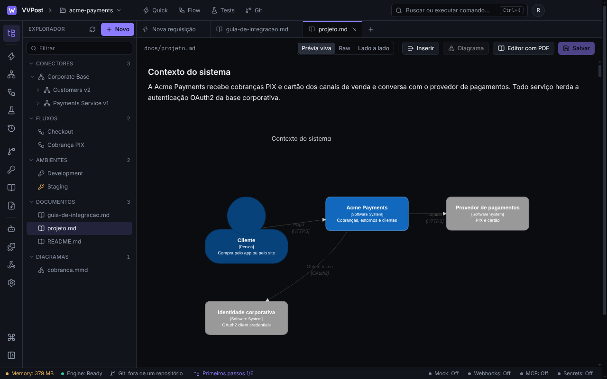

### Diagramas Mermaid

Cada diagrama abre num editor com o código, a prévia redesenhada a cada tecla e uma paleta de
blocos (fluxograma, sequência, C4, arquitetura, classes, estados, ER) e de ícones. O diagrama volta
para o bloco do Markdown ou para um `.mmd` próprio, e o editor recusa gravar por cima de um arquivo
que mudou por fora. No PDF, os diagramas saem nas cores do modelo e cabem na página: um fluxograma
alto escrito em etapas vira um diagrama por etapa, com pontas que ligam uma etapa à seguinte.
[Diagramas](docs/documentation.md#diagramas)

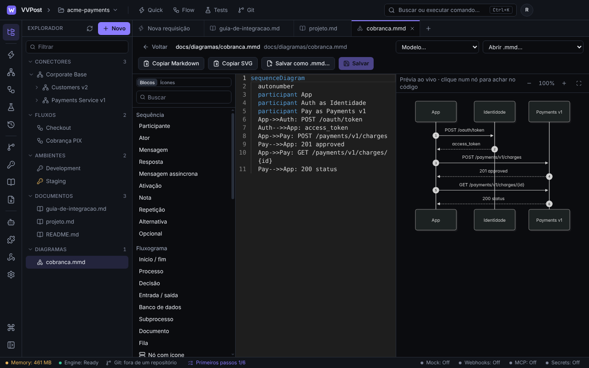

### Catálogo com herança

A árvore de conectores mostra a configuração efetiva e de onde vem cada valor, seja o conector um
arquivo próprio ou um fluxo-base. Um workspace pode guardar vários projetos, com um Compartilhado de
bases e ambientes de que todos herdam ([Projetos](docs/git-workspace.md#projetos)). Cada conector tem a
documentação em Markdown ao lado, validação do corpo por JSON Schema e uma referência gerada com
auth, schemas, exemplos, cenários e diagramas de sequência. Uma spec OpenAPI importada pode ser
reimportada, e a revisão mostra o que mudou em cada endpoint antes de gravar.
[Catálogo](docs/catalog.md)

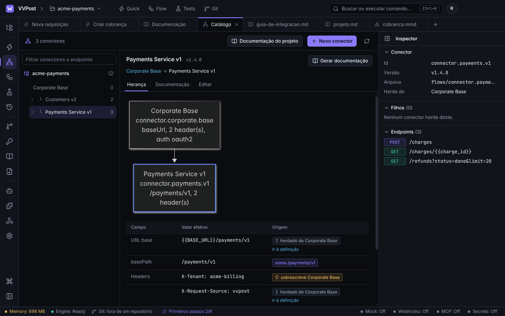

### Os protocolos do backend

Um backend fala mais do que REST, e documentar um protocolo exige poder chamá-lo para conferir o
que se escreve sobre ele. O cliente do VVPost cobre REST com auth headless (bearer, API key,
basic, OAuth2 com client credentials ou authorization code com PKCE, login com MFA, Digest, NTLM,
AWS SigV4 e OAuth 1.0, com o token só em memória), GraphQL com introspecção, autocomplete e
explorer de tipos, conexões WebSocket, SSE e Socket.IO com a tela de mensagens, SOAP a partir do
WSDL importado e, por plugin, gRPC e Kafka. Todas herdam a URL, os headers e a auth do conector.
[Guia](docs/quick-request.md) · [Plugins](docs/plugins.md)

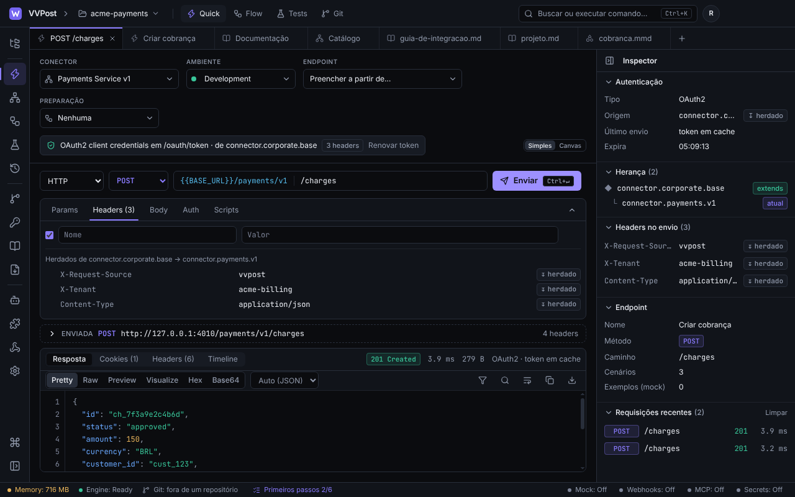

## Como ela se prova

### Testar a partir da documentação

Cada endpoint documentado abre como requisição pronta, com a auth e os headers herdados. Uma
requisição é um fluxo de um passo visto de forma simples: **Simples | Canvas** troca a visão do
mesmo documento, `Ctrl+S` grava como fluxo, e os passos de antes (um login, a busca de um cliente)
rodam em segundo plano antes de cada envio. O corpo pode ser JSON, um formulário gerado do schema,
form-data ou binário, e a resposta tem visualizações, busca, filtro JSONPath/XPath e cookies.
[Requisição e fluxo](docs/quick-request.md#requisição-e-fluxo-o-mesmo-documento)

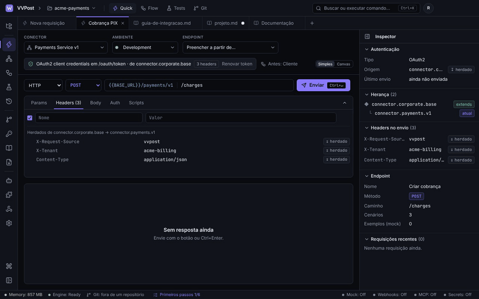

### Cenários: os exemplos que rodam

Testes *table-driven* por endpoint: cada cenário sobrescreve corpo, headers ou query e declara
asserções, e a matriz roda cenário × ambiente com esperado e recebido em cada célula. Os cenários
entram na referência do endpoint e podem ser citados numa página com `{{> request …}}`, então o
exemplo que o guia mostra é o mesmo que o CI roda. Cenários encadeados, expectativa por ambiente e
iterações a partir de CSV ou JSON. [Guia](docs/tests.md)

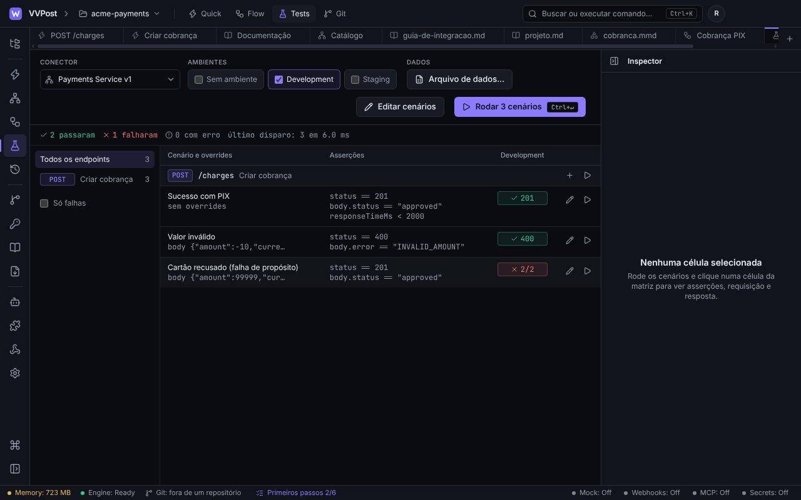

### Fluxos: o caminho entre serviços

Fluxos em grafo com execução topológica, em que a saída de cada nó fica em `$nodes` para os
seguintes. Nós de requisição (com polling), condição, asserção, espera, webhook, Python e plugins,
e os scripts pre e post de uma requisição rodam no mesmo motor. No documento, `{{> flows}}` mostra
cada fluxo como diagrama, desenhado a partir do arquivo que executa. [Guia](docs/flows.md)

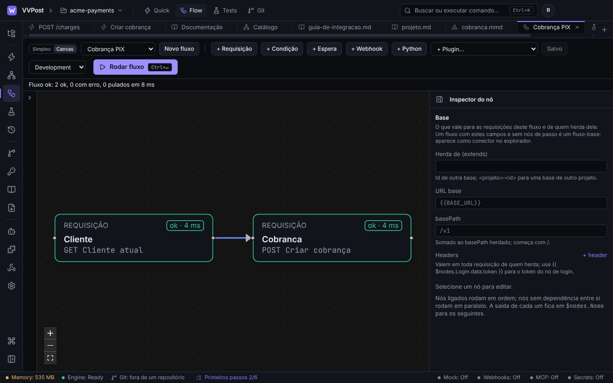

### E ainda

- **Mock server** com os exemplos de resposta de cada endpoint, para quem integra começar pela
  documentação antes de o backend existir. [Guia](docs/mock.md)
- **Webhooks locais** em `localhost:4480`, com assinatura HMAC conferida e disparo de fluxos e
  cenários, para documentar e conferir o que a API manda de volta. [Guia](docs/webhooks.md)
- **Histórico**: cada execução com a requisição montada e a enviada, resposta, tempos, auth e
  asserções, para reabrir e reproduzir. [Guia](docs/quick-request.md#histórico)
- **Emulador de Secret Managers** (Azure Key Vault, AWS Secrets Manager e HashiCorp Vault) em
  `localhost:4460`, para o backend documentado rodar local com os SDKs oficiais.
  [Guia](docs/secret-engine.md)
- **Importar e exportar**: coleções e specs nos formatos mais usados, com revisão da hierarquia
  antes de gravar; exporta como coleção, como OpenAPI 3.1 ou num pacote próprio sem segredos, e
  leva o workspace inteiro ou um projeto num `.zip`. [Guia](docs/import-export.md)
- **Git no app**: clone, commit, branches, pull com resolução de conflitos e diff de JSON.
  [Guia](docs/git-workspace.md)
- **Plugin SDK**: nós e protocolos em JavaScript, cada plugin num processo isolado, com plugins
  oficiais de JavaScript, GraphQL, gRPC e Kafka. [Guia](docs/plugins.md)
- **Teclado**: Command Palette (`Ctrl+K`), busca no projeto e menu de contexto em todo lugar.

## Agentes de IA mantêm a documentação

O servidor MCP liga Claude Code, Cursor, Copilot e outros clientes MCP ao projeto aberto. O agente
lê a documentação e os schemas antes de mexer no backend, roda cenários e fluxos pelo motor do
VVPost e edita conectores, endpoints, cenários, ambientes, fluxos, páginas e diagramas, sem que
nenhuma credencial chegue a ele pelo VVPost.

```bash
claude mcp add vvpost -- node /caminho/vvpost/out/main/mcp.js --workspace /caminho/do/workspace
```

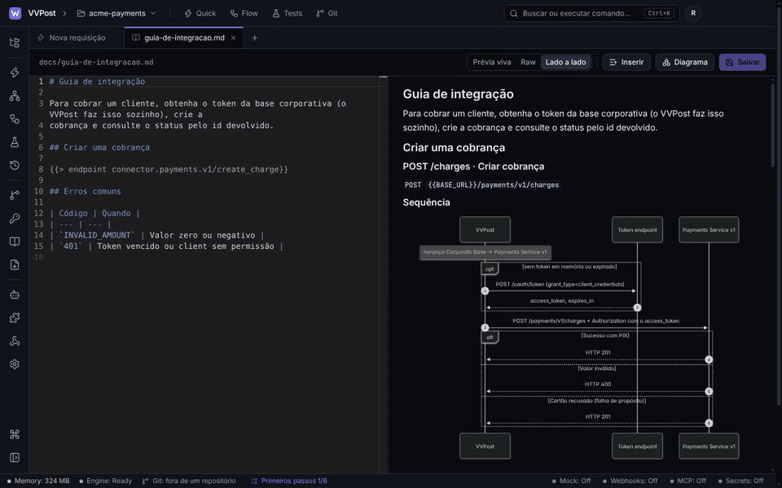

### A documentação muda junto com o código

A regra do VVPost no `CLAUDE.md` ou no `AGENTS.md` do repositório de código faz a documentação
entrar em toda mudança feita pelo agente. Quando ele muda o código, também atualiza no VVPost o
catálogo e as páginas e os diagramas que citam o que mudou, confere com `find_references` que
nenhuma menção ficou para trás e gera o PDF de novo, no modelo de documentação que o projeto usa.
`vvpost connect <repositório>` (ou **Escolher repositório e ligar**, no módulo MCP & IA) registra o
servidor no Claude Code, Cursor, Copilot ou Codex e grava a regra num passo só; num repositório
ainda sem ela, o servidor avisa o agente, que oferece `install_agent_rules`.
[Código e documentação juntos](docs/mcp.md#código-e-documentação-juntos)

Para documentar do zero, o servidor traz prompts prontos (`documentar_projeto`,
`documentar_conector`, `aplicar_template`) e o guia em `vvpost://docs/guia`, e o agente escreve no
documento do projeto, com as diretivas e o modelo do time, em vez de espalhar `.md` soltos.

### Um contrato pensado para o agente

Cada ferramenta segue o mesmo contrato, para que o agente leia e aja sem adivinhar:

- **Versões e `CONFLICT`.** As leituras trazem a versão de cada arquivo e as escritas a conferem.
  Se você salvou no app enquanto o agente trabalhava, nada é sobrescrito: ele recebe `CONFLICT`
  com a versão esperada e a atual. O app faz o mesmo no outro sentido, e as abas abertas mostram o
  que o agente gravou. [Concorrência](docs/mcp.md#contrato-para-agentes)
- **Erros com `code` e `hint`.** Todo erro tem um código estável e, quando a próxima chamada é
  óbvia, a dica de qual é. [Erros](docs/mcp.md#contrato-para-agentes)
- **Validar e gravar num passo.** O lote de operações é atômico: valida schemas, herança e
  credenciais e grava, tudo ou nada, devolvendo o catálogo conferido, as diretivas do documento
  que a mudança quebrou e os PDFs que ficaram desatualizados.
  [Editar o projeto](docs/mcp.md#editar-o-projeto)
- **Leituras em lote e respostas compactas.** Vários conectores numa chamada, o catálogo em uma
  linha por conector e o sumário do documento sem trazê-lo inteiro para o contexto.
- **`find_references`.** Onde um nome aparece em páginas, diagramas, fluxos e conectores, para
  apagar ou renomear sem deixar sobras. [Ferramentas](docs/mcp.md#ferramentas)
- **`export_docs`.** O PDF sai pelo próprio agente, com a capa, o logo, as cores e os diagramas
  do modelo. [Documento do projeto](docs/documentation.md#pela-ia-mcp)

Num [benchmark público](docs/benchmark-agentes.md), o mesmo agente fez cinco tarefas de manutenção
num projeto pequeno, com e sem o VVPost, seis rodadas de cada. A qualidade foi a mesma (30 de 30
corretas nas duas variantes) e o custo empatou (US$ 0,17 contra US$ 0,18 por tarefa). Com o VVPost,
o agente usou em média 19% menos passos, mas a variação entre rodadas ainda não permite afirmar
ganho no conjunto. O resultado mais claro foi o das credenciais: na consulta autenticada, a chave
apareceu na transcrição do agente em 6 de 6 rodadas sem o VVPost e em nenhuma com ele. É uma
evidência inicial (um projeto, um agente, cinco tarefas), e o custo de montar o projeto no VVPost
não entra na conta. [Limites](docs/benchmark-agentes.md#limites) ·
[Contrato para agentes](docs/mcp.md#contrato-para-agentes)

### O que fica protegido, e até onde

Uma documentação que executa usa credenciais de verdade, e entregá-la a um agente levanta duas
perguntas diferentes: se ele consegue **ler** um segredo e o que ele consegue **fazer** com a auth
que o VVPost aplica por ele.

- **Ler: o valor não chega ao agente.** Os valores ficam num cofre local cifrado, fora da pasta do
  projeto, com a chave no cofre do sistema, e tudo o que o MCP devolve (respostas, erros, catálogo,
  eventos) passa pelo Secret Sanitizer, que troca credenciais por `[REDACTED_SECRET]`. O agente
  também não escreve `{{SEGREDO}}` em requisições nem em asserções.
  [Cofre local](docs/security-model.md#cofre-local) · [Secret Sanitizer](docs/mcp.md#secret-sanitizer)
- **Usar: limitado, não proibido.** Sem ver o token, o agente pode disparar requisições
  autenticadas nos endpoints dos conectores, e é isso que permite a ele conferir o que documenta.
  O que limita esse uso: a credencial só vai para a origem da `baseUrl` do conector; ambientes de
  produção ficam protegidos sem configurar nada (o agente só monta o plano); há teto de
  requisições por minuto e por chamada; `--allow-env`, `--allow-methods` e `--read-only` restringem
  o resto; e uma mudança de auth ou de destino feita pelo agente, ou um nó de código escrito por
  ele, só roda depois da sua revisão. [Limites de disparo](docs/security-model.md#limites-de-disparo) ·
  [Ambientes protegidos](docs/security-model.md#ambientes-protegidos)
- **Dados pessoais: por campo.** Um campo marcado com `x-sensitive` no schema (`cpf`, `email`,
  `phone`, `card`...) chega ao agente como `[REDACTED_PII:<tipo>]` em respostas, asserções, fluxos e
  webhooks, e o app segue mostrando o valor. A detecção pelo formato, para campos sem marca, é
  opcional (`.vvpost/privacy.json`, `--pii-detect` ou a política Enterprise).
  [Dados pessoais para o agente](docs/security-model.md#dados-pessoais-para-o-agente)
- **O que não é garantido.** Os dados de negócio que a API devolve chegam ao agente (as
  credenciais são mascaradas sempre, os dados pessoais só quando marcados ou detectados); um
  segredo que a API devolve transformado (com hash, cifrado, invertido) não é reconhecido; e um
  ambiente que não é de produção, com métodos liberados, aceita escrita de verdade. Para um agente
  que só deve ler, use `--allow-methods GET,HEAD` ou `--read-only`.
  [O que não é garantido](docs/security-model.md#o-que-não-é-garantido)

## Arquivos seus, no seu Git

O projeto é uma pasta de JSON e Markdown. A documentação entra no code review como qualquer outro
código, e o histórico é o do Git. Segredos ficam num cofre local cifrado, fora da pasta do projeto,
com a chave no cofre do sistema (Keychain, DPAPI do Windows ou libsecret), e o commit, pelo app ou
pelo hook de pre-commit (`vvpost guard --install`), recusa o arquivo que levaria um
([garantias contra vazamento](docs/security-model.md#garantias-contra-vazamento-de-segredos)). O
app, o CLI e o servidor MCP usam o mesmo motor (`@vvpost/core`, Node puro), então o que passou na
sua máquina passa no CI ([arquitetura](docs/architecture.md)). Não há conta, login nem serviço para
assinar, e tudo isso está neste repositório, sob Apache 2.0.

## Início rápido

Depois da [demonstração em 5 minutos](#demonstração-em-5-minutos), com `npm run dev` aberto:

1. Deixe a API de demonstração rodando: `node scripts/demo-server.mjs` (porta 4010).
2. Copie `examples/demo-workspace` para fora do repositório e abra a cópia em
   **Abrir workspace** na barra superior.
3. No módulo **Secrets**, preencha `CLIENT_SECRET` de Development com `demo-secret`.
4. No explorador, abra `docs/projeto.md`: a documentação do projeto, no modelo C4, monta os
   conectores, o mapa, os fluxos e os ambientes a partir dos mesmos arquivos.
5. Abra o endpoint *Criar cobrança* do conector *Payments Service v1*, use **Testar** e envie
   com `Ctrl+Enter`. O token OAuth2 é obtido em segundo plano e a resposta aparece embaixo.
6. Em **Cenários de teste**, rode os três cenários (um falha de propósito); no **Flow Studio**,
   rode o fluxo *Checkout*. Em **Documentação → Editor**, o documento sai em PDF.

Já tem coleções ou specs? Veja [Experimentar sem migrar](#experimentar-sem-migrar). Para gerar o
instalador do seu sistema em `dist/`: `npm run dist`.

## CLI para CI/CD

O `vvpost` confere a documentação sem abrir o app: valida as referências, aplica o lint, roda os
cenários e os fluxos e gera o documento, com relatórios em texto, JUnit e JSON e códigos de saída
para pipelines. Segredos do CI entram só em memória.

```bash
npm run build
node out/main/cli.js run --workspace ./apis --env staging --junit reports/vvpost.xml
```

```yaml
# GitHub Actions
- name: Documentação e testes de API
  run: |
    node vvpost/out/main/cli.js validate --lint
    node vvpost/out/main/cli.js run --env staging --junit reports/vvpost.xml
  env:
    VVPOST_SECRET_API_TOKEN: ${{ secrets.STAGING_API_TOKEN }}
```

Comandos `run`, `list`, `validate`, `lint`, `export`, `import`, `sync` e `docs`. [Guia do CLI](docs/cli.md)

## Documentação

| | |
| --- | --- |
| [Índice da documentação](docs/README.md) | Todos os guias de uso e de referência |
| [Documento do projeto](docs/documentation.md) | Editor, diretivas, modelos, diagramas, MCP e CLI |
| [Enviar para…](docs/publish.md) | Exportar a documentação como site HTML estático ou MkDocs (Backstage) e publicar em outro lugar (Confluence Cloud no Enterprise), com a estrutura no repositório |
| [Servidor MCP](docs/mcp.md) | O contrato para agentes, as ferramentas, a regra no repositório e o que fica protegido |
| [Modelo de segurança](docs/security-model.md) | Cofre, Secret Sanitizer, dados pessoais, limites de disparo, garantias contra vazamento e o que não é garantido |
| [CLI](docs/cli.md) | `run`, `validate`, `lint`, `import`, `docs`, `connect` e os segredos no CI |
| [Lint de regras](docs/lint.md) | Estilo e erros comuns com regras por JSONPath no formato do Spectral, no app, no CI (SARIF e JUnit) e no MCP |

## Community e Enterprise

Este repositório é o **VVPost Community**: o app completo, sob Apache 2.0, sem recursos travados.
O **VVPost Enterprise** é um módulo comercial separado para quando a documentação viva é de uma
organização inteira: credenciais do cofre corporativo via SSO, governança de equipe (papéis,
políticas para os agentes e auditoria central), catálogo compartilhado de bases e execução remota.
Ele se conecta ao core só pelos
[pontos de extensão](docs/architecture.md#pontos-de-extensão-para-o-módulo-enterprise) públicos, e o
core não depende dele.

## Para quem contribui

O código está organizado em torno do motor compartilhado: `packages/core` (Node puro: herança,
auth, dispatcher, cenários, fluxos, documentação e políticas), `src/main` (app, CLI e servidor MCP,
que usam o mesmo motor) e `src/renderer` (a interface). Para começar:

- [Arquitetura e contratos](docs/architecture.md): as partes do app, os pontos de extensão, o
  contrato de autenticação, a herança e o versionamento dos schemas.
- [Desenvolvimento](docs/development.md): stack, comandos, testes, benchmark e as metas de
  desempenho que o CI confere.
- [Modelo de segurança](docs/security-model.md): toda superfície nova de saída ganha caso em
  `test/secret-leaks.test.ts`.
- [Schemas JSON](packages/schemas/README.md) de conector, ambiente, fluxo, plugin e pacote.

Contribuições são bem-vindas: correções, documentação, plugins e recursos. Leia o
[guia de contribuição](CONTRIBUTING.md) antes de abrir um PR e siga o
[código de conduta](CODE_OF_CONDUCT.md). Bugs e ideias vão nas
[issues](https://github.com/victorverdoodt/vvpost-community/issues).

## Segurança

Achou uma vulnerabilidade? Não abra uma issue pública: siga a [política de segurança](SECURITY.md).

## Licença

[Apache 2.0](LICENSE).
