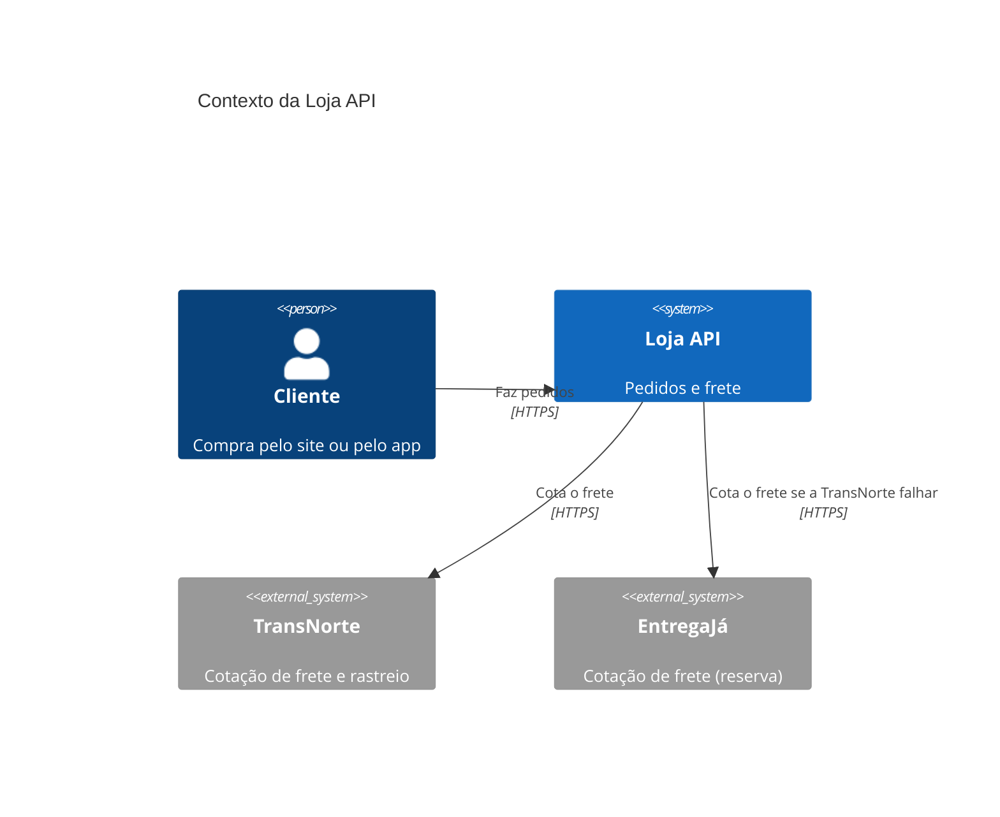

# Arquitetura

A Loja API recebe os pedidos do site e do app, guarda os pedidos e cota o frete com as
transportadoras parceiras. A TransNorte é a transportadora principal; a EntregaJá é a reserva,
chamada só quando a TransNorte não responde.

## Componentes

| Componente | Arquivo | Papel |
| --- | --- | --- |
| Rotas | `src/app.js` | Traduz método e caminho para as operações de pedidos |
| Pedidos | `src/pedidos.js` | Valida, soma os itens, cota o frete e guarda o pedido |
| Frete | `src/frete/index.js` | Tenta as transportadoras em ordem: TransNorte, depois EntregaJá |
| Cliente TransNorte | `src/frete/transnorte.js` | Conector `transnorte`, `POST /cotacoes` |
| Cliente EntregaJá | `src/frete/entregaja.js` | Conector `entregaja`, `GET /v1/frete` |
| Catálogo | `src/produtos.js` | Produtos, preços e pesos |
