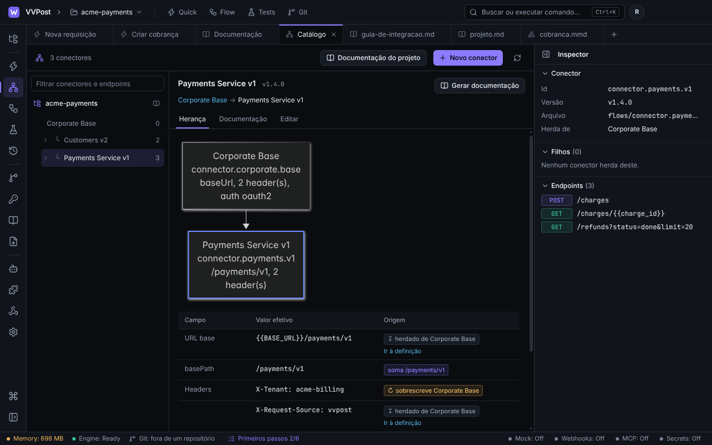
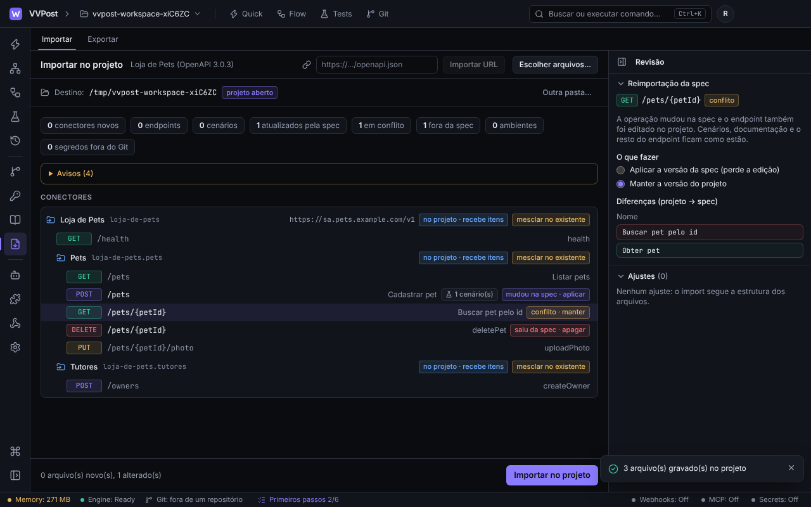
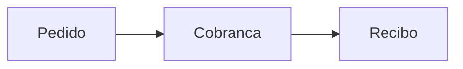
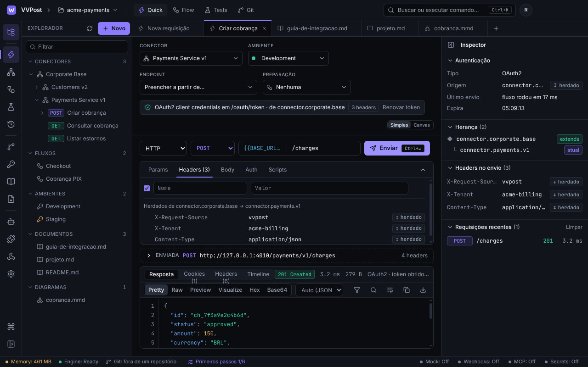
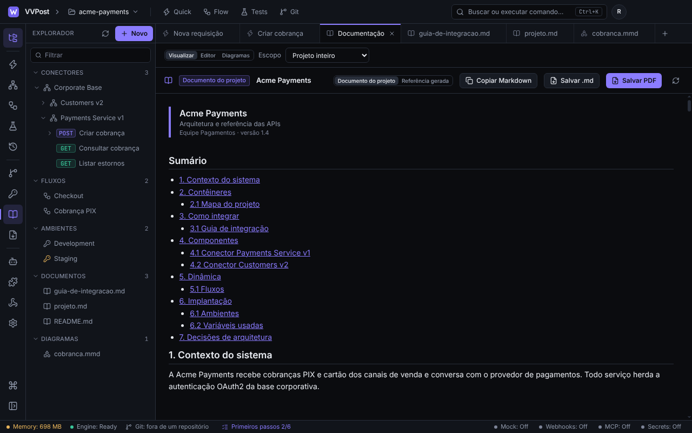

# Catálogo de conectores e documentação viva



O painel **Catálogo** mostra os conectores do workspace
como uma árvore pelo `extends`. Para cada conector há duas abas:

- **Herança:** o diagrama da linhagem (do conector raiz até os filhos diretos) e a
  configuração efetiva com a origem de cada valor: a URL base, o `basePath` acumulado, cada
  header com o conector que o define e quem ele substitui, a auth (ou quem a desliga com
  `{ "type": "none" }`) e o mTLS. Pai ausente e herança circular marcam o conector com o
  erro, sem derrubar o resto do catálogo. Ao lado de cada valor herdado, **Ir à definição** abre
  a aba Editar do conector que define o valor, com o campo (a URL base, o header pelo nome, a auth
  ou o mTLS) em foco.
- **Documentação:** a `description` do conector e dos endpoints, o arquivo
  `<nome>.connector.vvpost.md` ao lado do conector, o diagrama do fluxo de auth headless e,
  por endpoint, a URL montada, a tabela de campos do `bodySchema` e o corpo padrão e o de
  cada cenário conferidos com o schema. Um campo de texto valida qualquer corpo colado.

No Inspector, o painel **Lint** mostra os achados das [regras de estilo e dos erros comuns](lint.md)
do projeto (o ruleset do time em `.vvpost/ruleset.yaml` ou o `vvpost:recommended`): endpoint sem
descrição, sem exemplo ou sem cenário, resposta sem schema, caminho fora do padrão, credencial sem
`isSecret`. Clicar num achado abre o conector, o endpoint, o cenário, o ambiente ou o fluxo dele.



Um conector importado de uma spec OpenAPI (ele ou o raiz dele tem `source`) ganha **Reimportar a
spec** no cabeçalho e no menu de contexto: a spec é lida de novo de onde veio e a revisão mostra o
que mudou em cada endpoint antes de gravar ([Reimportar a spec](import-export.md#reimportar-a-spec)).

~~~markdown
# Billing

Visão geral do serviço, com diagramas:



## Efetuar cobrança {#charge_customer}

Tudo até o próximo título de mesmo nível vai para o endpoint `charge_customer`.
~~~

Um título terminado em `{#id}` abre a seção do endpoint `id`; o resto do arquivo é a visão
geral. O Markdown vem de repositórios quaisquer, então o HTML passa pelo DOMPurify e o
Mermaid roda com `securityLevel: 'strict'`; links `https://` abrem no navegador do sistema.
Na validação, um valor que é inteiro uma variável (`"{{AMOUNT}}"`) só é conhecido no
disparo e não conta como erro de tipo; num texto com variável dentro (`"{{$timestamp}}-1-1"`),
padrão, formato, tamanho e enum também não contam (o tipo continua contando). O validador é o mesmo da asserção `matchesSchema`
dos cenários e roda no main process. O Mermaid (o maior pedaço do painel) só carrega quando
o primeiro diagrama aparece.

Um endpoint que é um fluxo de requisição abre pelo explorador como a requisição dele (a visão
Simples), com a auth e os headers da base já no envio e a herança no Inspector. Um endpoint definido
dentro de um `.connector.vvpost.json` abre a documentação viva dele, com **Testar**, **Schema do corpo**,
**Novo cenário** e **Rodar cenários** no topo.



## Criar e editar conectores

A aba **Editar** e o botão **Novo conector** editam o que o arquivo do conector define: id, nome,
versão, `extends`, descrição, URL base, `basePath`, headers, auth por tipo, mTLS, scripts pre e post
([quick-request.md](quick-request.md#scripts-pre-e-post)) e os endpoints (headers, query, corpo
padrão, `bodySchema`, scripts e **Autenticação**: exige credencial, pública ou não declarada, o
`requiresAuth` que o [gate de acesso](tests.md#gate-de-acesso-requiresauth) confere); os cenários são preservados e se editam no módulo
de [cenários](tests.md). O app valida com o schema e recusa id repetido, trocar o id de um conector
que tem filhos e credencial literal: auth, passphrase e headers sensíveis precisam de uma
`{{VAR}}`, porque o arquivo vai para o Git. Salvar descarta o token em cache do conector. O
`.connector.vvpost.md` continua sendo editado fora do app.

### Campos do corpo sem OpenAPI

O `bodySchema` é parte do formato do conector (JSON Schema do corpo), então um endpoint escrito à
mão tem o mesmo formulário tipado de um importado do OpenAPI. Para não escrever JSON Schema:

- Na aba **Documentação**, cada endpoint com corpo tem **Definir os campos do corpo** (ou
  **Editar os campos do corpo**): uma linha por campo com nome, tipo (texto, inteiro, número,
  booleano, objeto, lista), obrigatório e descrição; a seta abre valores aceitos (enum), formato
  (data, data-hora, e-mail, UUID, URI), mínimo e máximo. Objetos e listas de objetos abrem os campos
  deles. **Gerar do corpo padrão** cria os campos pelos valores do corpo do endpoint (nenhum sai
  obrigatório). **Salvar os campos** grava só o `bodySchema` daquele endpoint.
- Na aba **Editar**, o endpoint tem o mesmo editor na visão **Campos** e o JSON Schema cru em
  **JSON Schema**, para o que o visual não cobre (`$ref`, `oneOf`, `allOf`; esses campos aparecem
  como "avançado" e o resto do schema não muda).
- Pela IA, as operações `setBodyField` e `setBodySchema` do `edit_project`
  ([mcp.md](mcp.md#editar-o-projeto)); no terminal, `vvpost schema <conector>/<endpoint>`
  ([cli.md](cli.md#vvpost-schema)).

### Schemas compartilhados

Um schema usado por vários endpoints (o `Pedido` que o criar, o trocar e a resposta do consultar
usam) fica uma vez só, em `schemas/<Nome>.schema.json` na pasta do projeto, e os endpoints citam:

```json
{ "bodySchema": { "$ref": "schema:Pedido" } }
```

A citação vale no `bodySchema`, no `schema` de um exemplo de resposta e dentro de outro schema
(`"cliente": { "$ref": "schema:Cliente" }`). Na leitura do workspace, cada citação é trocada pelo
schema, então o envio, a validação dos corpos, o mock, o formulário do Body, a documentação e o MCP
veem o schema inteiro, e editar o arquivo muda todos os usos de uma vez. Num projeto, os schemas do
Compartilhado da raiz valem também, só para leitura; um do projeto com o mesmo nome vence. Um schema
citado que não existe aparece nos avisos do catálogo e aceita qualquer corpo até ser criado.

Um campo com dado pessoal leva `"x-sensitive": "<tipo>"` (`cpf`, `email`, `phone`, `card`... ou
`true`): o valor dele não chega à IA pelo MCP, e o app segue mostrando
([dados pessoais para o agente](security-model.md#dados-pessoais-para-o-agente)). Vale em qualquer
schema do projeto e passa pelo import e pelo export de OpenAPI.

O import do OpenAPI cria um schema por componente ([import-export.md](import-export.md#importar-openapi-e-swagger)).
Em **Editar os campos do corpo**, um corpo que é um schema compartilhado edita o schema, com a lista
dos endpoints que ele muda. Pela IA, `upsertSchema`, `setSchemaField` e `deleteSchema` do
`edit_project`, e `setBodyField` num corpo que cita um schema muda o schema.

Um projeto importado antes, com o mesmo schema copiado em cada endpoint, passa a compartilhar com
**Converter para fluxos** no Explorer ou `vvpost migrate`: toda entrada de `$defs` igual em dois ou
mais endpoints vira um schema compartilhado, citado no lugar das cópias (a operação `extractSchemas`).
O hash da spec dos endpoints acompanha, então a reimportação não vê edição.

Os campos montam o formulário do Body no Quick Request e no Flow Studio
([quick-request.md](quick-request.md#formulário-pelo-schema)), conferem o corpo padrão e o dos
cenários e viram a tabela de campos da documentação.

Num conector com filhos, a aba Editar diz quantos conectores e endpoints herdam a configuração
dele. Salvar uma mudança no que é herdado (URL base, `basePath`, headers, auth ou mTLS) pede
confirmação antes, com o nome de cada conector afetado e o total de endpoints.

Duplicar, renomear (`F2`) e excluir (`Del`) conectores, endpoints e cenários ficam no botão
direito da árvore, e passam pela mesma camada de escrita em lote do projeto (tudo ou nada).
Conectores do catálogo compartilhado do módulo Enterprise aparecem como somente leitura; para
personalizar, crie um conector com `extends` apontando para ele.

Quando a IA muda pelo MCP a auth, o destino ou as credenciais de um conector, ou o código de um
fluxo, o Catálogo mostra o painel **Alterações da IA para revisar**, com **Aprovar** e **Aprovar
todas** ([mcp.md](mcp.md#regras-da-escrita-pela-ia)).

## Documentação rica



O botão direito (ou `Shift+F10`) no projeto, num conector, num endpoint ou numa request da árvore
do Catálogo, e nos endpoints e cenários dos Cenários de teste, abre **Gerar documentação**
daquele nível. O Catálogo também tem os botões **Documentação do projeto** e **Gerar
documentação**, e a Command Palette tem "Gerar documentação do projeto".

O documento abre por cima do módulo ativo, com sumário, e traz o mapa do projeto (herança entre
conectores, endpoints e fluxos), os ambientes, as variáveis usadas com o valor por ambiente
(segredos só pelo nome), a herança efetiva com a origem de cada valor, a auth (campos de
credencial só como `{{VAR}}`) com o diagrama do fluxo de auth e, por endpoint, a sequência da
chamada, headers, parâmetros, campos e JSON Schema do corpo, exemplos, as requests com overrides
e asserções, a documentação escrita e os fluxos que usam o endpoint.

**Salvar .md** grava o Markdown com os diagramas Mermaid, e **Salvar PDF** imprime o mesmo
documento (diagramas em SVG, tema claro) numa janela oculta sem JavaScript e sem rede. Tudo passa
pelo Secret Sanitizer, e o arquivo é recusado se ainda tiver o valor de uma credencial do
workspace. O mesmo documento sai no CLI (`vvpost docs`, [cli.md](cli.md#opções-de-docs)) e no
MCP (`generate_docs`).

Para o documento do projeto inteiro, no padrão visual do time (logo, capa, cabeçalho, rodapé,
modelos como C4 e arc42) e com trechos de endpoints e de outros Markdown, veja
[Documento do projeto](documentation.md).
