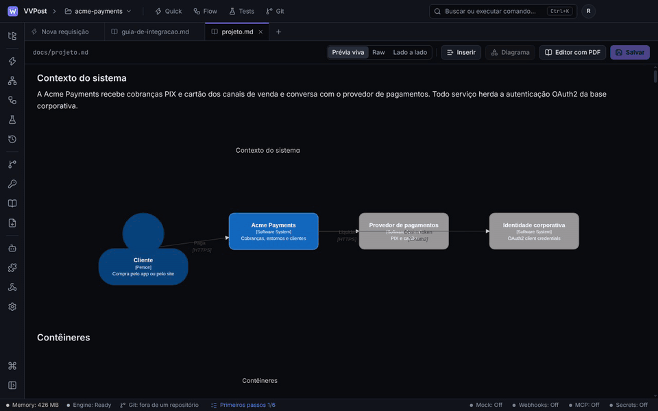
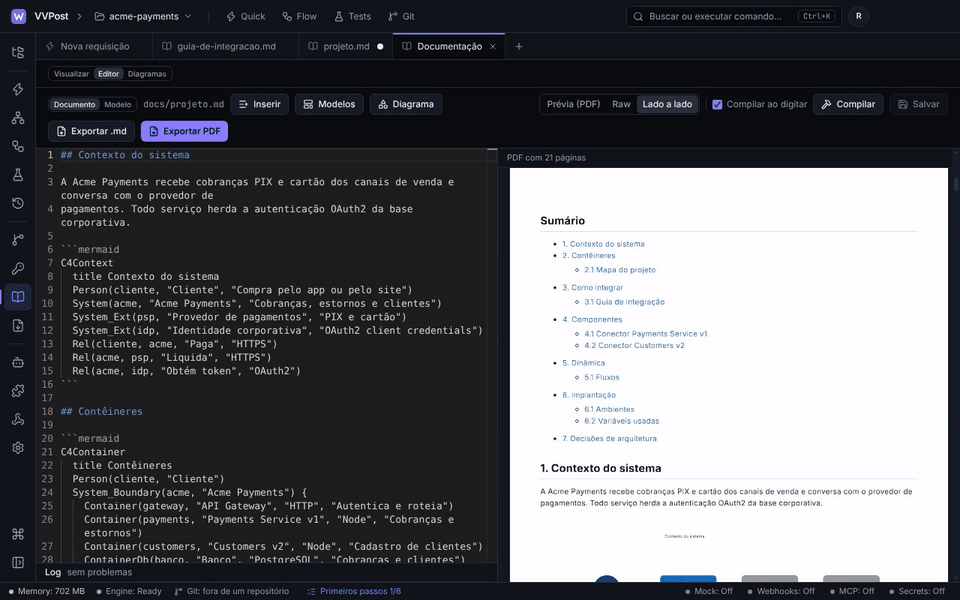
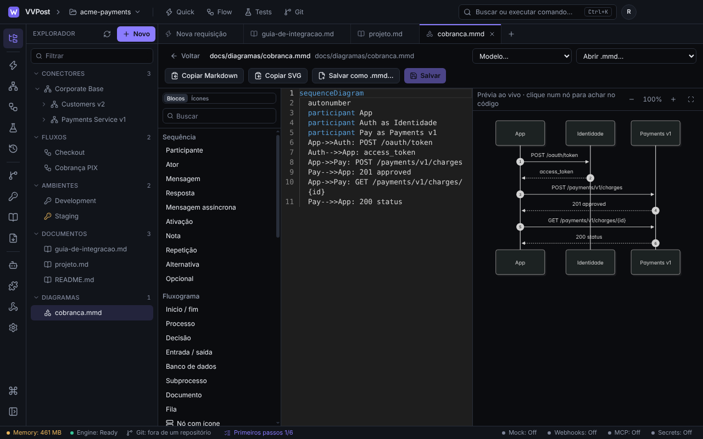
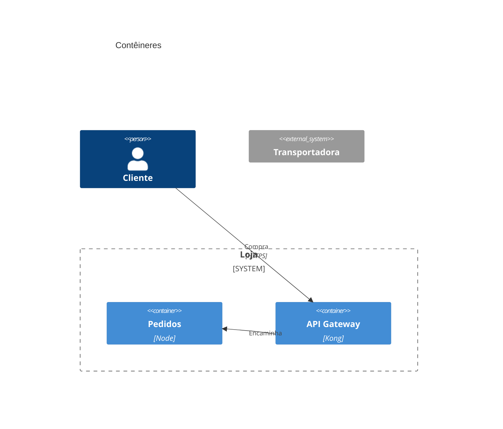

# Documento do projeto (editor de documentação)

O VVPost monta a documentação do projeto inteiro num documento só, no padrão visual que o time
define: logo, capa, sumário, cabeçalho, rodapé, cores, fontes e página. O texto é Markdown, e
trechos do projeto (endpoints, conectores, mapa, fluxos, ambientes) e de outros Markdown entram
por diretivas, sempre atualizados. O documento sai no app (visualização e PDF), no CLI
(`vvpost docs`) e no MCP (`generate_docs`).



## Arquivos

| Arquivo | O que guarda |
| --- | --- |
| `vvpost.docs.json` | O modelo: `title`, `subtitle`, `organization`, `version`, `logo` (imagem do workspace), `cover`, `toc`, `numberHeadings`, `theme` (cores e fontes, ou `theme.tokens` para lê-las dos [tokens da marca](brand.md#na-documentação-e-no-pdf)), `page` (tamanho, orientação, margens), `header` e `footer` (esquerda, centro, direita e logo), `methodology` (o nome do último modelo aplicado, só para mostrar). Schema `docs` em [packages/schemas](../packages/schemas/README.md). |
| `docs/projeto.md` | O documento-fonte (ou o arquivo em `source` do modelo). |
| `docs/**.md` | Páginas de nível de projeto (visão geral, arquitetura, guias, decisões) que o documento inclui. |
| `*.doc-template.vvpost.json` | Modelos de documentação do projeto. |

Cabeçalho e rodapé aceitam `{{title}}`, `{{subtitle}}`, `{{organization}}`, `{{version}}`,
`{{date}}`, `{{project}}`, `{{page}}` e `{{pages}}`.

## Diretivas

Uma linha sozinha, fora de bloco de código, vira um trecho:

| Diretiva | Trecho |
| --- | --- |
| `{{> summary}}` | Resumo do projeto (conectores, endpoints, fluxos, ambientes). |
| `{{> map}}` | Mapa do projeto em Mermaid. |
| `{{> c4}}` | Diagrama C4 de contexto gerado do catálogo: o projeto, os conectores (dentro da fronteira do conector-base) e os fluxos que chamam cada um. |
| `{{> environments}}`, `{{> variables}}` | Ambientes e variáveis por ambiente (segredos só pelo nome). |
| `{{> flows}}` | Os fluxos com os diagramas. |
| `{{> reference}}` | A referência gerada inteira (todos os conectores). |
| `{{> issues}}` | Avisos do workspace (arquivos ignorados, herança quebrada). |
| `{{> connector <id>}}` | Um conector com os endpoints. |
| `{{> endpoint <conector>/<endpoint>}}` | Um endpoint. |
| `{{> request <conector>/<endpoint>/<cenário>}}` | Uma request (cenário). |
| `{{> include <arquivo.md>#<seção>}}` | Outro Markdown do workspace, inteiro ou uma seção (pelo título ou `{#id}`). Inclusões aninham até 8 níveis; ciclos viram erro. |
| `{{> diagram <arquivo.mmd>}}` | Um diagrama Mermaid guardado em arquivo próprio (`docs/diagramas/*.mmd`), editável no editor de diagramas. |
| `{{> codemap <pasta>}}` | O mapa do código: uma linha por área (cada pasta dentro de `<pasta>`, relativa à raiz do repositório) com os arquivos de código dela, no formato ``- Área: `A.cs`, `B.cs` ``. Nunca fica velho; a cópia escrita à mão (no `AGENTS.md`, por exemplo) leva `<!-- vvpost:codemap <pasta> -->` logo acima das linhas, e o lint `doc-code-map` confere. |
| `{{> tokens <grupo>}}` | Os tokens da [marca](brand.md) (todos, ou só um grupo como `color`), com o valor em cada modo e a descrição. |
| `{{> contrast}}` | Os pares de contraste da [marca](brand.md) em cada modo, com a razão WCAG e se passam. |

Os títulos do trecho entram um nível abaixo do título em que a diretiva está. Uma diretiva com
erro aparece no documento como aviso com arquivo e linha, e o editor lista os diagnósticos.

## No app



Em **Documentação**, **Editor** abre a fonte (Monaco, com autocompletar das diretivas) ao lado da
prévia, que remonta sozinha ao digitar (`Ctrl+Enter` remonta na hora, `Ctrl+S` grava).
Acima do texto, a barra do editor simplificado formata a seleção sem precisar lembrar a sintaxe:
títulos 1 a 3, negrito (`Ctrl+B`), itálico (`Ctrl+I`), riscado, código, link, listas (com
marcadores, numerada e de tarefas), citação, bloco de código, tabela e linha horizontal. Clicar
de novo desfaz (um título ou uma lista do mesmo tipo volta a ser texto). A mesma barra aparece nas
abas de `.md`.

Com o mouse sobre uma diretiva, a dica mostra o trecho que ela monta com o projeto de agora: o texto
de outra doc num `{{> include arquivo.md#seção}}`, o conector com a cadeia de herança num
`{{> connector ...}}`, o endpoint, a request ou o diagrama. `Ctrl+clique` (`Cmd+clique` no macOS) na
diretiva abre o arquivo de onde o trecho vem para editar: o `.md` do include numa aba, com o
cursor no título da seção; o conector, o endpoint, o cenário ou o `.mmd` no editor de cada um.
Vale no editor do documento do projeto e nas abas de `.md`.

Sem passar o mouse, o próprio texto mostra o que cada diretiva monta: embaixo de cada
`{{> include ...}}`, `{{> connector ...}}`, `{{> endpoint ...}}` e companhia aparece uma prévia
recolhida do trecho (o texto incluído, o conector com a herança, o endpoint, um erro da diretiva),
como o peek de definição do VS Code. **Mostrar tudo** abre o trecho inteiro ali, **Abrir** abre o
arquivo dele. A prévia não entra no arquivo nem tira o cursor do lugar: o texto que você está
digitando fica onde está quando um trecho novo aparece acima dele. O olho no fim da barra de
formatação liga e desliga as prévias (a escolha fica lembrada); elas saem da mesma montagem da
prévia ao lado, então também aparecem com só o texto aberto.

Lado a lado, a prévia e o texto andam juntos, como na prévia de Markdown do VS Code: rolar um lado
leva o outro ao mesmo trecho (dentro de um trecho incluído, a rolagem passa por ele proporcionalmente
enquanto o texto passa pela linha da diretiva), um clique num trecho da prévia mostra e destaca as
linhas de onde ele veio (a diretiva, para um trecho montado), o duplo clique põe o cursor lá, e o
trecho da linha do cursor fica marcado com uma barra na prévia.

A prévia tem dois formatos, no seletor **Página | PDF** acima dela: **Página** mostra o documento
como em **Visualizar** e atualiza rápido enquanto você digita (é nela que o clique e a rolagem
ligam a prévia ao texto); **PDF** é o arquivo de verdade, com capa, cabeçalho, rodapé e quebras de
página. A escolha fica lembrada.
Em **Visualizar** e na **Página**, cada diagrama só é desenhado quando chega perto da área visível e
é solto quando se afasta (o espaço dele fica reservado), e as tabelas fora da tela não passam pelo
layout: o documento do projeto inteiro, com centenas de diagramas e tabelas, abre sem levar o app
a gigabytes de memória.
O seletor **Prévia | Raw | Lado a lado** no cabeçalho mostra só a prévia, só o texto
ou os dois; a escolha vale também para as abas de `.md` e fica lembrada.
A aba **Estilo** edita o formato e mostra a metodologia em uso (C4, arc42, Diátaxis, ADR ou um
modelo do time), com **Trocar…** para escolher outra; o botão **Estilo da documentação**, no topo
de qualquer aba da Documentação, abre direto nela. **Inserir** coloca diretivas e **Modelos** aplica
um modelo ou salva o atual como modelo do projeto ou como modelo pessoal. **Visualizar** mostra o documento
montado com o padrão do modelo, com **Testar** em cada endpoint (abre o Quick Request) e em cada
fluxo (abre o Flow Studio). Num documento grande, quando o sumário do texto sai da tela, um
**sumário fixo** aparece ao lado, com as seções e a que está em leitura destacada; o botão de
seta volta ao sumário do texto, e o sumário fixo some quando ele reaparece. Ele ocupa o mesmo lugar
e largura do sumário da referência gerada (dá para mover de lado e redimensionar). **Exportar PDF** e **.md** saem no mesmo padrão.

No PDF, os diagramas saem nas cores do modelo e cabem numa página. Um fluxograma alto demais,
escrito em etapas (um `subgraph` de primeiro nível por etapa e nenhum nó fora delas), sai como
um diagrama por etapa, com o título "Etapa 2 de 5 · …" e pontas que dizem de qual etapa um passo
vem e em qual ele segue. Um fluxograma grande sem etapas gera um aviso na linha dele, com a
sugestão de dividir.

## Diagramas



Cada diagrama Mermaid da visualização tem um botão **Editar** (aparece ao passar o mouse). Ele abre
a aba **Diagramas**, um editor ao vivo: o código à esquerda (Monaco, `Ctrl+S` grava) e a prévia à
direita, redesenhada a cada tecla, com zoom e o erro de sintaxe na hora. Clicar num nó da prévia
seleciona o id dele no código. No **Editor** do documento, o botão **Diagrama** abre o bloco
` ```mermaid ` em que o cursor está (ou um novo) e **Aplicar no documento** devolve o código ao texto.

A paleta tem duas abas:

- **Blocos**: nós, ligações e grupos de fluxograma, sequência, C4, arquitetura, classes, estados e
  ER. Um clique insere no cursor; arrastar para o código insere onde o bloco cair. Os grupos do tipo
  do diagrama aberto vêm primeiro.
- **Ícones**: o pacote `vv` (servidor, banco, fila, gateway, usuário, nuvem e outros, desenhados a
  partir do Lucide) e os pacotes dos plugins. Um clique insere o nome `prefixo:nome`, que vale em
  `architecture-beta` (`service api(vv:servidor)[API]`) e em nós de fluxograma
  (`api@{ icon: "vv:servidor", label: "API" }`).

**Modelo…** começa um diagrama inteiro (fluxograma, sequência, C4 de contexto e de contêineres,
arquitetura com ícones, classes, estados, ER, Gantt, mapa mental e linha do tempo).

Onde o diagrama é gravado:

| Origem | Salvar |
| --- | --- |
| Bloco ` ```mermaid ` de um `.md` do workspace | Troca só o miolo do bloco, na mesma linha. |
| `{{> diagram docs/diagramas/x.mmd}}` | Regrava o `.mmd`. |
| Diagrama gerado do projeto (mapa, fluxos, sequência de endpoint) | Não tem arquivo: **Salvar como .mmd…** cria um em `docs/diagramas/` e copia a diretiva `{{> diagram ...}}` para colar no documento. |

Se o arquivo mudou desde que o diagrama foi aberto (outra pessoa, o Git, a IA), o editor recusa a
gravação e pede para abrir de novo, em vez de sobrescrever. **Abrir .mmd…** lista os diagramas do
projeto; **Copiar Markdown** e **Copiar SVG** levam o diagrama para fora.

## Diagramas C4 que não envelhecem

Um diagrama gerado (`{{> map}}`, `{{> c4}}`, `{{> flows}}`) sai do catálogo a cada montagem e nunca
fica velho. Um C4 escrito à mão diz mais (pessoas, bancos, filas, fronteiras do time), mas envelhece
calado: o serviço novo não entra, o que saiu continua lá e nenhuma referência quebra. Para isso, o
lint compara cada diagrama C4 (`C4Context`, `C4Container`, `C4Component`, `C4Dynamic`,
`C4Deployment`) de `docs/`, em bloco ` ```mermaid ` ou em `.mmd`, com o catálogo. Um fluxograma
(`flowchart`, `graph`) ou um `architecture-beta` entra também quando tem alguma anotação
`%% vvpost:` (é assim que o time diz que aquele diagrama é de arquitetura): os nós, os `subgraph`
e os `service`/`group` são os elementos, e as setas, as relações.

Cada elemento do diagrama é ligado a um conector ou fluxo pelo nome (o alias ou o rótulo igual ao
nome ou ao id, com ou sem a versão) ou por uma anotação, que o Mermaid trata como comentário:



| Anotação | O que faz |
| --- | --- |
| `%% vvpost:bind <alias> connector:<id>` (ou `flow:<id>`, vários por linha) | Liga o elemento ao item do catálogo. Ligado a um conector-base sem endpoints, o elemento representa a família inteira. Elemento com anotação não é ligado pelo nome. |
| `%% vvpost:cover connectors flows` | Este diagrama precisa mostrar todos os conectores (ou fluxos) do projeto. Sem nenhum `cover`, basta que cada conector apareça em algum diagrama de arquitetura. |
| `%% vvpost:ignore connector:<id>` | Fica fora de propósito. |

O que o lint acusa (regras do `vvpost:recommended`, com a severidade trocável no
[ruleset do time](lint.md#ruleset-do-time)):

| Regra | Nível | Quando |
| --- | --- | --- |
| `c4-binding-unknown` | erro | Anotação liga a um conector ou fluxo que não existe mais, a um alias que não está no diagrama, ou não dá para ler. |
| `c4-connector-missing` | aviso | Conector do projeto com endpoint que nenhum C4 mostra (ou o diagrama com `cover connectors`). O `hint` traz o `System_Ext(...)` e a anotação prontos. |
| `c4-flow-missing` | aviso | Fluxo que o diagrama com `cover flows` não mostra. |
| `c4-relation-missing` | aviso | Elemento de um fluxo sem relação (`Rel`, direta ou pela fronteira) com um conector que o fluxo chama e que está no diagrama. |
| `c4-relation-stale` | info | Relação de um fluxo com um conector que ele não chama mais. |
| `c4-relation-unknown-element` | aviso | `Rel` com um alias que o diagrama não declara. |
| `c4-element-ambiguous` | dica | Elemento com o nome de mais de um item do catálogo: diga qual com `vvpost:bind`. |
| `doc-stale-since-change` | info | Num repositório Git, página com diagrama ligado ao catálogo, ou ADR, cujo conector ou fluxo mudou de estrutura (endpoint novo ou removido, `baseUrl`, `basePath`, auth, herança, o que o fluxo chama) depois do último commit da página. A mensagem diz o que mudou. Página com mudança ainda não commitada conta como revista; depois de revisar, qualquer mudança commitada na página (por exemplo `<!-- vvpost:revisado 2026-10-26 -->`) tira o aviso. |
| `doc-code-map` | aviso | Cópia do mapa do código (as linhas `- <Área>: ` logo abaixo de `<!-- vvpost:codemap <pasta> -->`) numa página ou no `AGENTS.md`/`CLAUDE.md` da raiz do repositório com área ou arquivo que o código não tem mais, ou sem os que ele tem. O hint traz a linha certa. |
| `doc-unknown-reference` | aviso | Em qualquer página (ADRs também), uma citação em código inline que não existe mais: `` `conector/endpoint` `` ou `` `conector/endpoint/cenário` `` de um conector que existe, ou um id com o prefixo dos ids do projeto (`connector.x`) que nenhum conector ou fluxo tem. As diretivas `{{> ...}}` o `vvpost validate` já confere. |

O achado aponta para a linha do diagrama ou da página: no app, o painel **Lint** abre o arquivo;
no CI, `vvpost lint` reprova o C4 que liga a algo removido (e, com `--fail-on warn`, o conector novo
que ficou de fora); pelo MCP, a escrita que cria um conector já devolve em `lint.new` que o C4 não o
mostra, com o trecho de Mermaid para acrescentar.

### Correção automática

O que é estrutural o VVPost corrige sozinho, na sintaxe de cada diagrama: acrescenta o elemento e o
`%% vvpost:bind` do conector (ou fluxo) que falta, já com as relações dos fluxos do diagrama que o
chamam; acrescenta a relação que um fluxo faz e o diagrama não mostra; tira o elemento ligado a algo
que não existe mais, com as relações dele; tira a relação que o fluxo não faz mais e a anotação que
sobrou. Rótulos, descrições e o texto em volta ficam para quem revisa.

| Onde | Como |
| --- | --- |
| App | Botão **Corrigir os diagramas** no painel **Lint** (aparece quando há o que corrigir): mostra as linhas que saem e entram e grava ao confirmar. |
| CLI | `vvpost lint --fix`: corrige, lista os arquivos em `corrigido: ...` e roda o lint. |
| MCP | `fix_diagrams`: sem `apply`, o plano; com `apply: true`, grava (filtros `codes` e `file`). |

## Modelos de documentação

| Modelo | Para quê |
| --- | --- |
| `api-guide` | Guia de API: visão geral, autenticação, ambientes, referência. |
| `c4` | Arquitetura C4: contexto, contêineres, componentes (diagramas `C4Context`/`C4Container`). |
| `arc42` | As 12 seções do arc42. |
| `diataxis` | Tutoriais, guias práticos, referência e explicação. |
| `adr` | Registro de decisões de arquitetura. |

Aplicar um modelo troca o texto e o formato, mantendo título, subtítulo, organização, versão,
logo e o arquivo da fonte. Modelos do projeto ficam em `docs/templates/` e vão para o Git; os
pessoais ficam na pasta do usuário.

## Pela IA (MCP)

O servidor MCP orienta a IA a documentar no VVPost em vez de criar `.md` soltos: as instruções do
`initialize` dizem isso, o resource `vvpost://docs/guia` traz o guia completo e
`vvpost://docs/modelos` os modelos, e os prompts `documentar_projeto`, `documentar_conector` e
`aplicar_template` trazem o passo a passo. As ferramentas são `get_docs_project`,
`save_docs_project`, `write_docs_page`, `save_docs_template`, `generate_docs` e `export_docs`, que
grava o PDF no padrão do modelo ([mcp.md](mcp.md#documentação-do-projeto)).

Cada escrita pela IA devolve o documento montado, com os diagnósticos, as diretivas que a mudança
quebrou (um `{{> endpoint ...}}` de um conector apagado, por exemplo) e os PDFs exportados que
ficaram desatualizados. `find_references` mostra onde um nome aparece nas páginas, nos diagramas e
no documento, para renomear ou apagar sem deixar sobras, e `replace_references` faz a troca no
catálogo e nas páginas num lote só.

### Documentação que acompanha o código

Para que a documentação mude junto com o código, a regra do VVPost precisa estar no arquivo de
instruções do repositório de código. `install_agent_rules` (pelo próprio agente) ou
`vvpost docs agents --out CLAUDE.md` (ou `AGENTS.md`) acrescenta um trecho curto, uma vez só, que
aponta para o workspace e o projeto. Com ele, ao mudar o código, o agente atualiza o catálogo e
as páginas e os diagramas afetados e gera o PDF de novo
([código e documentação juntos](mcp.md#código-e-documentação-juntos)).

## Pelo terminal

```bash
vvpost docs init --template c4 --title "Plataforma de Pagamentos"
vvpost docs templates
vvpost docs --strict --out build/documentacao.md
vvpost docs agents --out AGENTS.md
```

## Segredos

Tudo passa pelo Secret Sanitizer. Variáveis secretas aparecem só pelo nome, e gravar o modelo, a
fonte, uma página, um modelo ou um diagrama com o valor de uma credencial do workspace é recusado.

O texto é tratado como prosa: `Authorization: Bearer <token>` ou "o campo password: obrigatório"
num parágrafo ficam como estão. O que é mascarado, com o aviso de valores com cara de segredo, é o
valor de uma credencial do workspace, um formato conhecido (JWT, chave privada, tokens de
provedores) e o valor depois de um nome de credencial que parece uma (`Bearer abc123def456`,
`password: hunter2024`): uma palavra só, com letras e dígitos, que não é um marcador como `<token>`
ou `SUA_CHAVE`. Respostas, erros e logs que vão para a IA seguem a regra estrita.
