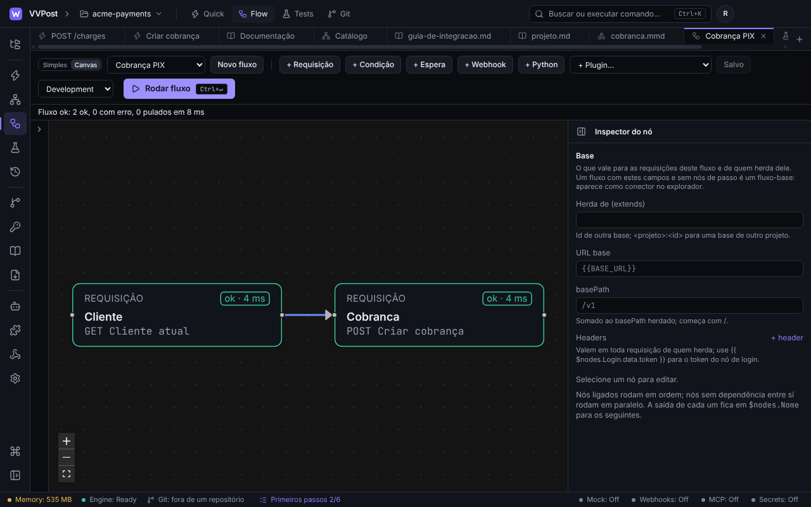
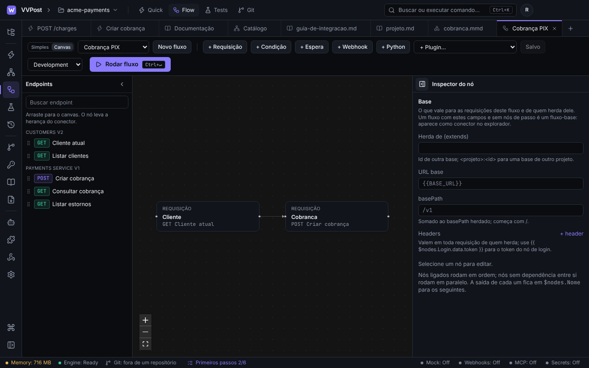

# Flow Studio: canvas, Context Engine e nó Python

O Flow Studio orquestra requisições num grafo. A saída de cada nó fica em
`$nodes.<Nome>` e os nós seguintes a referenciam com `{{ $nodes.Nome.data.campo }}`, sem scripts
de atribuição. O canvas (React Flow) só carrega quando a aba **Flow Studio** abre; o motor e o
executor Python são outro chunk do main process, carregado na primeira execução.



## O arquivo do fluxo

Cada fluxo é um `*.flow.vvpost.json` em qualquer pasta do workspace (o app cria em `flows/`),
validado pelo schema [`flow.json`](../packages/schemas/schemas/flow.json). O canvas grava as
posições dos nós; elas não afetam a execução.

```json
{
  "$schema": "https://vvpost.dev/schemas/v1/flow.json",
  "id": "flow.checkout",
  "name": "Checkout",
  "nodes": [
    { "id": "login", "name": "Login", "type": "request",
      "request": { "method": "POST", "url": "{{BASE_URL}}/auth/login", "body": { "user": "{{USER}}" } } },
    { "id": "cart", "name": "Cart", "type": "request",
      "request": { "method": "GET", "url": "{{BASE_URL}}/carts/{{ $nodes.Login.data.cartId }}",
                   "headers": { "Authorization": "Bearer {{ $nodes.Login.data.token }}" } } },
    { "id": "total", "name": "Total", "type": "python",
      "python": { "code": "output = {'amount': sum(i['price'] for i in nodes['Cart']['data']['items'])}" } },
    { "id": "has_total", "name": "HasTotal", "type": "condition",
      "condition": { "target": "$nodes.Total.data.amount", "operator": "greaterThan", "expected": 0 } },
    { "id": "charge", "name": "Charge", "type": "request",
      "request": { "connector": "connector.billing.v2", "endpoint": "charge_customer",
                   "body": { "amount": "{{ $nodes.Total.data.amount }}", "method": "PIX" } } }
  ],
  "edges": [
    { "from": "login", "to": "cart" },
    { "from": "cart", "to": "total" },
    { "from": "total", "to": "has_total" },
    { "from": "has_total", "to": "charge", "branch": "true" }
  ]
}
```

O nome do nó é o que vai em `$nodes`: letras, números e `_`, único no fluxo. Renomear um nó no
inspetor atualiza as referências a ele nos outros nós.

## Como o fluxo roda

- **Ordem topológica.** Um nó começa quando todos os nós ligados antes dele terminaram. Nós sem
  dependência entre si rodam em paralelo (até 6 ao mesmo tempo). Ciclos são recusados.
- **`$nodes` imutável.** A saída de um nó é congelada quando ele termina, e cada nó enxerga só os
  nós anteriores a ele no grafo: o resultado não depende de qual ramo paralelo terminou primeiro.
  Referenciar um nó que não é anterior, ou um campo que não existe na saída, é erro do nó
  (`EXPRESSION_ERROR`), em vez de seguir com um valor vazio.
- **Condição.** O nó `condition` usa os mesmos operadores das asserções dos cenários (`equals`,
  `greaterThan`, `exists`, `matchesSchema`...) sobre um caminho em `$nodes`. As arestas que saem
  pela alça "sim" (`branch: "true"`) seguem quando a condição vale; as da alça "não", quando não
  vale. O ramo não escolhido é pulado, e um nó que junta dois ramos roda com o que foi seguido.
- **Asserção.** Uma condição com `failWhenFalse: true` não escolhe ramo: quando não vale, o nó
  falha com `ASSERTION_FAILED` (com o valor recebido em `actual`), o fluxo termina como falho no
  app e no CLI (`vvpost run` sai com 1), e os nós depois dela só rodam quando ela vale. As arestas
  dela dispensam `branch` (ou usam `"true"`; `"false"` é recusado).
- **Erros.** Um nó com erro pula os nós que dependem dele; ramos independentes continuam. Uma
  resposta 4xx/5xx é erro, a menos que o nó marque `ignoreHttpErrors` (aí uma condição decide).
- **Cancelar** interrompe as requisições e os scripts em andamento e não começa os nós restantes.

## Herança entre fluxos

Conector, endpoint e requisição são o mesmo tipo de arquivo: um fluxo que pode herdar de outro com
`extends`. Um **fluxo-base** faz o papel do conector: guarda em `defaults` o que vale para toda
requisição de quem herda dele (URL base, `basePath`, headers, mTLS, scripts e a auth que não é uma
requisição à parte) e, quando a API tem login próprio, o nó de login. Um **fluxo de requisição**
herda da base e tem um nó de requisição só, com os cenários e os exemplos: é o endpoint.

O explorador do app mostra essa herança como árvore: cada base com as bases que herdam dela (abertas
de início) e as requisições dela, com os cenários. Uma requisição abre na visão Simples, como
qualquer fluxo de um nó; a base abre no editor de conector. Os arquivos que viram conectores e
endpoints não se repetem na seção Fluxos, que fica com os fluxos de vários passos.

O editor de conector também edita uma base: ao salvar, a base e os fluxos de requisição dela são
regravados, e nenhum `.connector.vvpost.json` é criado. O id de uma base se troca pelo fluxo. Num
workspace sem arquivos `.connector.vvpost.json`, um conector novo (Novo → Fluxo-base) é criado
como fluxo-base. No Flow Studio, com nenhum nó selecionado, o painel **Base** edita o `extends`, a URL
base, o `basePath` e os headers do fluxo, e o nó `oauth2` tem o mesmo formulário da auth OAuth2 do
conector.

```json
{
  "$schema": "https://vvpost.dev/schemas/v1/flow.json",
  "id": "billing",
  "name": "Billing",
  "version": "2.0.0",
  "extends": "corp.base",
  "defaults": {
    "basePath": "/billing/v2",
    "headers": { "Authorization": "Bearer {{ $nodes.Login.data.token }}" }
  },
  "nodes": [
    { "id": "login", "name": "Login", "type": "request",
      "cache": { "expiresIn": "data.expires_in" },
      "request": { "method": "POST", "url": "/auth/login",
                   "body": { "user": "{{API_USER}}", "password": "{{API_PASSWORD}}" } } }
  ]
}
```

```json
{
  "$schema": "https://vvpost.dev/schemas/v1/flow.json",
  "id": "billing.charge_customer",
  "name": "Efetuar cobrança",
  "extends": "billing",
  "nodes": [
    { "id": "request", "name": "Request", "type": "request",
      "request": { "method": "POST", "url": "/charges", "body": { "amount": 1000 },
                   "bodySchema": { "type": "object", "required": ["amount"] } } }
  ],
  "scenarios": [
    { "id": "ok", "name": "Sucesso",
      "assertions": [{ "target": "status", "operator": "equals", "expected": 201 }] }
  ]
}
```

- **Herança.** As regras são as dos conectores ([architecture.md](architecture.md#precedência-e-conflitos-na-herança)):
  a `baseUrl` mais específica vence, o `basePath` acumula, os headers se mesclam pelo nome, `tls` e
  `auth` vêm inteiros e os scripts rodam todos, da raiz para o filho. Um fluxo pode herdar de um
  conector (`*.connector.vvpost.json`) e um conector, de um fluxo-base: a cadeia é uma só.
- **Login como nó.** Um nó de requisição com `cache` numa base é o login: roda uma vez, a saída fica
  só em memória (nunca no disco nem no histórico) e o header de `defaults` que lê `$nodes.Login`
  leva o token a cada requisição. Valem as regras da auth headless: um pedido por vez para o mesmo
  ambiente, renovação antes de vencer (`expiresIn`, caminho da saída com a validade em segundos, ou
  `ttlSeconds`) e, com um 401, o token sai do cache e a requisição é repetida uma vez. A url
  relativa do login entra depois da URL base e do `basePath` da base; `"basePath": false` no nó a
  deixa só depois da URL base.
- **OAuth2 como nó.** Um nó `oauth2` na base (client credentials, password ou authorization code
  com PKCE, com os campos da auth `oauth2` de um conector) pede o token, e o `access_token` vai em
  `Authorization` em toda requisição de quem herda, com renovação pelo `refresh_token`. Ele segue as
  mesmas regras do login: só em memória, um pedido por vez e o 401 repetido uma vez.

  ```json
  { "id": "oauth2", "name": "OAuth2", "type": "oauth2",
    "oauth2": { "type": "oauth2", "grantType": "client_credentials", "tokenUrl": "/oauth/token",
                "clientId": "{{CLIENT_ID}}", "clientSecret": "{{CLIENT_SECRET}}" } }
  ```
- **Auth que não é requisição.** Digest, NTLM, AWS SigV4 e OAuth 1.0a assinam ou negociam a própria
  chamada, então ficam em `defaults.auth`, como num conector. Bearer, API key e Basic também cabem
  ali.
- **Rodar a base.** Rodar um fluxo-base (no Flow Studio, no `execute_flow` do MCP ou no CLI) é testar a
  auth dele. O login ou o OAuth2 roda de verdade, com um token novo, que fica no mesmo cache das
  requisições. O resultado mostra de onde o token veio e até quando vale, nunca o token. Uma base
  sem auth que peça token aparece como pulada. Pelo MCP, uma base com auth escrita pela IA só roda
  depois da revisão do usuário, e o ambiente segue o `--allow-env`.
- **Fluxos que herdam com mais nós.** Um fluxo com `extends` e vários nós manda cada requisição sem
  `connector` pela base, com a herança aplicada.
- **Uma auth para várias APIs.** Quando duas APIs de origens diferentes usam o mesmo login, a auth
  vira uma base própria, sem `baseUrl` e com o login em url absoluta (`{{AUTH_URL}}/oauth/token`).
  Cada API é uma base que herda dela e define a própria `baseUrl`, e as requisições herdam da API.
  O token é pedido uma vez e serve às duas, e o header só vai para a origem de cada API. Como a auth
  não tem origem própria, as APIs não recebem o aviso de troca de origem. O MCP monta esse desenho
  com `upsertFlow` e o mostra no `get_api_catalog` como uma árvore: a auth, e as duas APIs como
  filhas dela.
- **Ids.** Uma base usa o formato de id de conector (minúsculas, números e `. _ -`). O id de um
  fluxo de requisição que começa com o da base (`billing.charge_customer`) dá o id do endpoint
  (`charge_customer`), que é o que o CLI, o MCP e os cenários encadeados usam.

Limites do fluxo-base: a base tem só um nó de auth (o login ou o `oauth2`), e um header só lê a
saída do login.
Fluxos-base e endpoints de fluxo aparecem no Catálogo, nos Cenários, no MCP e no CLI como os
conectores e endpoints que são. Editar pelo Catálogo, pelas operações de conector do MCP ou por
uma importação grava nos fluxos: a base muda só quando a configuração dela muda, um endpoint novo
ganha o arquivo dele ao lado da base, e um endpoint apagado leva o arquivo junto. Renomear uma
base ou mudá-la de arquivo se faz pelo fluxo (`upsertFlow`). A ordem dos endpoints fica no `order`
de cada fluxo de requisição; sem `order`, o endpoint vem depois, pelo nome do arquivo. A documentação escrita de uma base fica ao lado, em
`<nome>.flow.vvpost.md`, como o `.connector.vvpost.md` de um conector. Algo fora dessas regras aparece como aviso do
workspace, com o arquivo e o motivo, e o resto continua usável.

### Converter conectores em fluxos

Conectores em `.connector.vvpost.json` (com os endpoints dentro) continuam
funcionando. Para trazê-los ao modelo de fluxos, `vvpost migrate` (ou o op `migrateConnector` do MCP) troca cada conector por uma
base em `flows/<id>/<id>.flow.vvpost.json` e um fluxo de requisição por endpoint ao lado, um por
arquivo. O `extends`, os defaults, a auth (o login com cache ou o nó `oauth2`), os cenários e a
documentação vão junto, e a herança resolvida fica igual: o CLI, o MCP e os cenários encadeados
continuam usando os mesmos ids. Filhos que herdam do conector ficam herdando da base.

Uma importação (OpenAPI, Postman, pacote do VVPost e os outros formatos) segue o formato do
workspace: num workspace que tem arquivos `.connector.vvpost.json`, ela grava conectores; nos
outros, inclusive num workspace vazio, grava fluxos. A reimportação de uma spec funciona igual nos
dois formatos.

No app, o explorador avisa quando o projeto tem arquivos `.connector.vvpost.json` e oferece
**Converter para fluxos** (também na paleta, "Converter conectores para fluxos…"). A conversão
mostra antes quais conectores mudam e quais ficam como estão, e só grava depois da confirmação,
tudo de uma vez. "Agora não" esconde o aviso naquela pasta.

`--dry-run` mostra os arquivos que seriam criados, mudados e apagados sem gravar nada. Ficam como
estão, com o motivo, os conectores do Compartilhado de um projeto (convertem-se na raiz) e os que
usam algo que o fluxo não representa (um endpoint de plugin, por exemplo). Rodar de novo não
muda nada.

## Saída de cada nó em `$nodes`

| Nó | Formato |
| --- | --- |
| `request` | `{ data, status, headers, durationMs }`: `data` é o corpo em JSON (ou o texto); headers em minúsculas |
| `condition` | `{ data: { result, message, actual } }`; `actual` com o tipo do valor (`500`, não `"500"`) |
| `wait` | `{ data: { waitedMs } }` |
| `python` | `{ data }`: o valor atribuído a `output` |
| `plugin` (tipo de nó) | `{ data }`: o valor que o plugin devolve |
| `plugin` (adapter) | `{ data, status, headers, durationMs }`, como uma requisição |

## Nó de requisição

Passa pelo mesmo dispatcher e pela mesma auth headless do Quick Request: com `connector`, valem a
baseUrl, os headers herdados, a auth (com o token em cache dividido com o Quick Request e os
cenários) e o mTLS. Com `connector` + `endpoint`, o endpoint é a base e os campos do nó funcionam
como os overrides de um cenário (`headers`, `query`, `pathParams`, `rawPathParams`, `body`; um
header `null` tira o herdado). Sem endpoint, `method` e `url` descrevem a requisição. Cada execução do fluxo entra no
histórico com as requisições dos nós ([quick-request.md](quick-request.md#histórico)).

Referências em textos (`url`, headers, query, corpo em texto) entram como texto; em query e
parâmetros de rota, codificadas para URL. Num corpo JSON, um valor que é só a referência,
`"{{ $nodes.Total.data.amount }}"`, vira o valor referenciado com o tipo dele (número, objeto,
lista). Dados vindos de uma resposta nunca são interpolados de novo: se uma API devolver o texto
`{{API_TOKEN}}`, ele segue literal para o próximo nó e não vira o segredo do ambiente.

A requisição mostrada no inspetor (e devolvida pelo `execute_flow` do MCP) traz a URL inteira:
com conector, a baseUrl e o basePath entram antes do caminho.

Scripts pre e post do conector e do endpoint ([quick-request.md](quick-request.md#scripts-pre-e-post))
rodam em volta do nó, com as variáveis que os scripts definem valendo para os nós seguintes do
fluxo; um `vv.test` reprovado falha o nó com `ASSERTION_FAILED`, e os testes ficam no resultado do
nó. `"scripts": false` no nó desliga isso. Para scripts só deste fluxo, use nós
`javascript.request-script` antes e depois do nó de requisição e `"fromScript": "<nó pre>"` nele:
a requisição sai como o script a deixou (método, URL, headers, query e corpo).

`"requestScripts": { "pre": "...", "post": "..." }` no nó são os scripts da própria requisição,
como os da aba do Quick Request: rodam depois dos do conector e do endpoint (e também com
`"scripts": false`). No canvas, o inspetor do nó edita em **Scripts do nó**. Um fluxo que termina
num nó de requisição abre também na visão Simples, no Quick Request
([quick-request.md](quick-request.md#requisição-e-fluxo-o-mesmo-documento)).



### Polling: repetir até uma condição valer

Para um processamento assíncrono (um job, uma fila, um status que muda depois), `poll` repete a
requisição até a condição valer. A condição lê a resposta de cada tentativa pelo nome do próprio
nó:

```json
{ "id": "status", "name": "Status", "type": "request",
  "request": { "connector": "billing.v2", "endpoint": "get_job",
               "pathParams": { "id": "{{ $nodes.Create.data.jobId }}" },
               "poll": { "until": { "target": "$nodes.Status.data.state", "operator": "equals", "expected": "DONE" },
                         "intervalMs": 2000, "timeoutMs": 60000 } } }
```

- `intervalMs` (padrão 1000) é a espera entre as tentativas e `timeoutMs` (padrão 30000), o tempo
  total. `maxAttempts` limita as tentativas (padrão: as que cabem no tempo).
- Respostas 4xx/5xx no meio do polling não param o nó (um 503 enquanto o job sobe, por exemplo);
  a resposta que encerra o polling segue a regra do `ignoreHttpErrors`.
- Sem a condição valer a tempo, o nó falha com `POLL_TIMEOUT` e a última resposta fica na saída.
  O resultado do nó traz `attempts`, o número de tentativas.

## Nó de espera

O nó `wait` só espera antes de seguir: `{ "type": "wait", "wait": { "ms": 5000 } }`. Serve para
dar tempo a algo que não tem como ser consultado; quando dá para consultar, prefira o polling.
Cancelar a execução interrompe a espera.

## Nó webhook

O nó `webhook` espera um evento do [servidor local de webhooks](webhooks.md), para fluxos
assíncronos: criar um pedido e esperar o callback do pagamento, ou reagir ao evento que disparou o
fluxo. `hook`, `path` (exato ou com `/*`, aceita `{{ $nodes... }}`), `method` e a condição `until`
filtram o evento, e `timeoutMs` (padrão 60000) é o tempo de espera:

```json
{ "type": "webhook", "webhook": { "path": "/callbacks/{{ $nodes.Pedido.data.id }}", "until": { "target": "$nodes.Callback.data.body.status", "operator": "equals", "expected": "paid" } } }
```

A saída em `$nodes.<nome>.data` tem `id`, `receivedAt`, `method`, `path`, `query`, `headers` (em
minúsculas), `body` (JSON e formulário já lidos) e `hook`. No app e no `vvpost run`, o servidor liga
sozinho; sem servidor, o nó falha com `WEBHOOK_UNAVAILABLE`, e sem evento a tempo com
`WEBHOOK_TIMEOUT`.

## Nó Python

O script roda num subprocesso separado. Ele recebe `nodes` (a mesma árvore `$nodes`, como
dicionário) e atribui o resultado a `output`, que precisa ser serializável em JSON; `print()` vai
para os logs do nó, mostrados no inspetor.

```python
items = nodes['Cart']['data']['items']
print('itens:', len(items))
output = {'count': len(items), 'amount': sum(i['price'] for i in items)}
```

- **Interpretador:** o primeiro Python 3.8+ do PATH (`python3` ou `python`; no Windows `python`,
  `py -3` ou `python3`). A variável `VVPOST_PYTHON` aponta para outro executável.
- **Versão:** `"version": "3.11"` (o campo **Python mínimo** do inspetor) declara a versão mínima
  que o script precisa. Com um Python mais antigo, o nó falha com `PYTHON_NOT_FOUND` sem rodar o
  script, e a mensagem diz qual versão achou e em qual executável. A versão que rodou cada nó
  aparece no relatório do `vvpost run` (`✓ Total · 41 ms · Python 3.12.3`) e no campo `python` do
  resultado do nó no `--json`.
- **Protocolo:** os dados vão pelo `stdin` como JSON e o resultado volta numa linha marcada do
  `stdout`.
- **Isolamento:** modo isolado do Python (`-I`: sem `PYTHONPATH` nem pacotes do site do usuário),
  numa pasta temporária vazia apagada no fim, com ambiente mínimo (só `PATH` e o necessário no
  Windows: nenhum token ou variável do app chega ao script), limite de tempo (`timeoutMs`, padrão
  10 s), até 16 MB de saída e 1 GB de memória (no Linux).
- **Rede:** sem `network`, o script não tem rede: um audit hook do Python (PEP 578) recusa DNS e
  conexões, e no Linux com user namespaces o processo ainda roda num namespace de rede vazio, em
  que nem um socket bruto sai. Com `"network": ["api.example.com", "*.acme.com:443"]` (o campo
  **Rede** do inspetor), só esses hosts; `"*"` devolve o acesso de rede do usuário. Com a rede
  restrita, o script também não abre subprocessos, não carrega `ctypes`/`cffi` e não varre
  objetos pelo `gc`, que são os caminhos para contornar o hook. O erro diz o host recusado:
  `PermissionError: [VVPost] o host x não está liberado em "Rede" do nó Python`.
- **Limite:** o audit hook não é uma fronteira do sistema operacional (o próprio PEP 578 avisa) e
  os arquivos seguem com o acesso do seu usuário. Fora do namespace de rede do Linux, código feito
  para burlar o hook ainda pode conseguir; rode só scripts em que você confia.

## Nós de plugin

Plugins instalados e ligados no Extensions Hub acrescentam tipos de nó (`plugin.node`, ex.: o
nó JavaScript) e adapters de protocolo (`plugin.adapter`, ex.: GraphQL com a auth do
conector). Cada plugin roda num processo próprio, com as permissões que o manifesto declara.
Formato do nó, erros e o modelo de confiança em [plugins.md](plugins.md).

## No canvas

- **+ Requisição / + Condição / + Espera / + Python** e o seletor **+ Plugin…** criam o nó; com um nó selecionado, o novo já sai ligado
  a ele. Arraste da alça direita de um nó para a esquerda de outro para ligar; `Delete` remove o
  nó ou a aresta selecionados.
- **Endpoints do catálogo:** a coluna **Endpoints**, à esquerda do canvas, lista os endpoints de
  cada conector, com busca. Arraste um para o canvas e o nó de requisição nasce onde foi solto,
  com `connector` + `endpoint`; Enter ou duplo clique adicionam sem arrastar, ligados ao nó
  selecionado. O nó guarda só a referência, então toda a herança vem junto na execução: baseUrl e
  basePath da cadeia, headers, auth, mTLS, scripts e o corpo padrão do endpoint. O inspetor mostra
  o que o nó herda (cadeia, base, auth e de onde vem, headers e scripts), e o card mostra o método
  e o nome do endpoint. A coluna recolhe pela seta e lembra a escolha.
- **Corpo pelo formulário:** num nó de endpoint com `bodySchema`, o corpo abre no formulário do
  schema, como no [Quick Request](quick-request.md#formulário-pelo-schema), partindo do corpo do
  endpoint; **JSON** volta ao texto. `{{ $nodes... }}` vale em qualquer campo de texto.
- **Autocomplete:** num campo do inspetor, digitar `{{` ou `$nodes.` sugere os nós anteriores e
  os campos da última execução.
- **Visual Data Picker:** depois de rodar, a árvore das respostas dos nós anteriores aparece no
  inspetor. Clique num campo para escrever a referência no último campo focado: `{{ $nodes... }}`
  nos textos, `$nodes...` na condição e `nodes[...]` no script Python.
- O estado de cada nó (rodando, ok, erro, pulado e o tempo) aparece no próprio nó, e o inspetor
  mostra a requisição montada (com `{{VAR}}` do ambiente ainda sem valor), os logs e a saída.
- **Abas:** cada fluxo aberto (pela lista, por um "Abrir no Flow Studio" ou criado com **+**) ganha
  uma aba, como no Quick Request. Fechar a aba não descarta o rascunho: o fluxo continua na lista
  com as mudanças não salvas.
- **Editor do script Python:** o Monaco (realce de Python, indentação, múltiplos cursores e
  autocomplete de `nodes['Nome']` e das chaves da última execução) só carrega quando um nó Python
  é aberto no inspetor. Enquanto carrega, o campo de texto com o mesmo autocomplete fica no lugar.
- **Abrir no Quick Request:** no menu de contexto de um nó de requisição, ou no topo do inspetor,
  abre o nó numa aba do Quick Request com conector, endpoint e ambiente, e os `{{ $nodes... }}`
  trocados pelos valores da última execução. Uma referência sem valor fica como está e o aviso diz
  qual: rode o fluxo até o nó para preencher.
- **Erro na propriedade:** quando um nó falha, o inspetor marca o campo que causou o erro (a URL
  com a referência inválida, o header com a variável que falta, o script Python, o conector da
  herança) e o aviso de erro tem **Ir para a propriedade**. O relatório da execução leva o caminho
  em `error.property` (`request.url`, `request.headers.Authorization`, `python.code`).

### Confirmação antes de operações de impacto elevado

Antes de rodar, o Flow Studio pergunta quando o fluxo (ou o trecho em **Executar até aqui**) tem:

- um nó de requisição `DELETE`, em qualquer ambiente;
- `POST`, `PUT` ou `PATCH` num ambiente de produção (id ou nome com `prod`, `produção` ou `live`);
- um nó Python com rede para qualquer host (`*`) num ambiente de produção.

O diálogo lista cada nó com o motivo e o ambiente; cancelar não envia nada. O método vem do nó ou
do endpoint do conector. O CLI e o MCP não perguntam: lá a execução já é uma decisão explícita.
