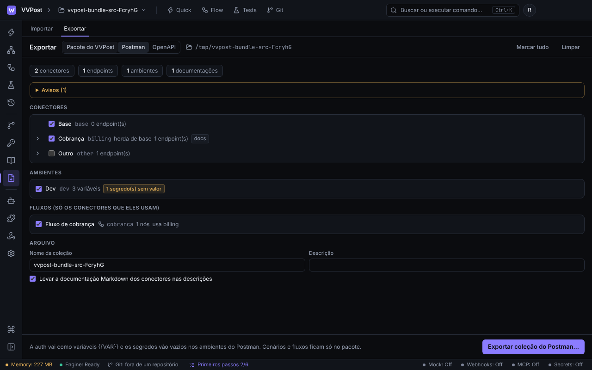
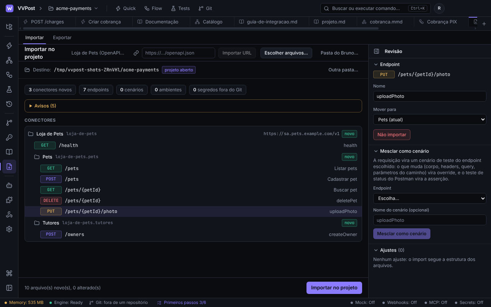
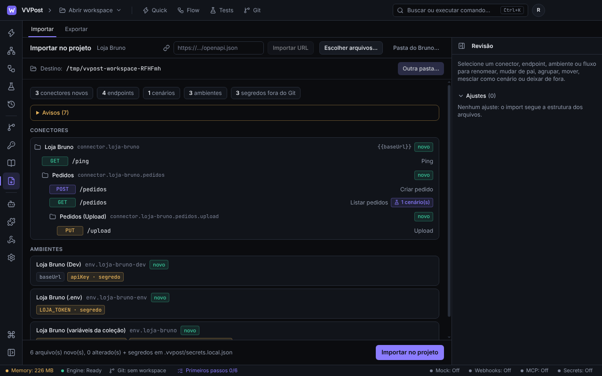
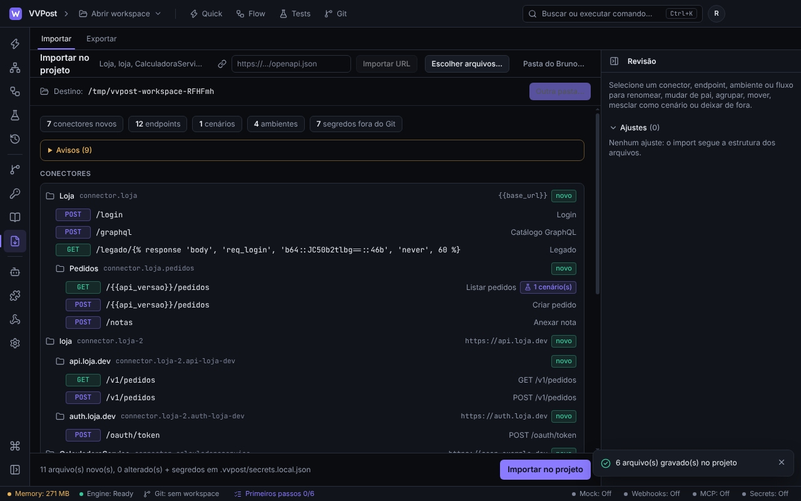

# Importar e exportar

Pacote do VVPost, importadores do Postman, de OpenAPI, do Insomnia, do Bruno, de HAR e de WSDL, e
exportação para o Postman e para OpenAPI.

O painel **Importar e exportar** tem duas abas. **Importar** recebe pacotes do VVPost, coleções e
ambientes do Postman, specs OpenAPI 3.x e Swagger 2.0 (arquivo ou URL), exportações do Insomnia,
coleções do Bruno, arquivos HAR e WSDL, todos pela mesma revisão e pela mesma camada de escrita;
**Exportar** gera o pacote do VVPost do projeto aberto, uma coleção do Postman ou uma spec OpenAPI
([Exportar para o Postman e OpenAPI](#exportar-para-o-postman-e-openapi)), ou leva o projeto ou o
workspace inteiro num [.zip](#workspace-ou-projeto-em-zip-vvpostzip).

## Pacote do VVPost (`.vvpost.bundle.json`)

É o formato próprio de importação e exportação: um único JSON, validado pelo schema versionado
`bundle.json` (`https://vvpost.dev/schemas/v1/bundle.json`, em `@vvpost/schemas`), com os
conectores (endpoints, cenários e herança), os ambientes, os fluxos e a documentação Markdown
dos conectores. Serve para levar um projeto, ou parte dele, para outro repositório ou outra pessoa.

- **Exportar** leva o projeto inteiro ou uma seleção de conectores, endpoints, ambientes e
  fluxos, com ou sem cenários e documentação. Os pais (`extends`) dos conectores e os conectores
  usados pelos fluxos entram junto, com aviso.
- **Nenhum valor de segredo sai.** Variáveis secretas vão como `__REQUIRED_SECRET__`, e uma
  variável comum com nome ou formato de credencial (`db_password`, um JWT) também, com aviso. O
  texto final ainda é conferido contra os valores do [cofre local](security-model.md#cofre-local) (em todas as
  codificações) e contra credenciais literais nos conectores; se algo escapar, a exportação é
  recusada dizendo onde, sem mostrar o valor.
- **Importar** um pacote passa pela revisão descrita abaixo: hierarquia, mesclagem em cenários,
  conectores, ambientes e fluxos de fora e o modo para ids que já existem. Fluxos que já existem
  ficam como estão por padrão (**manter o do projeto**); com **importar como novo**, o fluxo
  ganha outro id e os nós acompanham os conectores renomeados. Cada documento é validado pelo
  próprio schema, e um valor real numa variável secreta vai para o vault, nunca para o arquivo.

Os conectores vão no pacote como conectores, também quando o projeto os guarda como
[fluxos-base](flows.md#herança-entre-fluxos): o pacote leva os fluxos comuns, e quem importa
grava no formato do workspace de destino ([Converter conectores em fluxos](flows.md#converter-conectores-em-fluxos)).
O Postman e o OpenAPI exportados saem iguais nos dois formatos.

O MCP (`export_project`, `import_bundle`) e o CLI (`vvpost export`, `vvpost import`) usam o
mesmo código (`src/main/bundle/export.ts` e `src/main/importers/bundle.ts`).

## Workspace ou projeto em .zip (`.vvpost.zip`)

O pacote `.vvpost.bundle.json` leva conectores, ambientes, fluxos e a documentação dos conectores.
O `.zip` leva a pasta como ela está: o workspace inteiro, com o Compartilhado da raiz e todos os
[projetos](git-workspace.md#projetos), ou um projeto só. Vai junto o que o pacote não leva, como o
documento do projeto (`docs/projeto.md` e o `vvpost.docs.json`), os diagramas, os schemas
compartilhados, os dados de teste e a configuração de webhooks. Na raiz do zip fica o manifesto
`vvpost.archive.json`, que diz se é um workspace ou um projeto.

**Exportar.** Na aba **Exportar**, escolha **.zip** no seletor de formato. Com um projeto aberto, o
segundo seletor escolhe entre **Este projeto** e **Workspace inteiro**; no Compartilhado (raiz) ou num
workspace sem projetos, o zip é o workspace. A prévia conta projetos, conectores, fluxos, ambientes,
arquivos Markdown e segredos sem valor, e **Exportar .zip…** pergunta onde salvar.

- Num repositório Git, entra o que o Git levaria: os arquivos versionados e os novos, sem o que o
  `.gitignore` ignora. Fora do Git, a pasta toda. Em nenhum caso vão `.git`, `node_modules`, pastas
  ocultas (menos a `.vvpost`), o arquivo antigo de segredos e os `*.local.json` da `.vvpost`.
- **Nenhum valor de segredo sai.** O [cofre local](security-model.md#cofre-local) fica fora da pasta.
  Nos ambientes, variáveis secretas vão como `__REQUIRED_SECRET__`, e uma variável comum com nome ou
  formato de credencial também, com aviso. O zip inteiro passa pelo leak guard do commit, com os
  valores dos cofres de todos os projetos; se algo escapar, a exportação é recusada dizendo o
  arquivo, sem mostrar o valor.
- O zip de um projeto avisa quando um conector herda de uma base do Compartilhado ou de outro
  projeto, que não vai junto. Para levar tudo, exporte o workspace inteiro.

**Importar.** Na aba **Importar**, **Workspace ou projeto em .zip…** abre o zip e mostra o que tem
nele. Dali:

- **Abrir como workspace novo** pede uma pasta vazia, extrai o zip ali e abre o workspace, com os
  mesmos projetos. O zip de um projeto vira um workspace de um projeto só.
- **Acrescentar como projeto deste workspace** cria a subpasta do projeto no workspace aberto, com o
  `vvpost.project.json`. O id (o nome da pasta) e o nome vêm do zip e podem ser trocados; um id que
  já existe pede outro. Um zip de workspace sem projetos também entra como projeto. Um zip de
  workspace com projetos só abre como workspace novo.

Nada que já existe é sobrescrito. Os segredos chegam sem valor: preencha no módulo **Secrets**. Um zip
feito à mão (a pasta zipada, sem manifesto) também vale: com `vvpost.project.json` na raiz é um
projeto, sem ele um workspace, e se tudo estiver numa pasta só ela é a raiz.

No CLI, `vvpost export --format zip` grava o zip do projeto (dentro dele ou com `--project`) ou do
workspace inteiro (na raiz), e `vvpost import <arquivo.zip>` abre o zip como workspace numa pasta
vazia ou o acrescenta como projeto, com `--as <id>` para outro id ([CLI](cli.md#zip-do-workspace-ou-do-projeto)).

No MCP, `export_project` com `format: "zip"` grava o zip dentro do projeto (`out`, padrão
`dist/<pasta>.vvpost.zip`; `scope: "workspace"` leva o workspace inteiro), e `import_bundle` com
`archive` (o caminho de um `.vvpost.zip` dentro do projeto) mostra o projeto que ele vira e, com
`apply: true`, o acrescenta ao workspace (`as` e `name` trocam o id e o nome). Pelo MCP o zip só
entra como projeto novo, nunca como workspace. Como os arquivos entram como estão, os conectores
do zip que levam credencial e os fluxos com nós de código ficam aguardando a revisão da pessoa no
app, como uma alteração da IA: até lá, o agente só monta as requisições deles.
O código fica em `src/main/bundle/archive.ts`.

## Exportar para o Postman e OpenAPI

Na aba **Exportar**, o seletor ao lado do título troca o formato: **Pacote do VVPost**, **Postman**
ou **OpenAPI**. A seleção de conectores, endpoints, ambientes e fluxos é a mesma (um fluxo leva os
conectores que usa), e o arquivo parte do mesmo pacote: os pais (`extends`) entram pela herança
(com a configuração deles, sem os endpoints que você não marcou) e a mesma recusa de segredo vale,
conferida de novo no arquivo final. Cenários de teste e fluxos só existem no pacote do VVPost.



**Postman** grava a coleção v2.1 (`.postman_collection.json`) e, ao lado, um ambiente do Postman
por ambiente escolhido (`<nome>.<ambiente>.postman_environment.json`):

| VVPost | Postman |
| --- | --- |
| Conector | Pasta, na hierarquia do `extends` (com um conector raiz só, ele é a própria coleção). A descrição leva a documentação Markdown do conector. |
| Auth do conector | Auth da pasta, com os valores como estão no projeto (`{{VAR}}`): bearer, API key, basic, Digest, NTLM, AWS SigV4, OAuth 1.0 e OAuth2 (client credentials, password e authorization code com ou sem PKCE). `{ "type": "none" }` vira "No Auth". O login próprio da API vira uma requisição **Login** no começo da pasta, que guarda o token em `{{<CONECTOR>_TOKEN}}`, e a pasta usa essa variável. |
| Endpoint | Requisição com a URL base e o `basePath` herdados, `{id}` como `:id`, os headers do conector junto com os do endpoint, a query e o corpo (JSON, texto, form-data com arquivos, urlencoded e binário). |
| `bodySchema` | Seção **Schema do corpo** na descrição da requisição (o Postman não tem campo para schema). |
| Exemplos de resposta | Respostas salvas (exemplos) da requisição. |
| Scripts pre e post | Eventos pre-request e test, com a API `vv` trocada pelo `pm` (`vv.test`, `vv.expect`, `vv.response.*`, `vv.request.*`, `vv.variables.*`); o que não tem equivalente fica como está, com aviso. |
| Variáveis | `{{VAR}}` iguais; `{{$uuid}}` vira `{{$randomUUID}}`. Variáveis usadas sem ambiente no arquivo entram vazias nas variáveis da coleção. |
| Ambiente | Ambiente do Postman; segredos vão vazios e com o tipo `secret`. |

**OpenAPI** grava uma spec 3.1 em JSON (`.openapi.json`) ou YAML, se o nome terminar em `.yaml` ou
`.yml`:

| VVPost | OpenAPI |
| --- | --- |
| Conector | Tag com o nome e a documentação dele. Com um conector raiz só, os endpoints dele ficam sem tag e cada filho é uma tag, como o importador faz o caminho de volta. |
| URL base | `servers`: um por ambiente, com as variáveis que não são segredo trocadas pelo valor. Sem ambiente, `{{BASE_URL}}/v1` vira `{BASE_URL}/v1` com a variável do servidor. Operações de um conector com outra origem levam o servidor delas. |
| Endpoint | Operação no caminho com o `basePath` herdado, com `summary`, `description` e `operationId` (o id da operação de origem ou o id do endpoint). Parâmetros de caminho, query e headers (os do conector também) com o valor do projeto como exemplo. |
| `bodySchema` e corpo | `requestBody` com o schema (os `$defs` sobem para `components.schemas`) e o corpo padrão como exemplo; form-data e urlencoded viram schema de objeto, com os arquivos em `format: binary`. |
| Exemplos de resposta | `responses` por status, com os exemplos nomeados e os headers. |
| Auth | `securitySchemes` (um por conector que define auth) e `security` no topo ou por operação (`security: []` num endpoint com `requiresAuth: false`): bearer e basic como `http`, API key, OAuth2 com os fluxos e escopos, Digest, NTLM e OAuth 1.0 como `http`, AWS SigV4 com `x-amazon-apigateway-authtype`. Nenhum valor vai: a descrição diz quais variáveis o VVPost usa em cada campo. |

Endpoints de plugin (gRPC, Kafka) não têm equivalente nos dois formatos e ficam de fora, com aviso.
O CLI exporta com `vvpost export --format postman` ou `--format openapi` e o MCP com o `format` do
`export_project`. Os dois arquivos voltam pelos importadores do VVPost.

## Importar OpenAPI e Swagger



A aba **Importar** também lê specs OpenAPI 3.0/3.1 e Swagger 2.0, em JSON ou YAML, escolhidas como
arquivo ou baixadas pela URL (o campo ao lado de **Escolher arquivos…**). A spec passa pela mesma
revisão do Postman e vira conectores do catálogo:

| OpenAPI | VVPost |
| --- | --- |
| `info` | Conector raiz: `title` vira nome e id, `version` vira a versão (MAJOR.MINOR.PATCH), `description` vira a descrição. |
| `servers[0]` (Swagger: `schemes`, `host`, `basePath`) | `config.baseUrl`, com as variáveis do servidor no valor padrão. Servidor relativo usa a URL da spec ou `{{BASE_URL}}`. Os outros servidores aparecem como aviso. |
| `security` e `securitySchemes` | `config.auth` sem valor: bearer, basic, API key (header ou query) e OAuth2 client credentials ou password, com `{{<API>_TOKEN}}`, `{{<API>_CLIENT_SECRET}}` etc. para o ambiente preencher como segredo. Fluxos que pedem o navegador e OpenID Connect ficam como aviso. |
| `security` da operação | `requiresAuth` do endpoint ([gate de acesso](tests.md#gate-de-acesso-requiresauth)): `true` com uma exigência (da operação ou a global), `false` com `security: []` ou, numa spec que declara segurança em algum lugar, sem `security` na operação nem global. Uma exigência vazia (`{}`, auth opcional) ou uma spec sem nenhuma exigência deixam o campo de fora. |
| Tag | Conector filho com `extends` do raiz (a primeira tag da operação). Operação sem tag fica no raiz. |
| Operação | Endpoint: `operationId` vira o id, `summary` o nome, `description` a descrição (com **Obsoleto.** quando `deprecated`). Parâmetros de query e header obrigatórios, ou com exemplo/padrão, entram com o valor de exemplo. |
| `components.schemas` (Swagger: `definitions`) | Um [schema compartilhado](catalog.md#schemas-compartilhados) por componente usado, em `schemas/<Nome>.schema.json`, citado pelos endpoints como `{"$ref": "schema:<Nome>"}`. Renomear um campo do `Pedido` é uma edição só, e vale para todo endpoint que o usa. |
| `requestBody` JSON (Swagger: parâmetro `in: body`) | `bodySchema` em JSON Schema 2020-12, citando os componentes (referências recursivas continuam), e `body` com o exemplo da spec ou um gerado do schema (sem os campos `readOnly`). Texto e XML entram como texto com o `Content-Type`. |
| `requestBody` urlencoded ou multipart (Swagger: parâmetros `in: formData`) | `payload` com um campo de texto por propriedade, com o exemplo. Campos de arquivo ficam de fora, com aviso, para escolher o arquivo no Quick Request. |

`nullable`, `exclusiveMinimum` booleano e as outras palavras só do OpenAPI são traduzidas para o
JSON Schema que o validador dos cenários usa. Parâmetros em cookie, servidores por operação e
referências a outros arquivos aparecem como aviso, com as operações. Um exemplo da spec num campo com nome de
credencial (`api_key`, `password`, `client_secret`...) ou com formato de credencial (JWT, chave da
AWS) não vai para o arquivo versionado: vira `` para o ambiente preencher.

O conector raiz guarda de onde a spec veio (`source.location`: a URL, ou o caminho relativo à
pasta do projeto quando o arquivo está dentro dela) e cada endpoint guarda a operação e um hash
do que veio da spec (`source.operation` e `source.hash`).

### Reimportar a spec

**Reimportar a spec**, no cabeçalho de um conector importado de OpenAPI no Catálogo (ou no menu
de contexto dele), lê a spec de novo de `source.location` e abre a revisão. Importar a mesma spec
(ou a mesma URL) pela aba **Importar** dá no mesmo, inclusive se o título mudou. Cada operação é
achada pelo `operationId` e, depois, por método e caminho, em qualquer conector da família do
raiz; o hash diz o que mudou de cada lado:

| Situação | Na revisão | Padrão |
| --- | --- | --- |
| Operação nova | **novo** | Entra no conector da tag (que é criado se não existir). |
| Mudou só na spec | **mudou na spec** | Aplica a spec: nome, descrição, método, caminho, headers, query, `bodySchema` e corpo (`body` ou `payload`). |
| Mudou na spec e foi editada no projeto | **conflito** | Mantém a versão do projeto. |
| Saiu da spec | **saiu da spec** | Mantém o endpoint. |
| Endpoint feito no projeto com o método e o caminho de uma operação | **vinculado à spec** | Passa a seguir a operação, sem duplicar; se diferir, mantém a versão do projeto. |

Os schemas compartilhados seguem a mesma regra: cada arquivo guarda de que spec veio e o hash do
que veio dela (`"x-vvpost": {"source", "hash"}`). Na reimportação, um schema que ninguém editou é
atualizado com a spec, e um editado no projeto fica como está (a revisão avisa). Um nome que o
projeto já usa para outro schema ganha sufixo (`Pedido_2`), e as citações do import acompanham.

Selecionar o endpoint mostra as diferenças campo a campo (projeto → spec) e deixa trocar a
escolha (aplicar a spec, ou apagar o que saiu dela). Cenários, documentação e o resto do endpoint
ficam sempre; o id também, para os fluxos e cenários que apontam para ele. Uma operação que só
trocou de tag continua onde está.

Num time em que a spec é gerada pelo código, o `vvpost sync` faz a reimportação sem revisão, com a
spec ganhando nos campos de contrato, e o `vvpost sync --check` barra no CI o projeto que ficou
para trás ([A OpenAPI do código como fonte do contrato](openapi-sync.md)).

O CLI faz o mesmo com `vvpost import <spec | URL>` ou `vvpost import --reimport <conector>`
(`--spec-wins` resolve os conflitos com a spec e `--prune` apaga o que saiu dela), e o MCP com
`import_openapi` (`syncDecisions` por `<conector>/<endpoint>`). O código fica em
`src/main/importers/openapi.ts` (conversão) e em `syncSpecs` de `src/main/importers/plan.ts`.

## Importar do Postman

A aba **Importar** lê coleções v2.0/v2.1 e ambientes exportados do Postman (vários
arquivos de uma vez) e importa direto no projeto aberto (ou numa pasta escolhida). Nada é gravado
antes da revisão, que mostra a árvore resultante, os arquivos que serão criados ou alterados e
deixa ajustar o import:

```
connectors/<id>.connector.vvpost.json    um conector por coleção, pasta e origem extra
environments/<nome>.env.json             um por ambiente do Postman e um com as variáveis da coleção
```

| Postman | VVPost |
| --- | --- |
| Coleção | Conector raiz. A origem mais usada vira `config.baseUrl`, a auth vira `config.headers`. |
| Pasta | Conector filho com `extends` do pai: auth e headers continuam em cascata. |
| Requisição | Endpoint: método, path (`:id` vira `{id}`), query, headers e corpo (JSON é parseado). |
| Corpo form-data, x-www-form-urlencoded e binário | `payload` do endpoint (`multipart`, `urlencoded` ou `binary`), com os campos de arquivo. O caminho do arquivo é o da máquina de quem exportou e aparece como aviso para conferir. |
| Requisição em outro host | Conector auxiliar `<pasta>.<host>` que herda da pasta e só troca a `baseUrl`. |
| Auth bearer, basic, API key, OAuth2 (token) | Header `Authorization`/API key, ou query param. |
| Scripts de pre-request e de teste | Scripts `pre` e `post` ([quick-request.md](quick-request.md#scripts-pre-e-post)): os da coleção e das pastas em `config.scripts` do conector, os da requisição em `scripts` do endpoint. O `pm.*` é traduzido para a API `vv` (tabela abaixo). |
| Teste `pm.response.to.have.status(201)` | Além do script, um cenário com a asserção `status equals 201`, para o endpoint entrar na matriz de testes. |
| Variáveis da coleção e ambientes | Arquivos de ambiente. Nomes inválidos (`base-url`) viram `base_url`, e as referências são reescritas. |

Nenhum segredo vai para arquivo versionado. São tratados como segredo: variáveis com nome de
credencial (`token`, `password`, `client_secret`, `api_key`...), do tipo *secret* no Postman,
usadas em autenticação ou com formato de credencial (JWT, chaves da AWS/GitHub/Stripe). Elas
ficam com `__REQUIRED_SECRET__` e o valor real vai para o [cofre local](security-model.md#cofre-local). Um valor
fixo numa auth, num header sensível ou num parâmetro com nome de segredo vira uma variável nova
(`X_API_KEY`, `BASIC_CREDENTIALS`...) do mesmo jeito. Os valores nunca chegam ao renderer: a
prévia mostra só os nomes.

| Postman | API `vv` |
| --- | --- |
| `pm.environment`, `pm.variables`, `pm.collectionVariables`, `pm.globals` (`get`, `set`, `unset`, `has`, `toObject`) | `vv.variables`, um escopo só: o ambiente mais o que os scripts definem. Nomes inválidos seguem a troca dos `{{x}}`. |
| `pm.test`, `pm.expect` | `vv.test`, `vv.expect` (asserções no estilo chai). |
| `pm.response.json()`, `.text()`, `.code`, `.responseTime`, `.headers.get(nome)` | `vv.response.json()`, `.text()`, `.code`, `.responseTime`, `.header(nome)`. |
| `pm.response.to.have.status(n)`, `.to.be.ok`, `.to.have.header(nome)` | `vv.expect(vv.response).to.have.status(n)`, código entre 200 e 299, `vv.expect(vv.response.headers).to.have.property(nome)`. |
| `pm.request.headers.add/upsert/remove/get`, `pm.request.url`, `.method`, `.body.raw` | `vv.request.setHeader/removeHeader/header`, `vv.request.url`, `.method`, `.body`. |
| `postman.setEnvironmentVariable`, `responseBody`, `responseCode.code`, `responseTime` | `vv.variables.set`, `vv.response.text()`, `vv.response.code`, `vv.response.responseTime`. |

O que não tem tradução (`pm.sendRequest`, `pm.info`, `pm.cookies`, `tests[...]`, `require`) fica no
script como estava, com um aviso na prévia que nomeia o que reescrever; até lá o script falha ao
rodar com `SCRIPT_ERROR` (no pre) ou com o erro na aba Testes (no post). Um
`pm.environment.set('nome', 'valor')` com um valor com cara de credencial sai do script e vira uma
variável secreta do ambiente, e um segredo conhecido escrito no meio de um script vira `{{NOME}}`.

Também aparecem como aviso na prévia auths sem equivalente, métodos fora do padrão e URLs que não
são HTTP(S).

### Revisão antes de gravar

- **Hierarquia:** renomear conectores e endpoints, trocar o pai de um conector (inclusive por um
  conector que já está no projeto, para herdar a auth dele), desfazer uma pasta (endpoints e
  filhos sobem para o pai), agrupar endpoints num conector filho novo, mover um endpoint para
  outro conector do import ou do projeto e deixar conectores, endpoints ou ambientes de fora. Mover
  para um conector com outra URL base gera um aviso.
- **Requisições como cenários:** requisições que são variações de outro endpoint (mesmo método e
  caminho, ou um caminho concreto como `/users/999` de `/users/{id}`) aparecem como sugestão, e
  **Mesclar em cenários** transforma cada uma num cenário de teste do endpoint: corpo, headers e
  query diferentes viram `overrides` (um header ou parâmetro que some vira `null`), o trecho
  concreto do caminho vira `pathParams` e o teste de status do Postman vira a asserção (sem
  teste, `status < 500`, com aviso). Também dá para escolher o endpoint de destino à mão,
  inclusive um endpoint do projeto.
- **Ids que já existem no projeto:** o padrão é **mesclar** (mantém o conector ou ambiente do
  projeto e acrescenta só endpoints, cenários e variáveis novos, sem trocar valores nem
  segredos já salvos); **importar como novo** usa outro id e **substituir** regrava. Reimportar
  a mesma coleção sem mudanças não altera nenhum arquivo.

Cada ajuste entra numa lista com desfazer, e a revisão é recalculada no main process a cada
mudança. A gravação usa a mesma camada de escrita do projeto que o MCP (`src/main/project`), em
lote: valida schemas, herança e credenciais literais de tudo e só então grava; com qualquer
erro, nada muda e a prévia mostra o motivo. A conversão e os ajustes ficam em
`src/main/importers/plan.ts` (`planImport`), que devolve a lista de operações da camada.

## Importar do Insomnia, do Bruno, de HAR e de WSDL



**Escolher arquivos…** também aceita exportações do Insomnia, `.bru` soltos e a exportação JSON do
Bruno, arquivos `.har` e `.wsdl` (vários de uma vez, misturados com os do Postman), e **Pasta do
Bruno…** lê a pasta de uma coleção do Bruno. Cada formato é traduzido para uma coleção v2.1 do
Postman em memória e passa pelo mesmo conversor e pela mesma revisão: a hierarquia vira conectores
com `extends`, os valores de credencial vão para o vault, os scripts são traduzidos para a API `vv`
e os ajustes, a mesclagem em cenários e os modos para ids que já existem funcionam igual.

| Formato | O que é lido |
| --- | --- |
| Insomnia | Exportação v4 (JSON, `__export_format: 4`) e v5 (YAML, `type: collection.insomnia.rest/5.0`). O workspace vira o conector raiz e cada pasta um filho; o ambiente base e cada subambiente (com o base por baixo) viram ambientes, e as variáveis das pastas entram nas da coleção. `{{ _.nome }}` vira `{{nome}}` (objetos aninhados viram `a_b`), `` vira `{{$uuid}}` e `` vira `{{$timestamp}}` ou `{{$isoTimestamp}}`; outras tags (``, ``) ficam como estão, com aviso. Os scripts do Insomnia usam a API `insomnia.*`, que é a do Postman com outro nome. Num ambiente privado, o que ele define é segredo. Requisições gRPC e WebSocket, testes de unidade e documentos de design ficam de fora, com aviso. |
| Bruno | A pasta da coleção (`bruno.json`, `collection.bru`, `folder.bru`, as requisições e `environments/*.bru`), `.bru` soltos (o lote vira uma coleção; um `.bru` só com `vars` vira ambiente) e a exportação JSON. `vars:secret` e o `.env` (de `{{process.env.X}}`, só as variáveis usadas) vão para o vault. Os headers da coleção e das pastas vão para cada requisição, e as variáveis de pasta para as da coleção. `bru.setEnvVar`/`getEnvVar`/`setVar`, `req.setHeader`/`getHeader`, `res.status`/`body`/`getHeader`, `test` e `expect` viram a API `vv`; o bloco `assert` (`eq`, `neq`, `gt`, `contains`, `isArray`, `matches`...) vira `vv.test` no script post, e `res.status: eq 200` também vira cenário. O que fica sem tradução (`bru.runRequest`, `bru.sendRequest`) aparece no aviso. |
| HAR | O que o DevTools, o Charles, o Fiddler e o mitmproxy exportam. Cada origem vira um conector filho e cada método + caminho um endpoint, com a primeira chamada como modelo; as repetidas entram só como exemplos de resposta (um por status). Arquivos estáticos, preflights de CORS e os headers que o navegador põe sozinho (`user-agent`, `sec-*`, `referer`...) ficam de fora. Um `Authorization` igual em todas as chamadas de uma origem vira a auth do conector. As respostas viram `examples` (para a documentação e o [mock server](mock.md)) sem `Set-Cookie` e sem os campos com nome ou formato de credencial (`access_token`, JWT...), que ficam como `<removido no import>`. |
| WSDL | WSDL 1.1 com SOAP 1.1 ou 1.2, estilos document/literal (inclusive wrapped) e rpc. Cada serviço vira um conector com a URL do `soap:address`, e cada operação um `POST` com o `SOAPAction` (no SOAP 1.2, o `action` do `Content-Type`) e um envelope de exemplo montado do XSD: o valor pelo tipo (`0`, `false`, datas, o primeiro valor de um `enumeration`, `?` para texto), atributos, extensões de tipo, e comentários de opcional e de repetição. Quando o serviço tem portas SOAP 1.1 e 1.2, ficam as 1.1. WSDL 2.0 e schemas de outros arquivos (`xsd:import` com `schemaLocation`) não são lidos; o exemplo avisa. Operações SOAP no mesmo caminho não são sugeridas como variações umas das outras. |

As auths que o VVPost executa no conector entram como `config.auth`, com os segredos em `{{VAR}}`:
Digest, NTLM (`DOMINIO\usuário` do Insomnia vira `domain`), AWS Signature v4 (o IAM do Insomnia, o
`awsv4` do Bruno e do Postman), OAuth 1.0 e OAuth2 client credentials e password (com o token
endpoint); os outros fluxos do OAuth2 continuam como token fixo. Bearer, basic e API key continuam
como headers. Como no VVPost a auth executada é do conector, uma requisição com auth própria dessas
fica num conector filho com ela (`Pedidos (Upload)`), com aviso. Numa coleção do Postman, essas
auths entram do mesmo jeito, e os exemplos salvos das requisições (`response`) viram `examples`.



O CLI aceita os mesmos arquivos e a pasta do Bruno (`vvpost import ./colecao-bruno captura.har
servico.wsdl`), e o MCP tem `import_collection` (arquivo ou pasta dentro do projeto, URL ou o
conteúdo), pelo mesmo plano da revisão. O código fica em `src/main/importers/` (`insomnia.ts`,
`bruno.ts`, `har.ts`, `wsdl.ts` e o leitor de XML `xml.ts`, que não expande entidades nem busca
nada de fora).
