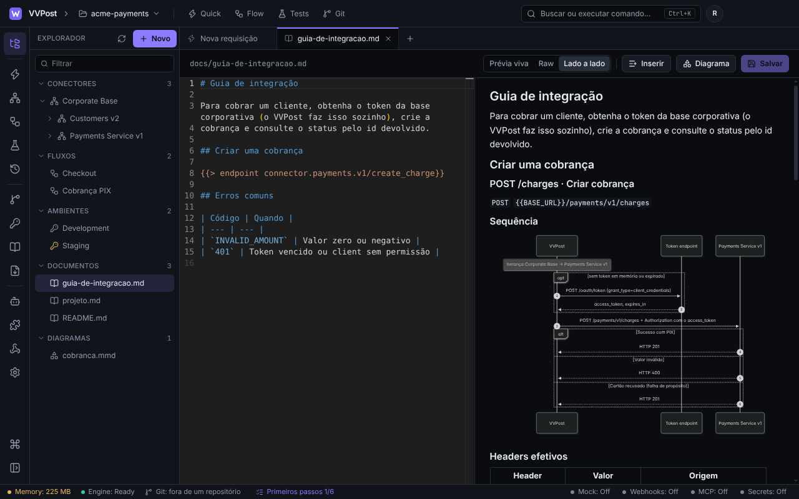
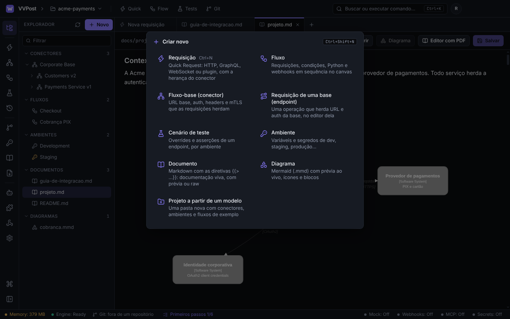

# Interface: navegação, atalhos, menus e conta

Como o app se organiza e como chegar a cada coisa pelo mouse e pelo teclado. Os componentes
visuais ficam em `src/renderer/src/design-system` ([desenvolvimento](development.md)).

## Shell

- **Barra superior**: o workspace aberto (**Abrir workspace** sem pasta; com pasta, clique no
  nome para trocar), atalhos rápidos para os módulos, a Command Palette (`Ctrl+K`) e o menu da
  conta, no canto direito. A barra é a própria barra de título da janela: arraste por ela.
- **Sidebar**: o botão do **Explorador** e os módulos agrupados por intenção. Ela expande para
  mostrar os rótulos, e a escolha fica lembrada.
- **Explorador** (`Ctrl+Shift+E`): a árvore do projeto, com conectores (e os endpoints e cenários
  de cada um), fluxos, ambientes, documentos `.md`, diagramas `.mmd` e os tokens da marca (`brand/*.tokens.json`), um filtro e o botão **Novo**.
  Cada item abre numa aba. Abre sozinho em janela larga; em 150% fica fechado até você abrir, e a
  escolha fica lembrada.
- **Abas do workspace**: uma barra só para tudo o que está aberto, como num editor de código. O
  editor de cada aba muda pelo tipo do arquivo (tabela abaixo). Os módulos de ferramenta (Catálogo,
  Histórico, Git, Secrets, Extensions...) também abrem como uma aba. `Ctrl+PageDown` e
  `Ctrl+PageUp` passam de aba, `Ctrl+W` fecha (pergunta antes se há mudança não salva) e o botão do
  meio do mouse fecha a aba sob o cursor.
- **Status bar**: o motor de requisições, a pasta do workspace, o servidor de webhooks (liga,
  desliga e mostra quantos eventos chegaram, [webhooks.md](webhooks.md)), o servidor MCP (liga, desliga e
  **Copiar URL**, [mcp.md](mcp.md#pela-barra-de-status-do-app)), o Secret Engine (com o seletor
  Mock/Proxy quando há módulo Enterprise, [secret-engine.md](secret-engine.md)), a memória em
  uso (amarela acima de 180 MB) e os **Primeiros passos**.

O ambiente escolhido num módulo vale para todos.

### Tamanho e posição dos painéis

Como no VS Code, toda borda entre painéis arrasta: a do explorador, a do inspector, a divisão
entre a edição e a resposta do Quick Request, a lista ao lado do canvas do Flow Studio, as listas
de Tests, Catálogo, Git, Histórico e Webhooks, o sumário da Documentação, o schema do GraphQL e a
divisão entre o texto e a prévia dos documentos. Com o foco na borda, as setas ajustam (`Shift`
dá passos maiores), e `Home` e `End` vão ao mínimo e ao máximo; duplo clique volta ao tamanho
padrão. Arrastar a borda do explorador, do inspector, da lista de endpoints do Flow Studio ou da
edição do Quick Request até quase zero recolhe o painel.

Os painéis também mudam de lugar, como as views do VS Code: arraste pelo grip (⠿) do cabeçalho e
solte onde o destaque mostrar. O terço de cima ou de baixo da área leva o painel para cima ou para
baixo; no resto, a metade esquerda ou direita escolhe o lado. `Esc` cancela o arraste.

| Painel | Lugares | Onde arrastar |
| --- | --- | --- |
| Explorador | à esquerda, à direita ou embaixo das abas (como o painel do VS Code) | o grip ao lado de "Explorador" |
| Inspector de cada módulo | à direita, à esquerda ou embaixo do conteúdo do módulo; cada módulo lembra o seu | o grip ao lado do título |
| Edição da requisição (Quick Request) | em cima da resposta, ou ao lado dela, à esquerda ou à direita | o grip ao lado das abas Params, Headers... |
| Lista lateral do módulo (hierarquia do Catálogo, endpoints de Tests e do Flow Studio, mudanças do Git, sumário da Documentação) | à esquerda ou à direita do conteúdo; cada lista lembra o seu lado | o grip ao lado do título da lista |

O inspector do Catálogo, de Tests e do Flow Studio também entra como aba na lista lateral do
módulo, como duas views num mesmo container do VS Code: arraste o grip do inspector para cima da
lista (o destaque cobre a lista inteira) e as abas **Conectores \| Inspector** (ou **Endpoints \|
Inspector**) dividem o mesmo lugar. A seleção e o estado do inspector ficam; só o lugar muda.
**Separar o inspector**, no menu de mover da lista, devolve o inspector ao lado escolhido.

Pelo teclado, o menu do cabeçalho (`Shift+F10`), o botão de mover do inspector e da edição e a
Command Palette (**Mover o explorador para baixo**, **Mover o inspector para a esquerda**, **Mover
a edição da requisição para a direita**, **Mover a lista lateral para a direita**, **Juntar o
inspector à lista lateral (como aba)**...) fazem o mesmo. Na paleta, só o painel do módulo à
mostra se move.

Tamanhos, painéis recolhidos e posições ficam lembrados por workspace (e por projeto, num
workspace com projetos), fora do repositório. Um workspace aberto pela primeira vez começa com o
último layout usado. **Restaurar o layout dos painéis**, na paleta, volta tudo ao padrão no
workspace aberto.

Um arranjo que vale guardar ganha nome: **Salvar o layout como…** grava tamanhos, lados, painéis
recolhidos e abas do workspace aberto com o nome escolhido (até 60 caracteres), e **Usar o layout
<nome>** aplica de novo em qualquer workspace. **Apagar o layout <nome>** tira da paleta. Os
layouts com nome ficam nas preferências do app, fora dos repositórios.

| Arquivo ou item | Editor da aba |
| --- | --- |
| Requisição (Quick Request) | O cliente HTTP, com a herança do conector. Uma requisição nova é uma aba ainda sem arquivo; `Ctrl+S` grava como fluxo |
| Fluxo (`*.flow.vvpost.json`) | O canvas do Flow Studio. Um fluxo que termina num nó de requisição abre na visão **Simples** (o Quick Request, com os nós de antes rodando em segundo plano); **Simples \| Canvas** troca a visão ([quick-request.md](quick-request.md#requisição-e-fluxo-o-mesmo-documento)) |
| Conector (`*.connector.vvpost.json`) | O editor do conector: URL base, auth, headers, mTLS, scripts e endpoints |
| Endpoint | A documentação viva do endpoint, com **Testar**, **Schema do corpo**, **Novo cenário**, **Rodar cenários** e o conector |
| Cenário de teste | O editor de cenários, com as asserções por ambiente |
| Documento (`.md`) | Seletor **Prévia viva \| Raw \| Lado a lado** no canto direito do cabeçalho: a prévia monta as diretivas `{{> ...}}` e os diagramas com o projeto de agora, e o Raw é o editor com autocomplete das diretivas. `Ctrl+S` salva; o documento do projeto também abre no **Editor com PDF** ([documentation.md](documentation.md)) |
| Diagrama (`.mmd`) | O editor Mermaid ao vivo, com blocos e ícones |
| Tokens da marca (`brand/*.tokens.json`) | Os tokens por grupo com a amostra da cor, o modo, o contraste e o código conferido sob pedido; a visão **JSON** edita o arquivo ([brand.md](brand.md#no-app)) |
| Ambiente (`*.env.json`) | Abre no módulo Secrets, no ambiente escolhido |

**Novo** (`Ctrl+Shift+N`, o `+` da barra de abas ou o botão do explorador) abre um modal para
escolher o que criar: requisição, fluxo, conector, endpoint, cenário de teste, ambiente, documento,
diagrama ou um projeto a partir de um modelo. O que precisa de nome (fluxo, documento) ou de um
conector (endpoint, cenário) pergunta ali mesmo; o resto abre direto na aba do editor.

Cada tipo de item tem um ícone só, o mesmo na sidebar, no explorador, nas abas, no modal **Novo**,
na paleta e nos botões: raio para requisição, grafo de nós para fluxo, rede para conector, rota
para endpoint, frasco para cenário, chave para ambiente e Secrets, livro aberto para documento e
documentação, e formas para diagrama. O grafo de nós aparece só onde algo abre ou roda um fluxo.

| Grupo | Módulo | Atalho |
| --- | --- | --- |
| Trabalho | Quick Request ([guia](quick-request.md)) | `Ctrl+1` |
| Trabalho | Flow Studio ([guia](flows.md)) | `Ctrl+2` |
| Trabalho | Catálogo ([guia](catalog.md)) | `Ctrl+3` |
| Trabalho | Cenários de teste ([guia](tests.md)) | `Ctrl+5` |
| Trabalho | Histórico ([guia](quick-request.md#histórico)) | `Ctrl+9` |
| Projeto | Secrets | `Ctrl+4` |
| Projeto | Git Workspace ([guia](git-workspace.md)) | `Ctrl+6` |
| Projeto | Documentação ([guia](catalog.md)) | sidebar e paleta |
| Projeto | Importar e exportar ([guia](import-export.md)) | `Ctrl+8` |
| Integrações | MCP & IA ([guia](mcp.md#módulo-mcp--ia)) | sidebar e paleta |
| Integrações | Extensions Hub ([guia](plugins.md)) | `Ctrl+7` |
| Integrações | Webhooks ([guia](webhooks.md)) | `Ctrl+0` |
| Integrações | Configurações | sidebar e paleta |

O dígito de cada módulo é fixo, independente da ordem na sidebar. Os dez dígitos já têm dono, então
Documentação, MCP & IA e Configurações abrem pela sidebar e pela paleta. Em janela baixa (zoom de
150%) a lista de módulos rola, e a paleta e o botão de recolher ficam sempre visíveis.

- **Documentação**: escolha o conector e, se quiser, um endpoint; a mesma visualização do menu
  "Gerar documentação", com diagramas e exportação em PDF e `.md`, fica fixa no módulo.
- **MCP & IA**: liga e desliga o servidor MCP, copia a URL, mostra a configuração pronta para
  Claude Code, Cursor e GitHub Copilot, as ferramentas do servidor e as edições de IA à espera de
  revisão.
- **Configurações**: conta e perfil (nome, entrar e sair), os serviços locais (Secret Engine, MCP,
  webhooks), a sidebar expandida ou recolhida, a tabela de atalhos dos módulos e o estado do teste
  com usuários. No macOS, `⌘` no lugar de
`Ctrl` em todos os atalhos desta página.

## Command Palette e busca

`Ctrl+K` abre a paleta: abrir módulos, nova requisição, ir para a URL, trocar a pasta do
workspace, gerar a documentação do projeto, mostrar os primeiros passos, ligar e desligar o mock
de Secret Managers, o servidor MCP e o de webhooks, e as ações do módulo ativo (as mesmas dos menus de
contexto). Ela entende sinônimos ("rodar teste", "executar cenário", "testar endpoint") e mostra
o atalho de cada comando; nada roda só por receber foco.

`Ctrl+Shift+F` procura no projeto: conectores, endpoints, cenários e fluxos.

## Menus de contexto

O botão direito (ou `Shift+F10`, ou a tecla de menu) abre o menu do item em todos os módulos:
o explorador, abas e campos do Quick Request, a resposta, a árvore do Catálogo, a matriz dos cenários, os nós do
Flow Studio, o Histórico, os segredos, o Git e o Extensions Hub. Os campos de texto têm o menu de
edição (desfazer, recortar, copiar, colar). Algumas ações que só existem ali:

- Copiar como cURL, fetch, Python ou HTTPie, e colar um cURL como requisição.
- Gerar um cenário de teste a partir da requisição, e gerar a documentação de qualquer nível
  ([catalog.md](catalog.md#documentação-rica)).
- Comparar com a resposta anterior, executar o fluxo até um nó e executar de novo só uma célula
  da matriz.
- No Secrets, revelar um valor do vault local por 10 segundos ou copiá-lo (a área de
  transferência é limpa em 30 segundos), sempre com confirmação.
- No explorador, cada linha tem as ações do item: abrir no Catálogo, no Quick Request, nos Tests
  ou no canvas, executar os cenários, copiar o id ou o caminho, revelar o arquivo e excluir (com
  confirmação). Conector compartilhado é só leitura: não tem excluir. Documento e diagrama também
  renomeiam (`F2`, mudar a pasta move o arquivo) e excluem (`Delete`).
- O cabeçalho de cada seção do explorador (Conectores, Fluxos, Ambientes, Documentos, Diagramas, Marca)
  tem o menu da seção: criar um item do tipo dela (novo documento, fluxo, ambiente, conector,
  endpoint, cenário...), revelar a pasta, recolher ou expandir a seção e recarregar. Em
  Conectores, também expandir ou recolher tudo, converter para fluxos e mostrar o Compartilhado
  sem uso.
- No Git, descartar a mudança de um arquivo (com confirmação) e, na lista de branches, checkout e
  "nova branch a partir desta".

## Atalhos

| Atalho | Ação |
| --- | --- |
| `Ctrl+Enter` | Executar: enviar, rodar os cenários ou o fluxo, reproduzir |
| `Esc` | Cancelar a execução em andamento (fora de diálogos e menus) |
| `Ctrl+Shift+Enter` | Abrir no Quick Request (aba nova) |
| `Ctrl+N` | Nova requisição |
| `Ctrl+Shift+N` | Novo: escolher o que criar |
| `Ctrl+Shift+E` | Mostrar ou ocultar o explorador |
| `Ctrl+S` | Salvar a aba: o documento, o fluxo ou a requisição (como fluxo) |
| `Ctrl+PageDown`, `Ctrl+PageUp` | Aba seguinte, aba anterior |
| `Ctrl+L` | Ir para a URL do Quick Request |
| `Ctrl+T`, `Ctrl+W`, `Ctrl+Shift+T` | Nova aba, fechar a aba, reabrir a aba fechada |
| `Ctrl+B` | Recolher ou abrir o inspector |
| `Ctrl+K` | Command Palette |
| `Ctrl+Shift+F` | Procurar no projeto |
| `F2` | Renomear |
| `Ctrl+D` | Duplicar |
| `Ctrl+C`, `Ctrl+Shift+C` | Copiar (valor, URL, caminho, referência); copiar como cURL |
| `Del` | Excluir, remover ou descartar |
| `Shift+Alt+R` | Revelar no explorador de arquivos |

Num campo de texto, `Ctrl+C`, `Ctrl+V`, `Del` e afins são sempre do campo. Os atalhos do menu de
valores do JSON estão em [quick-request.md](quick-request.md#a-resposta).

## Primeiros passos

O botão **Primeiros passos** da status bar lista as tarefas para começar (criar, abrir ou importar um
projeto, preencher os segredos pendentes, a primeira requisição, os cenários, um fluxo e o Git) e
marca as concluídas. Ele não abre sozinho, pode ser ocultado e volta pela paleta ("Mostrar os
primeiros passos"). Para conhecer o app com um projeto pronto, use o
[projeto de demonstração](../examples/demo-workspace/README.md).

### Projeto novo a partir de um modelo

**Novo projeto…** nos Primeiros passos, ou "Novo projeto a partir de um modelo…" na paleta, mostra
os modelos e os arquivos que cada um cria antes de pedir a pasta:

| Modelo | O que cria |
| --- | --- |
| Projeto vazio | `environments/dev.env.json` (Desenvolvimento, com `BASE_URL`), `.gitignore` e `README.md` |
| API REST com token | `connectors/api.connector.vvpost.json` (URL base e auth Bearer `{{API_TOKEN}}` herdadas, endpoints Listar, Buscar e Criar item, com cenários), os ambientes Desenvolvimento e Homologação, `.gitignore` e `README.md` |

A pasta precisa estar vazia (um `.git` recém-criado pode estar lá): um projeto novo nunca
sobrescreve arquivos escritos à mão, e uma pasta com arquivos é recusada sem gravar nada. Os
arquivos passam pelo schema antes de ir para o disco, os segredos entram como
`__REQUIRED_SECRET__` (pendentes em Secrets, sem valor) e o `.gitignore` já deixa o vault local
fora do Git. Com **Iniciar um repositório Git** marcado, a pasta vira repositório, sem commit;
dentro de um repositório que já existe, o projeto entra nele. O projeto abre como workspace e o
Quick Request já mostra o conector. MCP, plugins e o proxy de segredos continuam desligados.

## Conta e perfil

O VVPost não pede conta. O menu da conta (o avatar no canto direito da barra superior) mostra o
**perfil local**, com o nome de exibição e as preferências da estação, gravado em
`<userData>/profile.json`, e o estado "Usuário local · Sem sessão autenticada".

Com o módulo Enterprise instalado, o mesmo menu oferece entrar com a conta corporativa (SSO no
navegador do sistema; os tokens ficam só no processo principal) e, com a sessão aberta, mostra a
organização, os papéis por projeto e a troca de organização. Uma barra de contexto Enterprise
aparece sob a barra superior com a organização, os papéis no projeto aberto, a origem dos
segredos e o destino da execução. Sem o módulo, nada disso aparece e o app funciona inteiro.
