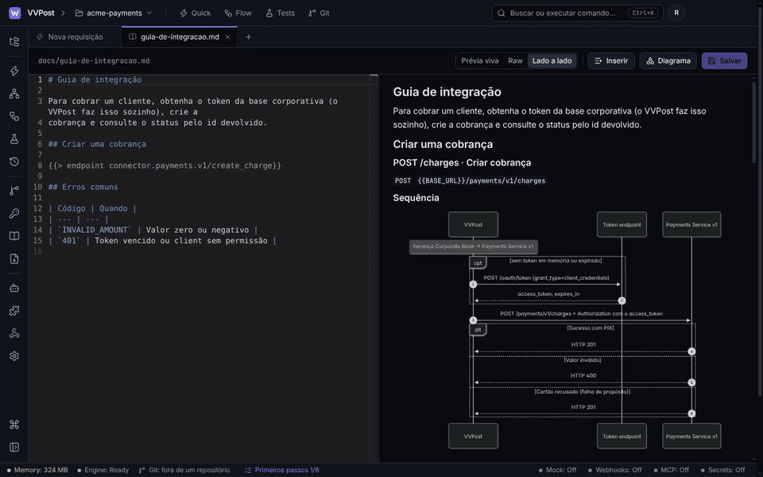
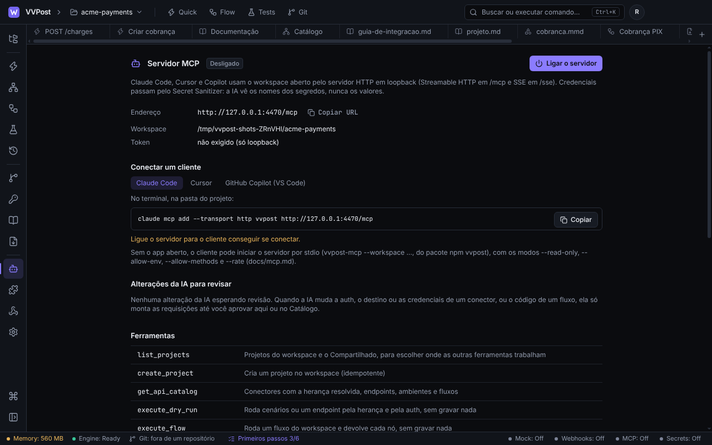

# Servidor MCP do VVPost

O VVPost expõe o workspace para agentes de IA (Claude Code, Cursor, GitHub Copilot) pelo
[Model Context Protocol](https://modelcontextprotocol.io), sobre `stdio` ou HTTP (Streamable HTTP
e o SSE antigo). A IA lê o catálogo de APIs, roda testes pelo motor do VVPost e edita o projeto
(conectores, endpoints, cenários, ambientes, fluxos e documentação), mas nenhuma credencial real
chega a ela pelo servidor nem é gravada por ela: tudo o que sai passa pelo **Secret Sanitizer**
([modelo de segurança](security-model.md), que explica também a diferença entre ler e usar um segredo).

As ferramentas foram desenhadas para o agente, não adaptadas para ele: seguem um
[contrato](#contrato-para-agentes) de versões, erros acionáveis e escritas atômicas, e levam a
documentação junto quando o agente muda o código ([código e documentação juntos](#código-e-documentação-juntos)).

## Ferramentas

| Ferramenta | O que faz |
| --- | --- |
| `list_projects` | Os [projetos do workspace](git-workspace.md#projetos) e em qual a chamada está. Toda ferramenta aceita `project: "<id>"` para ler, editar ou rodar naquele projeto. Sem `project`, vale a pasta em que o servidor abriu, ou o `--project` dele. Na raiz, a chamada está no Compartilhado. Um [projeto de referência](git-workspace.md#projeto-de-referência) lê o catálogo de outro repositório, só para leitura. |
| `get_api_catalog` | Sem argumentos: os conectores (herança `extends` resolvida, com a cadeia em `chain`), a hierarquia em `tree` (cada conector sob o pai), endpoints, ambientes e fluxos. Com `connectorId`: o detalhe do conector, com headers efetivos e a origem de cada um, auth, `bodySchema` e campos de cada endpoint, corpo padrão, cenários com asserções e a documentação Markdown. |
| `execute_dry_run` | Roda requisições pelo dispatcher, pela herança e pela auth headless do VVPost, sem gravar nada (nem histórico, nem arquivos). Sem `request`: os cenários declarados do conector (filtros `endpointId` e `scenarioIds`) em um ou mais `environmentIds`, com o mesmo resultado da matriz de cenários. Com `request`: um endpoint com `overrides` (`body`, `headers`, `query`, `pathParams`) e `assertions` opcionais; `select` (`"pedidos[].id"`, `"pedidos[].status"`) devolve só esses campos do corpo JSON, até 20 mil caracteres em vez do começo de 4 mil, e é o jeito de consultar um dado da API sem `curl` nem script. Um conector, endpoint ou ambiente que não existe volta com os ids certos no `hint`. `plan: true` só monta as requisições, sem enviar, e mostra para onde vai o pedido de token ou de login (`tokenUrl`/`loginUrl` resolvidos, com uma nota quando o caminho relativo junta com uma `baseUrl` que tem caminho), além de `dependsOn` e `capture` dos cenários. |
| `execute_flow` | Roda um fluxo do workspace pelo Context Engine (herança e auth dos conectores), sem gravar nada, e devolve cada nó: status, erro, requisição montada, status HTTP, saída (`$nodes.<nome>.data`, cortada em 4000 caracteres depois de sanitizada) e os logs dos nós Python. A URL da requisição vem inteira, com a baseUrl do conector e as variáveis comuns do ambiente (segredos como `[REDACTED_SECRET]`), e um nó com polling traz `attempts`. `plan: true` só lista os nós (com a espera e as asserções) e as requisições (com o polling). As tentativas de polling contam no limite de 50 requisições por chamada. Nós de plugin não rodam pelo MCP. |
| `validate_body` | Confere um corpo com o `bodySchema` do endpoint, sem enviar nada. |
| `get_source` | Um documento como está no arquivo, sem a herança aplicada: `connector` (com endpoints e cenários), `environment`, `flow` ou `doc` (o `.connector.vvpost.md`, ou o `.flow.vvpost.md` de um fluxo-base). Sem id, `flow` lista os fluxos. Um conector guardado como [fluxo-base](flows.md#herança-entre-fluxos) vem com `flows` (o arquivo da base e o de cada endpoint) e `versions`, e um fluxo que é base ou endpoint vem com `is` (`{connector, endpoint?}`). Com `endpoint`, só esse endpoint vem inteiro (os outros em `otherEndpoints`). Um `doc` acima de 30 mil caracteres vem em trechos: `truncated.next.offset` diz de onde pedir o resto (`offset`). |
| `get_schema` | O JSON Schema v1 de `connector`, `environment`, `flow`, `bundle` (o pacote de importação e exportação) ou `docs` (o modelo `vvpost.docs.json`), sem as descrições (cerca de metade do tamanho); `full: true` traz o schema inteiro. |
| `edit_project` | Lote atômico de operações sobre o projeto (abaixo). `dryRun: true` só valida e lista os arquivos que mudariam. |
| `import_postman` | Converte uma coleção do Postman (e ambientes) em operações de `edit_project`; com `apply: true` grava direto. |
| `export_project` | Pacote do VVPost (`bundle.json`) do projeto inteiro ou de uma seleção (`connectors`, `endpoints` como `"conector/endpoint"`, `environments`, `flows`, `scenarios`, `docs`). Com `format: "postman"`, devolve a coleção v2.1 em `collection` e os ambientes do Postman em `environments`; com `format: "openapi"`, a spec 3.1 em `spec` ([formatos](import-export.md#exportar-para-o-postman-e-openapi)). Com `format: "zip"`, grava a pasta do projeto (ou, com `scope: "workspace"`, o workspace inteiro) num `.vvpost.zip` dentro do projeto (`out`, padrão `dist/<pasta>.vvpost.zip`) ([zip](import-export.md#workspace-ou-projeto-em-zip-vvpostzip)). Nenhum valor de segredo sai (a auth vai como variáveis `{{VAR}}`); a exportação é recusada se algum escaparia. |
| `import_bundle` | Importa um pacote do VVPost pelo mesmo plano da revisão do app: `adjustments`, `conflicts`, `environmentConflicts` e `flowConflicts` (`merge`, `rename`, `replace`). Sem `apply`, mostra o plano, os arquivos que mudariam e as operações; com `apply: true`, grava. Com `archive` (um `.vvpost.zip` dentro do projeto), o zip entra como projeto novo (`as`, `name`), e os conectores com credencial e os fluxos com código dele ficam aguardando revisão. |
| `import_openapi` | Importa ou reimporta uma spec OpenAPI 3.x/Swagger 2.0 de `location` (URL ou caminho dentro do projeto), ou a `spec` mandada pela IA, pelo mesmo plano da revisão do app. Na reimportação, cada conector traz `specSync` (atualizado, em conflito, fora da spec) e `syncDecisions` (`spec` ou `keep` por `<conector>/<endpoint>`) decide. Sem `apply`, mostra o plano; com `apply: true`, grava. |
| `sync_openapi` | A [spec OpenAPI do código como fonte do contrato](openapi-sync.md): relê a spec de cada conector vinculado e devolve, por spec, o drift (endpoints `new`, `updated`, `conflict`, `edited`, `linked` e `removed`, com os campos que diferem e o que depende de um removido; schemas; `onlyInProject`) e as quebras (`breaks`: o que a validação acusaria depois do sync), mais `inSync`. A spec ganha nos campos de contrato; cenários, exemplos, docs, fluxos, ambientes e a config do conector ficam. Sem `apply`, só relata; com `apply: true`, grava. `link` com `connector` vincula um conector feito à mão; `prune` apaga o que saiu da spec; `keepEdits` mantém as edições do projeto. |
| `import_collection` | Importa uma exportação do Insomnia, uma coleção do Bruno (pasta, `.bru` ou JSON), um HAR ou um WSDL de `location` (URL, ou arquivo ou pasta dentro do projeto) ou do `content` mandado pela IA (com `file` dizendo o nome), pelo mesmo plano da revisão do app; `adjustments`, `conflicts` e `environmentConflicts` como no `import_bundle`. Sem `apply`, mostra o plano; com `apply: true`, grava. Segredos ficam pendentes para o usuário. |
| `lint_project` | O [lint](lint.md) do projeto: as regras do ruleset do time (`.vvpost/ruleset.yaml`, formato do Spectral) ou do `vvpost:recommended`, e as de OpenAPI quando o ruleset pede. Cada achado tem `code` (a regra), `severity`, `file`, `line`, `where` e `hint` de como corrigir. `severity` (o nível mínimo), `file` (arquivo ou pasta) e `code` filtram; `limit` vai até 200. |
| `get_brand` | Os tokens da [marca](brand.md) de `brand/*.tokens.json`, já resolvidos, uma linha por token (`color.primary=#bd948a (theme.palette.primary.main)`), no modo pedido (`mode`), de um grupo (`group`) e com a descrição de uso (`withDescriptions`). Traz também os pares de contraste que não passam. É o que o agente lê antes de mexer em tela, CSS ou tema: a marca da VV inteira cabe em uns 150 tokens. |
| `list_webhook_events` | Com o [servidor de webhooks](webhooks.md) ligado (no app ou com `--webhooks`): a URL, os hooks e os eventos recebidos, do mais novo ao mais antigo, com hook, status, assinatura e disparo. `hook` filtra, `afterId` traz só os novos e `limit` vai até 100. |
| `get_webhook_event` | Um evento inteiro: query, headers e corpo (cortado em 4000 caracteres), sanitizados. |
| `generate_docs` | Documentação rica em Markdown (a mesma do app e do `vvpost docs`): sem argumentos, o projeto; com `connector`, `endpoint` e `scenario`, o conector, o endpoint ou a request. Herança efetiva com origem, auth, schemas, exemplos, cenários, fluxos e diagramas Mermaid; segredos só pelo nome. Sem argumentos, havendo documento do projeto, devolve o documento montado (`generated: true` traz a referência gerada). |
| `get_docs_project` | O [documento do projeto](documentation.md): o modelo `vvpost.docs.json`, o documento-fonte, as diretivas, os Markdown e seções que dá para incluir, as imagens, os modelos de documentação e os diagnósticos por linha. Um documento-fonte acima de 30 mil caracteres vem em trechos (`sourceTruncated.next.offset` e o argumento `offset`). |
| `save_docs_project` | Grava o modelo e o documento-fonte; `template` começa de um modelo (ex.: `builtin:c4`), `dryRun: true` só monta e devolve os diagnósticos. |
| `write_docs_page` | Escreve uma página em `docs/` (visão geral, arquitetura, guias) para incluir no documento com `{{> include}}`, ou um diagrama `docs/diagramas/*.mmd` para `{{> diagram}}`; `markdown: ""` apaga. |
| `fix_diagrams` | Corrige os diagramas de arquitetura que divergem do catálogo ([C4 que não envelhece](documentation.md#correção-automática)): acrescenta o conector ou fluxo que falta e a relação de um fluxo, tira o elemento de algo removido e a relação que o fluxo não faz mais. Sem `apply`, devolve o plano; `codes` e `file` filtram. |
| `save_docs_template` | Salva o modelo e o documento atuais (ou os mandados) como modelo do projeto em `docs/templates/`. Na raiz de um workspace com projetos, o modelo é do Compartilhado e aparece em todos os projetos com `origin: "shared"`. |
| `export_docs` | Grava a documentação num arquivo dentro do projeto (padrão `docs/export/<projeto>.pdf`): `format: "pdf"` imprime como o "Exportar PDF" do app, com a capa, o logo, as cores, o cabeçalho e o rodapé do modelo e os diagramas desenhados; `format: "md"` grava o Markdown; `format: "site"` grava o site HTML estático do `vvpost docs export` numa pasta (padrão `dist/site`), com a página Mudanças (`label`, `target`, `force`; [Enviar para…](publish.md#pelo-agente-mcp)). Devolve só o caminho, o tamanho e as páginas. O PDF abre o executável do VVPost em modo de impressão (no código-fonte, o Electron do `node_modules` com o `out/` do build; `VVPOST_ELECTRON` troca o executável; sem o binário do Electron baixado, o `export_docs` falha na hora pedindo o `npx install-electron`, sem tentar baixar). |
| `create_project` | Cria um [projeto no workspace](git-workspace.md#projetos), como o "Novo projeto…" do app. Repetir com o mesmo nome devolve `existed: true` sem mudar nada. |
| `find_references` | Onde um ou mais termos aparecem no projeto: páginas e diagramas da documentação, documento do projeto, docs dos conectores e os campos (ids, nomes, descrições, URLs) de fluxos e conectores, com arquivo, linha ou caminho do campo e o trecho. Sem diferenciar maiúsculas nem acentos. Para usar antes de apagar ou renomear algo e para conferir, depois, que nada ficou para trás. |
| `replace_references` | Troca um nome em todo o projeto num lote, tudo ou nada: as chaves e os textos dos fluxos e conectores (schemas, exemplos, `required`, descrições, URLs), os schemas compartilhados em `schemas/`, as páginas e os diagramas em `docs/` e os docs dos conectores. Troca a palavra inteira, com a mesma caixa (`cep` não pega `cepDestino` nem `CEP`), e devolve em `nearMisses` o que só parece o termo. `in` limita a conectores, schemas (`schema:<Nome>`) ou arquivos, e os schemas compartilhados que um conector do alcance cita entram junto; ids não mudam (para isso, `moveConnector` e `moveEndpoint`). Valida como o `edit_project` e aceita `dryRun`. Renomear um campo que aparece no corpo, nas respostas e nos exemplos de vários endpoints vira uma chamada. |
| `check_readiness` | A [prontidão](readiness.md) do projeto: por ambiente e de uma vez, o que impede de rodar (segredo sem valor, variável que o ambiente não define, URL inválida, API que não abre conexão TCP) e o que limita só a IA (ambiente protegido, `--allow-env`, `--read-only`, revisão pendente), com `canExecute`, `agentCanExecute`, o hint de cada achado e `unverified`. `probe: false` não abre conexão. Nada é enviado para as APIs. |
| `install_agent_rules` | Grava no `AGENTS.md` de um repositório de código (`repo`, caminho absoluto), com o `CLAUDE.md` importando-o (`@AGENTS.md`, criado ou acrescentado; `claudeImport` na resposta diz o que mudou), o trecho do `vvpost docs agents`, já com o workspace e o projeto: a documentação daquele código fica no VVPost e, ao mudar o código, o agente atualiza junto o catálogo, as páginas e o PDF. Num repositório que só tem `CLAUDE.md`, o trecho vai nele e o `hint` avisa que o Codex, que lê só o `AGENTS.md`, não vai ver a regra; `file` escolhe o arquivo. Idempotente; `dryRun` só diz o que faria. Quando o servidor sabe em que repositório o agente trabalha (`--repo`, ou a pasta em que o cliente iniciou o stdio) e ele ainda não tem o trecho, a segunda linha das instruções pede para oferecer a instalação e a primeira resposta de ferramenta traz `agentRules` com o caminho. |

### Código e documentação juntos

O MCP não vê as edições que o agente faz no código; ele só oferece as ferramentas. O que liga as
duas coisas é a regra do VVPost no arquivo de instruções do repositório (`CLAUDE.md` ou
`AGENTS.md`), que o agente lê em toda sessão. Com ela, uma mudança pedida só no código também chega
à documentação: o agente atualiza o catálogo e as páginas e os diagramas que citam o que mudou,
confere com `find_references` que nenhuma menção ficou para trás e gera o PDF de novo com
`export_docs`, no modelo de documentação que o projeto usa.



O jeito mais simples é ligar o repositório de uma vez: `vvpost connect <repositório>` (ou
**Escolher repositório e ligar**, no módulo MCP & IA) registra o servidor nos clientes de IA e grava
a regra no `CLAUDE.md` e/ou no `AGENTS.md` ([vvpost connect](cli.md#vvpost-connect)). Num
repositório ainda sem a regra, o servidor iniciado nele avisa o agente, que oferece
`install_agent_rules`; e `vvpost docs agents --out CLAUDE.md` grava só a regra. A regra fica no
arquivo de instruções, e não numa skill, porque o arquivo de instruções entra em toda sessão,
enquanto uma skill só é aberta quando o agente decide.

## Contrato para agentes

As ferramentas seguem o mesmo contrato, pensado para um agente ler e agir sem adivinhar. O contrato
torna o trabalho do agente previsível e conferível. Nas mesmas cinco tarefas e no mesmo repositório,
com e sem o VVPost, a qualidade é a mesma e o custo empata. Com o VVPost, a chave da API não
aparece para o agente em nenhuma rodada ([benchmark com e sem o VVPost](benchmark-agentes.md)).

- **Instruções que começam pelo essencial.** A primeira linha das instruções do servidor tem no máximo 250
  caracteres e diz quando usar o VVPost e que uma API se chama por `execute_dry_run`, nunca por `curl`: o Codex
  mostra do servidor só essa linha (cortada em 250 caracteres) até carregar uma ferramenta dele. Algumas ferramentas
  terminam a descrição com `Terms:` em inglês, porque a busca de ferramentas do Codex é BM25 em inglês.
- **Respostas com teto.** Uma resposta passa de 40 mil caracteres (cerca de 10 mil tokens, o teto do Codex para
  saída de ferramenta) só cortada pelo servidor: o fim das listas e dos textos maiores sai por item inteiro, e
  `truncated` diz o tamanho original, o que foi cortado e como pedir menos. Sem isso, o cliente cortaria no meio do
  JSON.
- **Respostas compactas.** O texto é JSON sem indentação. `generate_docs { outline: true }` devolve só
  os títulos, quantos diagramas e o tamanho, para conferir o documento sem trazê-lo para o contexto;
  `get_api_catalog { view: "summary" }` traz uma linha por conector (cerca de 8 vezes menor que o
  catálogo inteiro) e `view: "issues"` só os avisos e as contagens; `export_docs` devolve o caminho,
  não o conteúdo.
- **Menos passos.** `get_source { ids: [...] }` lê vários conectores (ou fluxos, ambientes) numa
  chamada. O `edit_project` sem `dryRun` valida e grava num passo só (o lote é atômico) e devolve
  `catalog` com as contagens e os avisos do catálogo já conferidos; o `write_docs_page` devolve
  `document` com o documento do projeto montado (tamanho, diagramas e diagnósticos). Assim o agente
  não reconsulta o catálogo nem o documento depois de gravar. A escrita também devolve
  `documentErrors` (diretivas do documento do projeto que a mudança quebrou, como um
  `{{> endpoint ...}}` de um conector apagado) e `stalePdf` (PDFs em `docs/export` que ficaram para
  trás), com `hint` para corrigir com `write_docs_page` e gerar de novo com `export_docs`. Um
  endpoint que o lote criou ou mudou com o corpo padrão fora do `bodySchema`, ou com um exemplo de
  resposta fora do `schema` dele, vem em `warnings` (também no `dryRun`): o `vvpost validate` do CI
  reprovaria. E vem `lint`: a contagem do [lint](lint.md) e os achados de erro e aviso que a
  escrita trouxe (`new`, até cinco, com `code` e `hint`; na primeira escrita da sessão, os primeiros
  cinco em `findings`). O lint não bloqueia a escrita. O app avisa o mesmo depois de uma
  gravação feita nele (conector, cenário, schema do corpo, fluxo ou uma ação do catálogo), só com
  o que aquela gravação causou.
- **Sem reenviar.** O `dryRun` do `edit_project` devolve `planId`: `edit_project { planId }` aplica o
  mesmo lote sem mandar as operações de novo, e é recusado com `CONFLICT` se algum arquivo mudou desde
  o dryRun. `write_docs_page { file, edits: [{ find, replace }] }` troca trechos da página em vez de
  reenviar o texto inteiro (cada `find` precisa aparecer uma vez só).
- **Erros acionáveis.** Todo erro traz `error` (a mensagem), `code` estável e, quando há uma próxima
  chamada óbvia, `hint`: `INVALID_ARGS` (argumentos fora do `inputSchema`, com `issues`),
  `NOT_FOUND`, `UNKNOWN_PROJECT`, `VALIDATION` (o lote ou a página não passou; nada foi gravado),
  `CONFLICT` (abaixo), `BLOCKED` (servidor em `--read-only`/`--no-write` ou valor de segredo),
  `PRINT_FAILED` e `INTERNAL`.
- **Concorrência por versão.** Uma pessoa pode editar o projeto no app enquanto o agente edita pelo
  MCP. As leituras (`get_source`, `get_docs_project`, que inclui a versão de cada página em `docs/`)
  devolvem `version` ou `versions` de cada arquivo, e as escritas (`edit_project`, `save_docs_project`, `write_docs_page`) aceitam
  `expect: { "<caminho>": "<versão>" }` (`null`: o arquivo não pode existir). Se algum arquivo mudou
  desde a leitura, nada é gravado e o erro `CONFLICT` traz `conflicts` com a versão esperada e a
  atual. Mesmo sem `expect`, o `edit_project` confere, logo antes de gravar, que cada arquivo ainda
  é o que o lote leu e validou: a validação e a gravação operam sobre o mesmo estado. As escritas
  devolvem as versões novas, para o próximo lote mandar em `expect` sem reler. No outro sentido, o
  app também confere: o Flow Studio, o Quick Request (fluxo aberto como requisição), o editor de
  conector e o editor de Markdown salvam com a versão de quando a aba abriu e recusam, sem
  sobrescrever, se o agente gravou no meio ("mudou fora do app desde que foi aberto").
- **O app acompanha o agente.** O app observa a pasta do workspace: o que o agente grava (pelo MCP
  do app ou pelo `mcp.js`), o CLI, um editor ou o Git aparece sem a janela perder o foco. O
  explorador e o catálogo releem; a aba de um `.md`, de um diagrama, de um conector ou de um fluxo
  sem mudanças relê sozinha, e uma com mudanças não salvas avisa e deixa escolher entre
  **Recarregar do disco** e **Manter o meu** (Salvar grava por cima). A documentação de um
  endpoint e a prévia de um `.md` remontam a cada mudança. Pastas de build, dependências e o
  `.git` ficam de fora.
- **Lote e idempotência.** `edit_project` é um lote atômico; `write_docs_page { pages: [...] }`
  grava várias páginas tudo ou nada. Repetir um lote que não muda nada devolve `unchanged: true` e
  não regrava arquivo (o Git não suja), e `create_project` repetido devolve `existed: true`.
- **Medir.** `--stats <arquivo>` acrescenta uma linha JSON por chamada (`tool`, `project`, `ms`,
  `inChars`, `outChars`, `error`), para contar chamadas e estimar tokens por tarefa (≈ 4
  caracteres por token).
- **Servir só o que o passo usa.** A lista de ferramentas vai em todo turno do agente: inteira, são
  cerca de 45 mil caracteres (≈ 11 mil tokens) nas CLIs que não adiam as ferramentas do MCP (o Claude
  Code adia e busca pelo nome). `--tools leitura` anuncia 9 ferramentas (≈ 10 mil caracteres),
  `contrato` as 18 de mudar e testar o contrato e `docs` as 15 da documentação; perfis e nomes se
  somam (`--tools contrato,get_brand`). `--usage <arquivo do --stats>` (repetível, um arquivo por
  sessão) mostra quantas vezes cada ferramenta foi chamada, as que ficaram sem uso e o menor perfil
  que cobre o que foi usado. O teto da lista inteira e de cada perfil fica em `perf-budgets.json`
  (`mcpToolsListChars`): uma ferramenta nova que o estoura reprova o teste.
- **Anunciar curto e descrever quando for usar.** `--enxuto` anuncia cada ferramenta só com a primeira
  frase e o tipo de cada argumento (cerca de 12,5 mil caracteres, um quarto da lista inteira) e acrescenta
  `describe_tool`, que devolve a descrição e o `inputSchema` completos das ferramentas pedidas. A validação
  dos argumentos continua com o schema inteiro, e o erro de argumento aponta o `describe_tool`. Soma com
  `--tools` (`--tools contrato --enxuto`).

"Dry run" quer dizer que o workspace não muda. A requisição **chega na API** (é o teste), a não
ser com `plan: true` ou com o servidor em `--read-only`. Num [ambiente protegido](security-model.md#ambientes-protegidos)
(produção: `prod`, `produção`, `live`... no id ou no nome, ou `"protected": true` no arquivo) a IA
só aceita `plan: true`, mesmo com `--allow-env`. Para limitar também os outros, use
`--allow-env dev,hml`.

Limites que valem sempre ([limites de disparo](security-model.md#limites-de-disparo)): no máximo 60 requisições por minuto (somadas entre as
chamadas; `--rate` muda), 4 ao mesmo tempo, timeout de até 60 s e 50 execuções por chamada.
Passar de um limite devolve a execução com `POLICY_DENIED` e o motivo. Para deixar a IA só ler,
use `--allow-methods GET,HEAD`: os outros métodos são recusados antes de enviar, e `plan: true`
continua mostrando tudo.

## Documentação do projeto

O servidor vem com instruções para a IA usar o VVPost como ferramenta de documentação, em vez de
criar arquivos `.md` soltos pelo repositório:

- O `instructions` do `initialize` diz para documentar pelo documento do projeto, a partir de um
  modelo, com páginas em `docs/` e as diretivas `{{> ...}}`.
- Resources: `vvpost://docs/guia` (o guia completo, em Markdown) e `vvpost://docs/modelos` (os
  modelos de documentação disponíveis, em JSON).
- Prompts: `documentar_projeto` (argumentos opcionais `template` e `foco`), `documentar_conector`
  (`connector`) e `aplicar_template` (`template`, padrão `builtin:c4`). No Claude Code eles aparecem
  como `/mcp__vvpost__documentar_projeto` e assim por diante.

Para o mesmo valer fora do MCP, `vvpost docs agents --out AGENTS.md` (ou `CLAUDE.md`) acrescenta ao
arquivo de instruções do repositório um trecho curto que aponta para essas ferramentas. Veja
[Documento do projeto](documentation.md).

## Como iniciar

### Pela barra de status do app

Com o VVPost aberto, o botão **MCP** do rodapé liga o servidor HTTP para o workspace aberto em
`http://127.0.0.1:4470` (Streamable HTTP em `/mcp`, SSE em `/sse`). Com o servidor ligado, **Copiar
URL** copia o endereço do `/mcp` para colar na configuração do cliente. Trocar de workspace no
painel Git reinicia o servidor na pasta nova. Ele tem dispatcher e cache de tokens próprios: um
token que o Quick Request já obteve não é reaproveitado pela IA. A porta muda com
`VVPOST_MCP_PORT` e o token com `VVPOST_MCP_TOKEN` (variáveis de ambiente do app). Para os modos
`--read-only`, `--allow-env`, `--allow-methods` e `--rate`, use a linha de comando abaixo; os
limites padrão valem também aqui.

### Pela linha de comando

Com o pacote npm do CLI (`npm install -g vvpost`, veja [cli.md](cli.md)), o servidor é o comando
`vvpost-mcp`, com as mesmas opções: `vvpost-mcp --workspace /caminho/do/workspace`. No código-fonte,
é o arquivo `out/main/mcp.js` do build (`npm run build`). Roda em Node 22 ou no próprio Electron do
VVPost com `ELECTRON_RUN_AS_NODE=1`, sem abrir janela.

```sh
node out/main/mcp.js --workspace /caminho/do/workspace                  # stdio
node out/main/mcp.js --workspace /caminho/do/workspace --transport http # http://127.0.0.1:4470
```

| Opção | Efeito |
| --- | --- |
| `--workspace <pasta>` | Workspace VVPost. Padrão: `$VVPOST_WORKSPACE` ou a pasta atual. |
| `--project <id>` | Projeto do workspace em que as ferramentas trabalham sem o argumento `project`. Padrão: `$VVPOST_PROJECT`, ou o projeto que contém a pasta; senão, o Compartilhado. |
| `--repo <pasta>` | Repositório de código em que o agente trabalha. Padrão no stdio: o da pasta atual, quando ela fica fora do workspace. Sem a regra do VVPost no `CLAUDE.md` ou `AGENTS.md` dele, o servidor pede ao agente para oferecer `install_agent_rules`. |
| `--transport stdio\|http` (ou `--sse`) | `http` serve Streamable HTTP em `/mcp` e HTTP+SSE em `/sse` (com `POST /messages`). |
| `--port <n>` | Porta do `http`. Padrão `4470`. |
| `--token <valor>` | Exige `Authorization: Bearer <valor>` no `http` (ou `$VVPOST_MCP_TOKEN`). |
| `--read-only` | Nada é enviado para as APIs nem gravado no projeto: `execute_dry_run` vira `plan` e a edição é recusada. |
| `--no-write` | A IA não edita o projeto (`edit_project`, `import_postman`, `import_bundle`, `import_openapi` e `import_collection` com `apply` recusam), mas ainda dispara. |
| `--approve-review` | Comando do usuário: confirma as alterações de auth, destino e código que a IA fez e sai (veja abaixo). Com a [política central](#política-central-módulo-enterprise) mandando aprovar no console, recusa com `POLICY_DENIED` (código de saída 3). |
| `--allow-env <ids>` | Ambientes em que a IA pode disparar, separados por vírgula. Os outros só aceitam `plan`. |
| `--allow-methods <m>` | Métodos HTTP que a IA pode disparar, separados por vírgula (ex.: `GET,HEAD`). Padrão: todos. |
| `--rate <n>` | Requisições por minuto que a IA pode disparar. Padrão `60`. |
| `--pii-detect` | Mascara também dados pessoais em campos sem `x-sensitive`, reconhecidos pelo formato (CPF, CNPJ, e-mail, telefone, cartão). Soma com o `.vvpost/privacy.json` ([dados pessoais](security-model.md#dados-pessoais-para-o-agente)). |
| `--pii-types <tipos>` | O mesmo, só com estes tipos, separados por vírgula (ex.: `cpf,email`). |
| `--webhooks` | Liga o servidor local de webhooks junto: a IA lê os eventos e `execute_flow` roda fluxos com nó webhook (cada espera vai até 120 s). Os hooks não disparam fluxos neste modo. |
| `--webhook-port <n>` | Porta do servidor de webhooks (padrão: a de `.vvpost/webhooks.json` ou `4480`). |
| `--catalog <arquivo>` | Conectores e fluxos compartilhados, somente leitura (repetível), como no [CLI](cli.md#catálogo-centralizado-no-ci): a resposta de `GET /api/v1/catalog` do Control Plane, uma lista de conectores ou um conector só. Os do workspace herdam deles com `extends`. Com o módulo Enterprise, o catálogo central da organização entra sozinho depois do login, sem esta opção. |
| `--tools <lista>` | Anuncia e atende só estas ferramentas: perfis (`leitura`, `contrato`, `docs`, `tudo`) e nomes, separados por vírgula. Padrão: `tudo`. Sem `install_agent_rules` na lista, o servidor não pede para instalar a regra. |
| `--enxuto` | O `tools/list` traz só a primeira frase e os tipos dos argumentos, e `describe_tool` devolve o resto. |
| `--usage <arquivo>` | Lê arquivos do `--stats` (repetível), mostra o uso de cada ferramenta, as sem uso e um `--tools` sugerido, e sai (`--json` para JSON). |

### Política central (módulo Enterprise)

Com o módulo Enterprise e uma organização que usa Control Plane, a política do agente da
organização vale por cima das opções acima, no `mcp.js` e no servidor do app. A organização vem
do workspace (`.vvpost/organization.json`, abaixo) ou do `vvpost login <url>` na máquina; o resto
da configuração (o IdP, a política, os cofres, o catálogo central) vem do Control Plane depois do
login. O core só define o
ponto de extensão (`controlPlane.agent` em `src/main/enterprise/control-plane.ts`); a regra de cada
campo e o console ficam no módulo.

- **Só restringe.** Cada limite é o mais restrito entre a opção local e a política: os métodos e
  os ambientes liberados são a interseção, `--read-only` e `--no-write` somam com os da política,
  e a taxa e a concorrência ficam com o menor valor. A política pode proteger ambientes por id
  (só `plan`, como os de produção), e o `"protected": false` do arquivo não libera esses. Também
  pode ligar a detecção de dados pessoais pelo formato, como `--pii-detect`.
- **Relida durante a sessão.** O módulo lê a política ao iniciar e de tempos em tempos; o servidor
  aplica a de agora em cada chamada, sem reiniciar.
- **Fail-closed.** Sem política válida (sem login, Control Plane fora, cache vencido), o servidor
  fica no modo mais restrito: lê o catálogo, as fontes e a documentação, mas não envia nada para as
  APIs nem grava no projeto, e mascara os dados pessoais. A recusa traz `policy` com o motivo.
- **Login.** No stdio, o login corporativo abre no navegador ao iniciar (a URL vai para o log); até
  ele terminar, vale o modo restrito. No app, vale a conta corporativa aberta no menu da conta.
- **Revisão no console.** Com a política mandando aprovar no console, a revisão de auth, destino e
  código não é mais local: o app e o `--approve-review` recusam, salvar no editor não conta como
  revisão, e o VVPost abre sozinho um pedido de revisão com o hash de cada item (o documento do
  conector, ou o código dos nós do fluxo). A aprovação só se aplica se o conteúdo ainda tem aquele
  hash; se a IA mudar o item depois, um pedido novo é aberto.
- **Trilha por chamada.** Cada chamada de ferramenta vira um evento `mcpToolCall` para a auditoria
  da organização: ferramenta, projeto, conector, endpoint, fluxo, ambientes, resultado, código de
  erro e duração. Nunca vão argumentos de corpo, headers, overrides, valores ou a resposta.

- **Recursos desligados.** A organização pode desligar o próprio MCP (toda ferramenta responde
  `POLICY_DENIED`) e recursos que o agente usaria, como o nó Python, os scripts ou o
  `--webhooks` ([modelo de segurança](security-model.md#recursos-desligados)).
- **Catálogo central.** Depois do login, o módulo sincroniza o catálogo da organização e as bases
  herdadas com `extends` resolvem no `mcp.js` como no app, num workspace que só tem o conector do
  serviço. Sem rede, vale a última cópia em disco.

#### O workspace declara a organização

```json
{ "controlPlane": "https://vvpost.contoso.com", "project": "payments" }
```

Em `.vvpost/organization.json` (na raiz do workspace ou na pasta do projeto, que vence), versionado
com o resto. `environment` escolhe o ambiente do broker. Com ele, o MCP desse workspace não roda
sem a política: sem o módulo Enterprise (o build Community), com um módulo anterior a esta
configuração ou com o Control Plane fora, fica no modo mais restrito e diz por quê.

Um repositório clonado pode apontar para qualquer host, inclusive um Control Plane falso que mostre
um login falso. Por isso o `mcp.js` só abre o login sozinho para um host que a pessoa confirmou,
com `vvpost login <url>` ou entrando pelo menu da conta do app (que mostra o host). Até lá, o modo
restrito diz como confirmar.

Sem o módulo e sem organização declarada, nada disso existe e só as opções locais valem.

O transporte HTTP só escuta em `127.0.0.1` e recusa `Host` e `Origin` que não sejam locais
(proteção contra DNS rebinding de páginas abertas no navegador). Mesmo assim, use `--token` se
outras pessoas usam a máquina.

Nos exemplos abaixo, troque `/caminho/vvpost` pela pasta do VVPost e `/caminho/do/workspace`
pela pasta do workspace (a que tem `connectors/` e `environments/`).

## Módulo MCP & IA



No app, o módulo **MCP & IA** (grupo Integrações da sidebar, ou "MCP & IA" na paleta) junta o que
está nesta página: liga e desliga o servidor, **Copiar URL**, a configuração de cada cliente
(Claude Code, Cursor, GitHub Copilot) pronta para copiar, **Ligar um repositório de código** (o
`vvpost connect` num clique: o servidor do app nos clientes marcados e a regra no repositório), a
tabela das ferramentas do servidor e as edições feitas pela IA que esperam revisão.

## Claude Code

```sh
claude mcp add vvpost -- node /caminho/vvpost/out/main/mcp.js --workspace /caminho/do/workspace
```

Para o projeto inteiro, num `.mcp.json` na raiz do repositório do workspace:

```json
{
  "mcpServers": {
    "vvpost": {
      "command": "node",
      "args": ["/caminho/vvpost/out/main/mcp.js", "--workspace", "."]
    }
  }
}
```

Com o servidor em HTTP: `claude mcp add --transport http vvpost http://127.0.0.1:4470/mcp`
(com token: `--header "Authorization: Bearer <token>"`), ou `--transport sse` com
`http://127.0.0.1:4470/sse`.

## Cursor

Em `.cursor/mcp.json` no projeto (ou `~/.cursor/mcp.json` para todos):

```json
{
  "mcpServers": {
    "vvpost": {
      "command": "node",
      "args": ["/caminho/vvpost/out/main/mcp.js", "--workspace", "/caminho/do/workspace"]
    }
  }
}
```

Em HTTP: `{ "mcpServers": { "vvpost": { "url": "http://127.0.0.1:4470/mcp", "headers": { "Authorization": "Bearer <token>" } } } }`.

## GitHub Copilot (VS Code)

Em `.vscode/mcp.json` no workspace (o Copilot usa as ferramentas no modo Agent):

```json
{
  "servers": {
    "vvpost": {
      "type": "stdio",
      "command": "node",
      "args": ["/caminho/vvpost/out/main/mcp.js", "--workspace", "${workspaceFolder}"]
    }
  }
}
```

Em HTTP: `{ "servers": { "vvpost": { "type": "http", "url": "http://127.0.0.1:4470/mcp", "headers": { "Authorization": "Bearer <token>" } } } }`.

Sem Node instalado, use o Electron do VVPost: `"command": "/caminho/do/electron"`, os mesmos
`args` e `"env": { "ELECTRON_RUN_AS_NODE": "1" }`.

## Editar o projeto

A IA conhece o projeto por `get_api_catalog` (com o arquivo de cada conector e a lista de fluxos),
`get_source` e `get_schema`, e o altera com `edit_project`. O lote é uma lista de operações
aplicadas em ordem sobre uma cópia em memória, então uma operação vê o efeito das anteriores (criar
o conector pai e depois os filhos, por exemplo). No fim tudo é validado com os JSON Schemas, a
herança (pai inexistente, ciclos), as credenciais e o leak guard do commit, e só então os arquivos
são gravados; com qualquer erro, nada muda e cada erro aponta a operação (`ops[3] (upsertEndpoint)`).

As operações de conector, endpoint e cenário valem do mesmo jeito num conector guardado como
fluxo-base: a camada de escrita grava nos fluxos dele, só os arquivos que mudam (o endpoint novo
ganha o arquivo dele ao lado da base). Renomear uma base ou mudar o arquivo dela é com `upsertFlow`.
Uma credencial literal num fluxo (auth, nó OAuth2, mTLS ou header sensível) é recusada como num conector.

| Operação | O que faz |
| --- | --- |
| `upsertConnector {connector, file?}` | Cria ou substitui o conector inteiro. Sem `file`, o conector novo nasce no formato do workspace, como no app e no import: num workspace sem arquivos `.connector.vvpost.json`, vira [fluxo-base](flows.md#herança-entre-fluxos) em `flows/<id>/` (o `edit_project` acrescenta o `migrateConnector` no fim do lote, e grava como `.connector.vvpost.json` se a conversão não passar nas regras da IA, como um `{{SEGREDO}}` num header do endpoint); senão, `connectors/<id>.connector.vvpost.json`. Um conector existente fica no arquivo atual. |
| `patchConnector {id, set}` | Troca `name`, `description`, `version`, `extends` ou `config`; `null` remove. `config` mescla por chave (mudar a `baseUrl` não exige reenviar a `auth`), e `headers` mescla pelo nome, no formato `{"Nome": "valor"}` (`null` remove um header; a lista `[{name, value}]` é aceita e convertida). |
| `moveConnector {id, newId?, extends?, file?}` | Renomeia (o `extends` dos filhos e os nós dos fluxos acompanham, e o arquivo e o `.md` também, se seguiam o nome padrão), troca o pai (`null`: vira raiz) ou muda de pasta. |
| `deleteConnector {id}` | Apaga o conector e o `.md`; recusado se alguém herda dele. Avisa dos fluxos que o usam. |
| `upsertEndpoint {connectorId, endpoint, keepScenarios?, index?}` | Cria ou substitui pelo id. Sem `endpoint.scenarios`, os cenários que já existiam ficam. |
| `moveEndpoint {connectorId, endpointId, toConnectorId?, newId?, index?}` | Muda de conector, de id ou de posição; os fluxos acompanham. |
| `deleteEndpoint`, `upsertScenario`, `deleteScenario` | Endpoints e cenários de teste (`{id, name, overrides?, assertions}`). |
| `setBodyField {connectorId, endpointId, path, field}` | Cria, troca ou remove (`field: null`) um campo do schema do corpo pelo caminho (`cliente.nome`, `itens[].sku`), sem escrever JSON Schema: `field` é `{type, required?, description?, enum?, format?, items?, default?, example?, minimum?, maximum?, minLength?, maxLength?, pattern?}`. É o que monta o formulário tipado do app. |
| `upsertSchema {name, schema}`, `setSchemaField {name, path, field}`, `deleteSchema {name}` | [Schemas compartilhados](catalog.md#schemas-compartilhados) (`schemas/<name>.schema.json`), citados com `{"$ref": "schema:<name>"}`. Mudar um muda todos os endpoints que o citam; `setBodyField` num corpo que é `{"$ref": "schema:X"}` muda o `X`. Com `fillExamples: true`, o `setSchemaField` também põe o campo novo (com `field.example`, ou um valor vazio do tipo) nos exemplos de resposta que citam o schema, inclusive numa lista, e o tira deles com `field: null`. `deleteSchema` é recusado enquanto alguém cita. `get_source { kind: "schema" }` lista e lê os schemas, com os usos. |
| `extractSchemas {minUses?}` | Migração: toda entrada de `$defs` igual em `minUses` (padrão 2) schemas ou mais vira schema compartilhado, citado no lugar das cópias. |
| `setBodySchema {connectorId, endpointId, schema?, fromBody?}` | Troca o `bodySchema` inteiro (`null` remove) ou, com `fromBody: true`, gera do corpo padrão do endpoint. O schema atual e os campos já vêm em `get_api_catalog` com `connectorId`. |
| `upsertEnvironment {environment, overwriteValues?}` | Cria o ambiente ou mescla variáveis; sem `overwriteValues`, o valor, o tipo e o `isSecret` das que já existem ficam. |
| `setVariable {environmentId, name, value?, secret?, description?, placeholder?, overwrite?}`, `deleteVariable`, `deleteEnvironment` | Variáveis e ambientes. `secret: true` grava `__REQUIRED_SECRET__`. |
| `upsertFlow {flow, file?}`, `deleteFlow {id}` | Fluxos inteiros (`flow.json`). |
| `migrateConnector {id}` | Converte um conector `.connector.vvpost.json` em [fluxos](flows.md#converter-conectores-em-fluxos) (uma base e um fluxo por endpoint, em `flows/<id>/`), com a mesma herança resolvida; a doc vai junto. Um conector que não cabe no formato de fluxo é recusado com o motivo. |
| `writeDoc {connectorId, markdown}` | O `.connector.vvpost.md` do conector (`""` apaga). |
| `replaceReferences {from, to, in?}`, `writePage {file, edits \| markdown}` | A troca do `replace_references` e uma página de `docs/` (como no `write_docs_page`) no mesmo lote do catálogo, tudo ou nada. As trocas vêm antes das outras ops, e um `find` copiado da página de antes da troca ainda acha o trecho. Uma mudança de API inteira, como renomear um campo, acrescentar outro com `setSchemaField { fillExamples: true }` e contar no guia, cabe numa chamada. |

A mesma camada (`src/main/project`, `applyProjectOps`) grava o import do Postman no app, que
também usa `storeSecret` para mandar os valores ao vault. A IA não tem essa operação.

### Migrar uma coleção do Postman pela IA

Quando o importador do app não resolve sozinho (coleção grande, hierarquia que precisa de ajuste,
requests repetidas que deveriam virar cenários), passe o JSON para a IA e peça a migração:

1. `import_postman { collection, environments? }` converte e devolve as operações (`ops`), um resumo
   e os avisos (scripts ignorados, auth não suportada). Nada é gravado.
2. A IA ajusta as operações: renomeia ids, muda o `extends`, junta requests como cenários de um
   endpoint, apaga duplicadas, escreve a documentação.
3. `edit_project { ops, dryRun: true }` confere; sem `dryRun`, grava.

`import_postman` com `apply: true` grava direto; `onConflict: "merge"` acrescenta endpoints e
variáveis a conectores e ambientes que já existem, e `"replace"` substitui os documentos.

### Levar um projeto para outro pela IA

`export_project` devolve o pacote em `bundle` (com `summary` e `warnings`), e `import_bundle`
recebe o objeto ou o texto do arquivo noutro projeto. Os ids que já existem seguem o modo de
cada mapa de conflitos, pela chave que aparece no plano: `merge` (padrão) acrescenta só o que é
novo e mantém o fluxo do projeto, `rename` importa ao lado com outro id (os nós dos fluxos
acompanham) e `replace` regrava. Se o pacote trouxer um valor numa variável secreta, a IA não
grava o valor: ele entra no sanitizer e a variável fica em `pendingSecrets` para o usuário.

### Uma auth para várias APIs

Quando duas APIs usam a mesma auth, a IA monta uma base de auth só, sem `baseUrl`. Cada API vira
uma base com `"extends"` para a auth e a própria `baseUrl` ([flows.md](flows.md#herança-entre-fluxos)).
O `get_api_catalog` mostra a auth com as APIs como filhas em `tree`, e o login roda uma vez para
as duas. Se a auth fica no Compartilhado de um workspace com projetos, ela vale para todos os
projetos, e dentro deles aparece com `readOnly`.

O mesmo vale para a documentação de um workspace com projetos: o modelo salvo na raiz
(`save_docs_template` sem `project`) aparece em todos os projetos como `shared:<arquivo>`, e um
logo que não está no projeto (`"logo": "docs/assets/marca.svg"`) vem do Compartilhado. Assim os
PDFs de todos os projetos saem no mesmo padrão, com a marca num lugar só.

### Regras da escrita pela IA

- **Nenhum valor de segredo passa pela IA.** Variáveis secretas são criadas com
  `__REQUIRED_SECRET__` e o usuário preenche os valores no app (Git › pendências) ou importando o
  ambiente do Postman pelo app. Os valores secretos de uma coleção mandada a `import_postman` não
  são gravados e entram no sanitizer, então não voltam nem em mensagens de erro. A IA também não
  transforma um segredo em texto puro, nem cria variável de nome de credencial (`*_TOKEN`,
  `*_PASSWORD`...) com valor.
- **Nada de credencial nos arquivos.** O lote é recusado, sem ecoar o valor, se um arquivo ganhar
  credencial literal (auth, passphrase, header sensível sem `{{VAR}}`), um valor do vault em
  qualquer codificação, uma chave PEM ou uma credencial que o sanitizer conhece.
- **`[REDACTED_SECRET]` é preservado.** O que a IA leu mascarado volta, ao gravar, ao valor que
  estava no mesmo lugar do arquivo (casando endpoints, cenários e nós pelo id); sem valor anterior
  ali, é erro.
- **Código de fluxo escrito pela IA exige revisão.** Um fluxo com nós Python ou de plugin que a IA
  criou ou mudou (só o código conta; renomear não) fica "aguardando revisão" no mesmo
  `.vvpost/mcp-review.local.json`, com a chave `flow:<id>`. Até o usuário aprovar no painel de
  revisão do Catálogo, salvar o fluxo no Flow Studio ou rodar `--approve-review`, `execute_flow` só aceita `plan: true` nele: sem isso, a IA
  rodaria código arbitrário na máquina do usuário escrevendo um nó Python. O código aprovado fica
  registrado por hash em `.vvpost/mcp-reviewed.local.json` (fora do Git), e um fluxo com código que
  ninguém revisou nesta máquina (editado à mão ou vindo de um `git pull`, por exemplo) ganha a marca na próxima vez que o MCP ou o painel olham os fluxos.
- **`{{SEGREDO}}` não entra em fluxos**: um nó pode mandar o valor para qualquer URL quando o
  usuário rodar o fluxo. Nós com código (Python, plugin) escritos pela IA geram um aviso para o
  usuário revisar. Num [fluxo-base](flows.md#herança-entre-fluxos), a exceção é a auth da base: os
  `defaults` (auth, mTLS e headers) e os nós de login e OAuth2 podem citar segredos, como o
  `config.auth` de um conector. Um endpoint (nó de requisição) não pode, nem num header: um
  `Authorization: Bearer {{TOKEN}}` escrito no endpoint é recusado com
  `num fluxo, a credencial vem da auth do conector do nó`. Ponha o header nos `defaults.headers` da
  base ou use a auth dela. Por isso um conector `.connector.vvpost.json` com `{{SEGREDO}}` num header de
  endpoint não é convertido pelo `upsertConnector` e continua como está. Essa regra vale só
  para o que a IA escreve: pelo app, o usuário pode pôr o `{{SEGREDO}}` no header do endpoint.
- **Mudanças de auth e destino exigem revisão.** Quando um lote muda, num conector com credencial,
  a auth, o mTLS, os headers de credencial, as referências a segredos ou a origem da `baseUrl` ou
  da URL de token/login (inclusive pela variável de ambiente que ela usa), o conector fica
  "aguardando revisão" em `.vvpost/mcp-review.local.json` (fora do Git). Até o usuário revisar,
  `execute_dry_run` só aceita `plan: true` nele e o catálogo do MCP marca `review`.
- **Revisar no app.** O Catálogo mostra o painel "Alterações da IA para revisar", com o que se
  confirma em cada item (a auth e o destino efetivos do conector, com a herança, ou os nós de código
  do fluxo) e os botões **Aprovar** e **Aprovar todas**. Salvar o conector no editor também conta como
  revisão, e `node out/main/mcp.js --workspace <pasta> --approve-review` aprova tudo pelo terminal (com a
  [política central](#política-central-módulo-enterprise) mandando aprovar no console, só o console aprova). Sem isso, uma IA poderia
  trocar a `baseUrl` para outro host e disparar com o token real. Renomear e reorganizar não pedem
  revisão.

O modelo de ameaça é o de um cliente que só fala com o VVPost pelo MCP. Os valores ficam no
[cofre local](security-model.md#cofre-local), cifrado e fora da pasta do workspace: um agente com
acesso só à pasta do projeto (o Claude Code nela, por exemplo) não acha nenhum valor ali, e o
arquivo do cofre sozinho não abre sem a chave do cofre do sistema.

## Secret Sanitizer

Toda saída das ferramentas, inclusive mensagens de erro, passa pelo sanitizer antes de ir para o
cliente, e o texto final passa de novo como rede de segurança. Credencial real vira
`[REDACTED_SECRET]`; uma referência `{{NOME}}` (sozinha ou depois do esquema, `Bearer {{NOME}}`)
continua visível, porque é o nome da variável e não o valor. São três camadas:

1. **Valores conhecidos.** Os valores do cofre local, as variáveis `isSecret` e as
   de nome sensível (`*_PASSWORD`, `*_TOKEN`, `*_SECRET`, `*_KEY`...), literais escritos na auth
   ou em headers sensíveis dos conectores, e tudo o que o dispatcher vê passar: headers e
   parâmetros sensíveis das requisições (inclusive o header do `inject` de um login), tokens
   devolvidos pelos fluxos OAuth2 e de login e cookies de `Set-Cookie`. Cada valor é procurado
   também em URL-encode, form-encode, JSON-escape, base64 e hex. JSON com `\u` escapes é lido antes de
   comparar.
2. **Estrutura.** Valor de header, campo JSON, parâmetro de query ou form, ou par `chave=valor`
   em texto cujo nome é de credencial (`Authorization`, `Cookie`, `password`, `client_secret`,
   `access_token`, `api_key`...).
3. **Formato.** JWT, chave privada PEM, `Bearer`/`Basic`/`Token` seguido da credencial, usuário e
   senha na URL e tokens de provedores (AWS, GitHub, GitLab, Slack, Stripe, OpenAI/Anthropic,
   Google, npm).

Além de mascarar, o servidor fecha os caminhos para a IA extrair um segredo de forma indireta:

- `overrides` e `assertions` enviados pela IA não podem referenciar variáveis secretas
  (`{{CLIENT_SECRET}}`, `{{$totp:SEED}}`): segredos só entram pela auth do conector.
- As asserções da IA rodam sobre a resposta já sanitizada. Um `matches: "^ab"` sobre um token
  refletido pela API não revela nada pelo passou/falhou.
- O corpo é sanitizado inteiro e só depois cortado (4000 caracteres): um segredo no limite do
  corte não sai pela metade.
- Com conector, a URL só aceita caminhos na origem da `baseUrl` (regra do Quick Request), então a
  IA não manda a credencial herdada para outro host.

Dados pessoais são outra camada, antes do sanitizer: os campos marcados com `x-sensitive` nos
schemas do projeto vêm como `[REDACTED_PII:<tipo>]` em todo dado de execução (respostas, `select`,
asserções, `captures`, saída e logs dos nós, eventos de webhook), e a detecção por padrão é
opcional. A IA não tira a marca pelo `edit_project`. Detalhes em
[dados pessoais para o agente](security-model.md#dados-pessoais-para-o-agente).

Limites: um segredo com menos de 4 caracteres só é mascarado quando é o valor inteiro (senão
toda ocorrência de "abc" sumiria das respostas), e uma API que devolve o segredo transformado
(invertido, cifrado, com hash) não é reconhecida. A garantia vale para o que o VVPost entrega ao
agente: um agente que também tem terminal ou leitura de arquivos alcança o que o usuário do sistema
alcança, e o MCP não impede que ele *use* a auth de um conector dentro dos limites acima
([ler e usar um segredo](security-model.md#ler-um-segredo-e-usar-um-segredo)). Os testes adversariais estão em
`test/mcp.test.ts`, os da edição em `test/mcp-edit.test.ts` e `test/project-ops.test.ts`, e o teste
ponta a ponta do binário em `scripts/e2e-mcp.mjs`.
