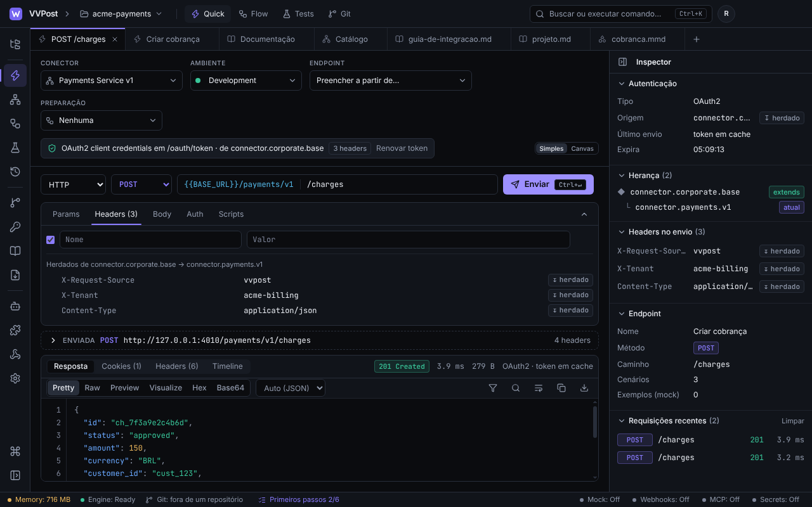
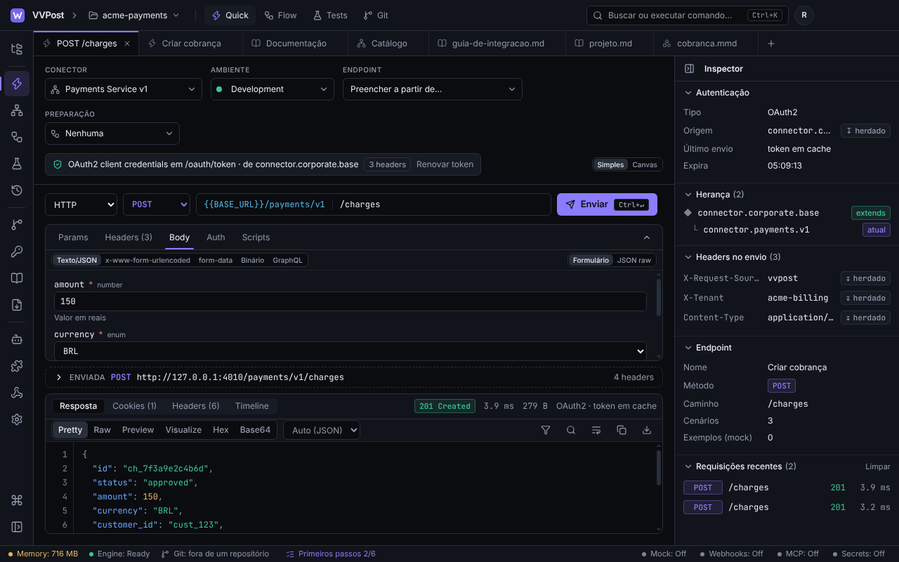
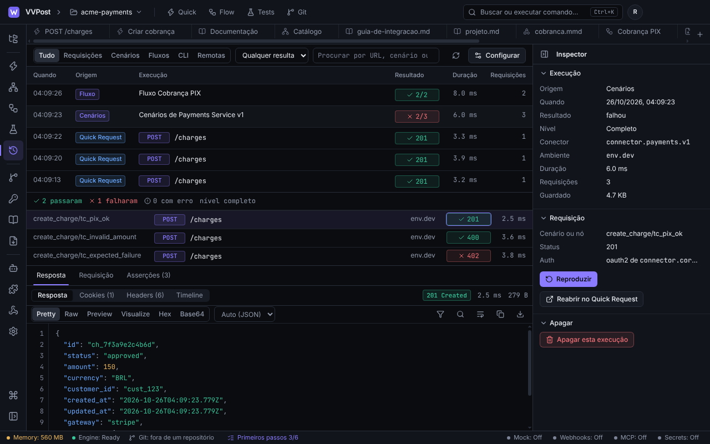
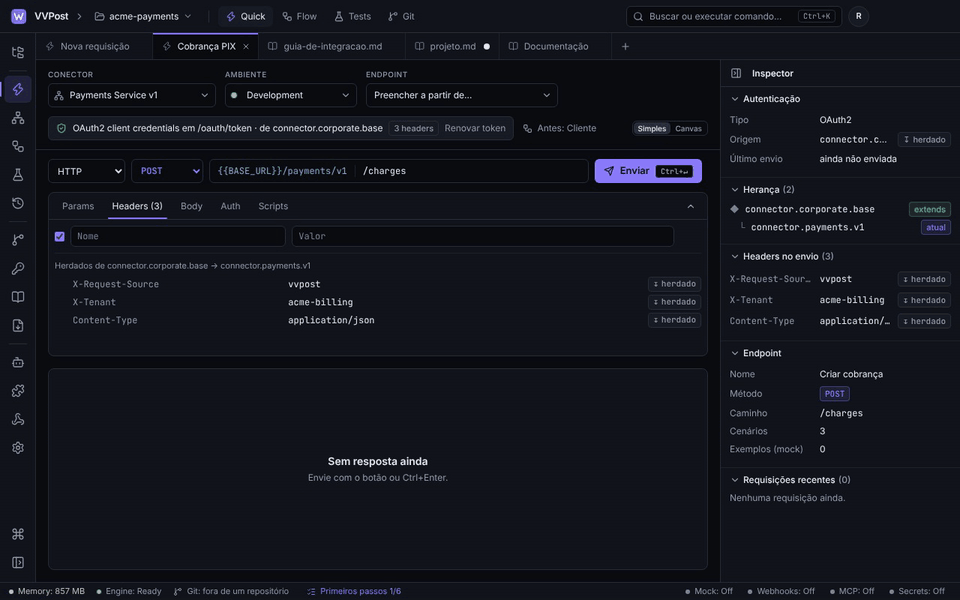

# Quick Request, resposta, histórico e auth headless



## Como o disparo funciona

O renderer nunca faz rede: `window.vvpost.sendRequest()` vai por IPC até o dispatcher do
main process, que usa um `Agent` do undici compartilhado pelo app inteiro. O pool mantém
sockets em keep-alive por origem, então só o primeiro disparo para um host paga o
handshake TCP/TLS. A resposta volta com status, cabeçalhos, corpo (descomprimido, até
10 MB guardados) e tempos (TTFB, download, total). Erros de rede voltam como valor com um
código (`TIMEOUT`, `CONNECTION_REFUSED`, `DNS_FAILURE`...), e a requisição pode ser cancelada.

O undici e o Kysely ficam em chunks separados do main process, carregados só no primeiro
uso: o histórico abre depois do primeiro paint, e o undici só no primeiro envio.

## Montar a requisição

Cada requisição é uma aba (`Ctrl+T` abre, `Ctrl+W` fecha, `Ctrl+Shift+T` reabre a fechada e
`Ctrl+N` abre uma requisição nova; `Ctrl+L` vai para a URL). `Ctrl+Enter` envia e `Esc` cancela
o envio em andamento.

- **Params** edita a query em linhas, nos dois sentidos com a URL, e lista os parâmetros de rota.
  Cada linha mostra a origem (do endpoint, sobrescrita ou definida aqui) e pode ser desativada sem
  ser apagada; os parâmetros do endpoint removidos aparecem com **Restaurar**.
- **Enviada**, ao lado da resposta, mostra o que foi para a rede: a URL final e os headers herdados
  e da auth, com as credenciais mascaradas. A edição se recolhe sozinha depois do envio em janelas
  baixas (zoom de 150%) e a escolha fica lembrada. Nessas janelas a faixa de contexto (conector,
  ambiente, endpoint e preparação) também vira uma linha só, sem os rótulos acima dos campos (o
  nome de cada um fica na dica).
- Três níveis de abas, cada um com a sua cara: as requisições abertas são abas de arquivo, com a
  barra no topo; o conteúdo que se edita (Params, Headers, Body, Auth) tem abas sublinhadas; a
  resposta (corpo, cookies, headers, timeline) usa botões segmentados.
- O menu da requisição (botão direito na aba ou na URL, ou a Command Palette com `Ctrl+K`) tem
  duplicar em nova aba (`Ctrl+D`), copiar a URL, copiar como cURL (`Ctrl+Shift+C`), fetch,
  Python ou HTTPie, colar um cURL como requisição, gerar um cenário de teste a partir da request
  ([tests.md](tests.md)) e abrir o conector no Catálogo.

### Corpo

A aba **Body** tem cinco modos:

- **Texto/JSON**: o corpo em texto, com validação e formatação de JSON. Sem `Content-Type`, o
  VVPost manda `application/json` quando o texto é JSON e `text/plain` nos outros casos.
- **x-www-form-urlencoded**: campos em linhas, que podem ser desativados sem ser apagados.
- **form-data**: `multipart/form-data` com campos de texto e de arquivo (o tipo de cada linha), e
  o `Content-Type` de cada parte, se precisar. O VVPost gera o boundary; um `Content-Type`
  `multipart/form-data` digitado nos headers sem boundary quebraria o corpo, então o importador do
  Postman tira esse header.
- **Binário**: um arquivo inteiro como corpo, com o `Content-Type` pela extensão ou o digitado.
- **GraphQL**: a consulta e as variáveis, enviadas como `{ "query", "variables", "operationName" }`
  em JSON ([abaixo](#graphql)).

Os arquivos são escolhidos pelo diálogo do sistema e vão como caminho: o processo principal lê os
bytes no envio (até 100 MB por arquivo), e o renderer nunca carrega o arquivo. No endpoint de um
conector o mesmo corpo fica em `payload` (no lugar de `body`), com caminhos relativos à pasta do
projeto, e os cenários trocam com `overrides.payload`:

```json
{
  "id": "enviar-foto",
  "name": "Enviar foto",
  "method": "POST",
  "path": "/usuarios/{id}/foto",
  "payload": {
    "mode": "multipart",
    "fields": [
      { "name": "descricao", "value": "{{DESCRICAO}}" },
      { "name": "foto", "file": "fixtures/foto.png" }
    ]
  }
}
```

Textos e caminhos aceitam `{{VAR}}`. Quem dispara sem uma pessoa (a IA pelo MCP, um hook de
webhook) só envia arquivos de dentro do projeto. No histórico ficam os campos e os caminhos dos
arquivos, sem os bytes; copiar como cURL vira `-F`, `--data-urlencode` ou `--data-binary @arquivo`
(e colar um cURL com essas opções monta o modo certo).

### Formulário pelo schema

Quando o endpoint escolhido tem `bodySchema` (o import do [OpenAPI](import-export.md) grava o de
cada operação, e num endpoint escrito à mão os campos se definem no
[Catálogo](catalog.md#campos-do-corpo-sem-openapi), pela IA ou com `vvpost schema`), o modo **Texto/JSON** abre como
formulário: cada propriedade vira um campo com o controle do tipo dela, e **JSON raw**, no canto da
barra do corpo, volta ao texto. Os dois editam o mesmo corpo; a escolha fica na aba.



- **enum** e **booleano** viram seletor com os valores do schema; **integer** e **number** aceitam
  número ou `{{VAR}}`; `format: date` usa o seletor de data; `default`, `examples` e o formato
  aparecem como dica no campo.
- Obrigatórios têm `*`; a `description` aparece embaixo do campo, e o tipo ao lado do nome
  (`integer ≥ 1`, `string · email`, `string[]`).
- Objetos aninhados abrem em grupo; um objeto opcional ausente vira **+ nome** e some do corpo com
  a lixeira. Listas têm **+ item** e remoção por item. `oneOf`/`anyOf` ganham um seletor do ramo,
  escolhido pelo que já está no corpo. `$ref` e `allOf` são resolvidos.
- Campo opcional vazio sai do corpo. Chaves que o schema não descreve continuam no corpo e são
  listadas no formulário; edite essas no JSON raw.
- Um corpo que não é JSON válido (por exemplo, `{{VAR}}` sem aspas no lugar de um número) mostra o
  aviso e o atalho para o JSON raw.

O mesmo formulário aparece no corpo do nó de requisição do [Flow Studio](flows.md#nó-de-requisição).

### GraphQL

No modo **GraphQL** da aba Body (com `POST`), a consulta fica num editor com realce, as
variáveis num campo JSON e, com mais de uma operação nomeada no documento, **Operação** escolhe
qual rodar. O corpo da aba é sempre o JSON montado deles, então copiar como cURL, gerar cenário de
teste e salvar no endpoint levam a consulta junto; um endpoint cujo `body` é
`{ "query": ... }` abre direto nesse modo.

**Buscar schema**, no painel **Schema**, manda a consulta de introspecção para a URL da aba pelo
mesmo caminho do envio (auth e headers do conector, ambiente, proxy). Com o schema:

- o **autocomplete** (`Ctrl+Espaço`, ou ao abrir `{` e `(`) sugere os campos do tipo em que o
  cursor está, os argumentos do campo dentro de `( )` e os tipos depois de `on`, com o tipo no
  formato do SDL (`[User!]!`) e a descrição; um campo de objeto já abre a seleção `{ }`;
- o **explorer** lista as raízes (`Query`, `Mutation`, `Subscription`) e os outros tipos, com busca
  por tipo ou campo. Clicar num campo insere no cursor (com os argumentos obrigatórios), e clicar
  no tipo dele abre esse tipo.

O schema fica guardado por conector e URL enquanto o app está aberto; **Atualizar** busca de
novo. Um servidor com a introspecção desligada responde com o erro dele, que aparece no painel.
`Ctrl+Enter` dentro da consulta envia.

### WebSocket, SSE e Socket.IO

O seletor **Protocolo** da barra de execução também abre conexões persistentes: **WebSocket**,
**SSE** (Server-Sent Events) e **Socket.IO**. A aba passa a **Conectar** em vez de enviar
(`Ctrl+Enter` conecta e desconecta), e a resposta vira a **tela de mensagens**: o estado da
conexão, as mensagens recebidas e enviadas com hora, nome do evento e tamanho, filtro por texto e
por direção, e cada mensagem abre com o JSON formatado. A lista guarda as 2.000 mais novas.

A conexão herda tudo do contexto, como uma requisição: com conector, a URL é um caminho relativo à
`baseUrl` + `basePath` (uma `baseUrl` `https://` vira `wss://` no WebSocket), os headers do
conector e da aba e a auth vão no handshake, e o mTLS, o proxy e as CAs extras valem. Auth por
desafio (Digest, NTLM) não abre conexão persistente: mande o header de auth na aba. Uma URL
absoluta de outra origem não leva as credenciais do conector.

- **WebSocket**: a caixa embaixo envia texto ou JSON; `{{VAR}}` é resolvida pelo ambiente da
  conexão. **Subprotocolos**, na aba Headers, vão no `Sec-WebSocket-Protocol`. Frames binários
  aparecem em base64.
- **SSE**: só recebe. `GET` por padrão; com `POST` (APIs que respondem em stream), a aba Body vale.
  A resposta precisa ser `text/event-stream`; o fim do stream fecha a conexão, sem reconectar
  sozinha.
- **Socket.IO** (servidores 3.x e 4.x, Engine.IO v4 sobre WebSocket): o caminho da URL é o
  namespace (`/admin`), no caminho padrão `/socket.io/`; uma URL que já tem `/socket.io` usa esse
  caminho e o namespace `/`. A conexão só fica **Conectado** quando o namespace aceita; uma recusa
  aparece com a mensagem do servidor. Envie com o nome do **Evento** e o argumento em JSON (texto
  que não é JSON vai como string). O ping do servidor é respondido sozinho. Anexos binários não
  são suportados.

O que aparece na tela passa pelo Secret Sanitizer, como o histórico: um token que o servidor
devolve numa mensagem, ou um `{{SEGREDO}}` enviado, aparece como `[REDACTED_SECRET]`. As conexões
não entram no histórico, e fechar a aba ou trocar de workspace fecha a conexão.

### Rede: proxy, certificados e cookies

Em **Configurações > Rede e cookies** (valem para o Quick Request, os cenários, os fluxos e o MCP
do app, e ficam em `userData`, fora do projeto):

- **Proxy**: do sistema (o padrão; inclui PAC e WPAD), das variáveis `HTTPS_PROXY`, `HTTP_PROXY`,
  `ALL_PROXY` e `NO_PROXY`, manual (HTTP, HTTPS ou SOCKS5, com a lista de hosts sem proxy, que
  aceita sufixos, `host:porta` e faixas CIDR) ou desligado. Endereços de loopback nunca passam
  pelo proxy. A senha do proxy vai para o cofre do sistema (DPAPI, Keychain ou libsecret); sem
  cofre, vale só até o app fechar.
- **Certificados**: desligar a verificação TLS (aceita certificado autoassinado, expirado ou de
  outro host, em todas as requisições) e CAs extras em PEM, somadas às do sistema e à `tls.ca` do
  conector.
- **Cookies**: o cookie jar guarda os `Set-Cookie` recebidos (inclusive nos redirecionamentos) por
  domínio e caminho, respeita `Secure`, `Max-Age` e `Expires`, e reenvia nas próximas requisições
  para o mesmo domínio. Um `Cookie` digitado na aba vence o do jar com o mesmo nome. A lista mostra
  os cookies guardados para filtrar, editar o valor, apagar um, apagar todos e adicionar à mão. Os
  cookies ficam em `userData/cookies.json` (os de sessão não passam de uma execução do app), e o
  MCP não usa o jar: a sessão do usuário não vai para a IA.

Um redirecionamento para outra origem não leva `Authorization`, `Cookie`, `Proxy-Authorization`
nem headers com nome de credencial; 303 (e 301/302 depois de um POST) vira GET sem corpo.

## A resposta

A resposta tem as abas **Resposta**, **Cookies** (lidos do `Set-Cookie`), headers e **Timeline**
(TTFB, download e total), e estes modos de visualização:

| Modo | O que mostra |
| --- | --- |
| Pretty | Formatado e com realce. A linguagem vem do content-type e do texto (Auto) ou é escolhida: JSON, XML, HTML, JavaScript, YAML, Markdown ou Texto. |
| Raw | O texto como chegou. |
| Preview | HTML e Markdown num iframe isolado, sem scripts e sem rede; imagem, áudio, vídeo e PDF a partir dos bytes. |
| Visualize | Um template de visualização, compatível com o `pm.visualizer` das coleções importadas (subconjunto do Handlebars, com `vv.response` e `pm.response`), num iframe isolado, sem acesso ao app e sem rede. |
| Hex e Base64 | Os bytes da resposta. |

A barra da resposta tem busca, filtro (JSONPath para JSON e XPath para XML e HTML), quebra de linha, copiar e **Salvar em arquivo…**, que grava o arquivo original. O menu
da resposta também compara com a resposta anterior da mesma aba.

Clicar com o botão direito (ou clicar) num valor do JSON, na resposta ou no body da requisição,
abre o menu de valores: copiar o valor (`Ctrl+C`) ou o path (`Ctrl+Alt+C`), usar como variável do
ambiente (`Ctrl+Shift+V`; nomes sensíveis vão para o vault local, não para o arquivo), inserir na
próxima requisição (`Ctrl+Shift+I`, abre uma aba nova com o valor no body), filtrar pelo path e
expandir ou recolher tudo.

## Histórico



Cada disparo (Quick Request, lote de cenários, fluxo e `vvpost run --history`) vai para o
histórico em `<userData>/vvpost.db`, SQLite em modo WAL, com a requisição como montada e como foi
para a rede, a resposta, os tempos, a auth, as asserções e os logs. O módulo
**Histórico** (`Ctrl+9`) lista as execuções com filtros por origem, resultado e texto, e cada uma
abre com o modelo, a requisição enviada, a resposta, as asserções e os nós do fluxo.

- **Reabrir no Quick Request** leva o modelo para uma aba nova, com conector e ambiente.
- **Reproduzir** refaz a requisição pelo modelo, resolvendo `{{VAR}}`, a herança e a auth de novo
  no estado atual dos arquivos e do vault; a execução nova aponta para a original. É recusado
  quando o nível não guardou o necessário ou quando o modelo tem valor mascarado: aí, reabra e
  preencha.
- A tela de configuração do módulo escolhe o nível por origem (`off`, `metadata`, `headers` ou
  `full`; padrão `full`) e os limites: execuções guardadas (1000), idade máxima (30 dias) e corpo
  por requisição (256 KB), além do tamanho total (200 MB). Passou de um limite, as execuções mais
  antigas saem.
- Execuções num Execution Runner da organização (**Rodar no runner**, com o módulo Enterprise)
  entram quando terminam, no nível dos cenários, com o selo **Remota**, o Control Plane e o número
  da execução. O filtro **Remotas** mostra só elas. Ficam os cenários com status, erro e asserções;
  as requisições rodaram no runner, então nenhuma reproduz daqui. Um runner que sumiu aparece como
  erro `RUNNER_LOST`.
- Credenciais nunca vão em claro, em nenhum nível: no modelo viram `__REQUIRED_SECRET__`, e o resto
  passa pelo Secret Sanitizer. O banco usa o `node:sqlite` embutido no Electron, então não há
  módulo nativo para recompilar.

O inspector do Quick Request (`Ctrl+B` recolhe) também mostra as requisições recentes.

## Scripts pre e post

A aba **Scripts** tem dois editores de JavaScript: **Antes do envio** (pre-request) e **Depois da
resposta** (post-response). Por trás, uma requisição com scripts vira um fluxo do Flow Studio,
script → requisição → script, que roda no mesmo motor e no runtime do `vvpost-plugin-javascript`
(precisa do plugin ligado). **Ver como fluxo** abre esse fluxo como rascunho no canvas, para ver
a ordem ou continuar a partir dele.

```js
// Antes do envio: altera o que vai para a rede.
vv.request.headers['X-Tenant'] = vv.variables.get('TENANT')
vv.request.query.pagina = 2

// Depois da resposta: testes e variáveis para as próximas requisições.
vv.test('status 200', => vv.expect(vv.response.status).to.equal(200))
vv.test('tem id', => expect(vv.response.json()).toHaveProperty('id'))
vv.variables.set('usuarioId', vv.response.json().id)
```

| API | O que faz |
| --- | --- |
| `vv.request` | `method`, `url`, `headers` e `query` (objetos por nome) e `body` (texto). No pre, o que o script mudar é o que vai para a rede. |
| `vv.response` | Só no post: `status` (e `code`), `headers`, `body` (JSON já lido, ou texto), `responseTime`, `json()` e `text()`. Um 4xx/5xx também chega ao post. |
| `vv.variables` | `get`, `has`, `set`, `unset` e `toObject`. Lê o ambiente e o que scripts anteriores definiram; `set` vale como `{{nome}}` nas próximas requisições do mesmo ambiente até fechar o app (nos cenários e fluxos, dentro da execução). `vv.environment` é o mesmo objeto. |
| `vv.test(nome, fn)` | Declara um teste; uma exceção dentro de `fn` o reprova. |
| `vv.expect(valor)` | Asserções no estilo chai (`to.equal`, `to.eql`, `to.include`, `to.have.property`, `to.be.above`, `to.be.a('string')`, `to.have.status`, `not`...) e no estilo Jest (`toBe`, `toEqual`, `toContain`, `toMatch`, `toHaveProperty`, `toHaveLength`, `toBeGreaterThan`...). |
| `console.log`, `http.send`, `signal` | Como no nó JavaScript ([plugins.md](plugins.md#vvpost-plugin-javascript)). |

Scripts também ficam no conector (`config.scripts`, herdado pela cadeia de `extends` como os
headers) e no endpoint (`scripts`), editáveis no Catálogo. Todos rodam, nesta ordem: os do conector
raiz até o conector, os do endpoint e os da aba (no pre e no post). A aba Scripts mostra quantos
vêm herdados.

- A resposta ganha a aba **Testes** com os testes que passaram e falharam, o console de cada script
  e as variáveis definidas. Um teste reprovado não muda o status da requisição.
- Um pre que lança erro para a requisição antes da rede, com `SCRIPT_ERROR` e a linha do script.
  Um post que lança erro aparece na aba Testes.
- Segredos chegam ao script como `{{NOME}}`: o script pode colocá-los na requisição, que o main
  process resolve no envio, mas nunca lê o valor. Logs, testes e variáveis passam pelo Secret
  Sanitizer como o resto da resposta.
- Nos cenários, cada `vv.test` vira uma asserção `test: <nome>` do resultado; no Flow Studio, um nó
  de requisição de um endpoint com scripts os roda (com `scripts: false` no nó, não), e um teste
  reprovado falha o nó com `ASSERTION_FAILED`. No CLI e no MCP, o mesmo.
- O histórico guarda os scripts da aba no nível **completo** (com os valores do vault mascarados);
  **Reproduzir** roda os scripts de novo.

O `node:vm` do plugin não é uma fronteira de segurança: rode scripts em que você confia, como faria
num terminal.

## Requisição e fluxo: o mesmo documento

Uma requisição do Quick Request é um fluxo do Flow Studio visto de forma simplificada. O botão
**Simples | Canvas**, no fim da faixa de contexto (e no cabeçalho do Flow Studio), troca a visão do
mesmo documento, no mesmo lugar da barra de abas; a mudança ainda não salva vai junto.



- **`Ctrl+S`** grava a aba como um `flows/*.flow.vvpost.json`. A primeira vez pergunta o nome; as
  seguintes regravam o mesmo arquivo, e a aba mostra o ponto de mudança não salva enquanto difere
  dele. A aba leva o nome do fluxo.
- **Um fluxo que termina num nó de requisição** abre na visão Simples (o explorador já abre assim).
  A aba edita esse último nó; os nós anteriores rodam em segundo plano antes de cada envio, como a
  [preparação](#fluxo-de-preparação), e o contexto mostra **Antes: Login → ...**. A requisição lê a
  saída deles com `{{ $nodes.Login.data.token }}`. Ao salvar, o grafo de antes fica como estava.
- **Preparação escolhida** no contexto entra no fluxo ao salvar, como os nós de antes.
- **Um fluxo que herda** ([herança entre fluxos](flows.md#herança-entre-fluxos)) abre com a base como
  conector: a URL é relativa a ela, e o login, os headers e o mTLS da base valem no envio. Salvar
  mantém o `extends`, os cenários, os exemplos e o schema do corpo. Um fluxo-base abre no canvas.
- O conector, o endpoint e os scripts pre e post da aba vão para o nó (`requestScripts`, que rodam
  depois dos do conector e do endpoint, na mesma ordem do Quick Request). Uma resposta 4xx/5xx segue
  como resposta (`ignoreHttpErrors`), como no Quick Request.
- Fica no canvas (o Simples aparece desligado) o fluxo que termina em mais de um nó ou num nó que
  não é de requisição, que tem um nó solto, ou cujo último nó usa polling, `fromScript`,
  `"scripts": false`, `pathParams` ou um header `null`. Conexões realtime e protocolos de plugin
  não viram fluxo.
- Salvar recusa um header de credencial com valor digitado (`Authorization: Bearer abc...`) e
  qualquer valor do vault: use um `{{NOME}}` do ambiente marcado como segredo, ou um
  `{{ $nodes... }}` de um nó anterior.

## Conectores no Quick Request (Headless Auth Binding)

Na barra superior, **Abrir workspace** escolhe a pasta (a mesma do painel Git Workspace) com os conectores
(`*.connector.vvpost.json` em qualquer subpasta) e `environments/*.env.json`, com os segredos no
[cofre local](security-model.md#cofre-local). Com um **Conector** escolhido, a URL vira um caminho relativo à
`baseUrl` + `basePath` herdados, e o main process aplica antes do disparo tudo o que vem da
cadeia de `extends`: headers, certificado de cliente (mTLS) e autenticação. O **Ambiente**
resolve os `{{VAR}}` do conector e da própria requisição; segredos vêm do arquivo local.
O seletor **Endpoint** preenche método, caminho, headers e corpo a partir do conector.

Um endpoint público (`"requiresAuth": false`, o [gate de acesso](tests.md#gate-de-acesso-requiresauth))
vai sem credencial, como no `vvpost run` e no MCP: sem a auth do conector e sem os headers de
credencial herdados (`Authorization`, `Cookie`, `X-Api-Key`...). Os outros headers herdados vão, e um
header de credencial digitado na aba também. O Inspector e a aba Auth avisam, e **Enviar a auth mesmo
assim** no Inspector manda a auth do conector naquela aba (para uma API em que a auth é opcional). O
histórico marca o envio sem credencial, e **Reproduzir** repete do mesmo jeito.

### Fluxo de preparação

Quando o workspace tem fluxos (`flows/*.flow.vvpost.json`), o contexto ganha o seletor
**Preparação**: o fluxo escolhido roda em segundo plano antes de cada envio da aba, sem abrir o
canvas, pelo mesmo dispatcher e cache de tokens. A requisição lê a saída dos nós
como um nó do próprio fluxo leria: `Authorization: Bearer {{ $nodes.Login.data.token }}` no header,
`?tenant={{ $nodes.Login.data.tenant }}` na URL ou no corpo. Serve para logins que não cabem no
`config.auth` do conector, para criar dados de teste antes da chamada ou para encadear um token de
outra API.

- A resposta mostra **Preparação** com o fluxo, os nós e o tempo; a Timeline ganha a etapa.
- Um nó que falha para a requisição antes da rede, com `PREPARE_FAILED`, o nó no erro e
  **Abrir o fluxo no Flow Studio**. Um `{{ $nodes... }}` que não está na saída é `CONFIG_ERROR`.
- O histórico guarda a requisição como digitada e o fluxo, nunca os valores que ele devolveu:
  **Reproduzir** roda a preparação de novo. As requisições do fluxo não viram execução à parte.

A autenticação fica em `config.auth` (formato em [`packages/schemas`](../packages/schemas/README.md#autenticação-e-mtls)):

| `type` | O que o main process faz |
| --- | --- |
| `bearer`, `apiKey`, `basic` | Monta o header (ou query) com os valores do ambiente. |
| `oauth2` | Pede o token (client credentials ou password) ao `tokenUrl`, em form ou, com `tokenRequestFormat: "json"`, em JSON; guarda em memória até expirar e usa o `refresh_token` quando há. Com `authorization_code`, abre o `authUrl` no navegador do sistema (com PKCE S256, a não ser com `pkce: false`), recebe o code num endereço de loopback (`redirectUri`, padrão `http://127.0.0.1:<porta livre>/callback`) e troca pelo token. |
| `digest`, `ntlm` | Mandam a requisição, recebem o 401 com o desafio e repetem uma vez com a resposta. O NTLM (v2) faz as duas etapas na mesma conexão, uma requisição por vez para o mesmo usuário. |
| `awsSigV4`, `oauth1` | Assinam a requisição final (método, URL, headers e corpo; com form-data, os bytes exatos que vão na rede). |
| `login` | Chama o endpoint de login da API (JSON, form ou texto, com `{{$totp:VAR}}` para MFA), tira o token de `body.<caminho>` ou `headers.<nome>` e injeta onde o conector mandar. |

O login no navegador só abre com uma pessoa do outro lado: no app e no `vvpost` rodando num
terminal (fora do CI), que mostra a URL e tenta abrir o navegador. Pelo MCP e pelos hooks, uma
auth `authorization_code` sem token em memória falha com `AUTH_FAILED`.

Tokens nunca vão para o disco nem para o renderer. Requisições simultâneas dividem um único
fluxo de token, e um token em cache recusado com 401 é descartado e a requisição é repetida
uma vez. Um header de auth digitado à mão vence a herança. Credenciais herdadas só vão para a
origem da `baseUrl`: uma URL absoluta de outro host é recusada com `CONFIG_ERROR`. O histórico
guarda a requisição como digitada (caminho relativo e `{{VAR}}`) com o conector e o ambiente,
para poder ser repetida, e nunca o token. **Renovar token** descarta o token em memória.
