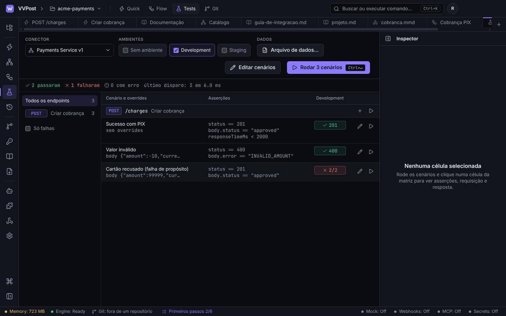

# Cenários de teste: a matriz cenário × ambiente



Os cenários são testes *table-driven* de um endpoint: o endpoint define a requisição
uma vez e cada cenário só diz o que muda (corpo, headers, query, parâmetros de rota) e o que
espera da resposta. O módulo **Cenários de teste** (`Ctrl+5`) roda o lote em um ou mais
ambientes e mostra a matriz, com uma linha por cenário e uma coluna por ambiente. O mesmo motor
roda os cenários no CLI (`vvpost run`, [cli.md](cli.md)) e pelo MCP (`execute_dry_run`,
[mcp.md](mcp.md)).

## Onde ficam

Os cenários moram no arquivo do conector, em `endpoints[].scenarios` (schema
[`connector.json`](../packages/schemas/schemas/connector.json)), e vão para o Git junto com ele:

```json
{
  "id": "charge_customer",
  "method": "POST",
  "path": "/charges",
  "body": { "amount": 1000, "method": "PIX" },
  "scenarios": [
    {
      "id": "pix_ok",
      "name": "Sucesso com PIX",
      "assertions": [
        { "target": "status", "operator": "equals", "expected": 201 },
        { "target": "body.status", "operator": "equals", "expected": "PENDING" }
      ]
    },
    {
      "id": "valor_invalido",
      "name": "Erro: valor inválido",
      "overrides": { "body": { "amount": -10, "method": "PIX" } },
      "assertions": [
        { "target": "status", "operator": "equals", "expected": 400 },
        { "target": "body.error", "operator": "equals", "expected": "INVALID_AMOUNT" }
      ]
    },
    {
      "id": "sem_auth",
      "name": "Erro: sem auth",
      "overrides": { "headers": null },
      "assertions": [{ "target": "status", "operator": "equals", "expected": 401 }]
    }
  ]
}
```

## Overrides

| Campo | Efeito |
| --- | --- |
| `body` | Substitui o corpo padrão do endpoint. |
| `headers` | Mescla com os headers herdados. `null` tira todos os herdados e a auth (o caso "sem auth"); um header com valor `null` tira só aquele. |
| `query` | Mescla com a query do endpoint; um parâmetro `null` é removido. |
| `pathParams` | Valores dos `{nome}` do caminho, codificados para URL (`a b` vai como `a%20b`). |
| `rawPathParams` | Nomes de `pathParams` que vão como estão, sem codificar: `"pathParams": { "codigo": "%E0" }, "rawPathParams": ["codigo"]` manda `/pedidos/%E0` cru, para testar o 400 de um caminho malformado (sem ele, o `%` vira `%25` e o servidor recebe um texto qualquer). |
| `config` | Só em endpoint com `plugin` (gRPC, Kafka...): mescla com `plugin.config`, campo a campo; `null` tira o campo. |

Tudo aceita `{{VAR}}` do ambiente. O resto da requisição (baseUrl, headers, auth, mTLS) vem da
herança do conector, como no Quick Request. Um endpoint com `plugin` é chamado pelo adapter do
plugin, e as asserções leem o `data` dele como corpo ([plugins.md](plugins.md#protocolos-no-quick-request-e-nos-cenários)).

## Asserções

Cada asserção tem `target`, `operator` e, menos em `exists`, `notExists` e `matchesExample`, `expected`.

- **`target`**: `status`, `responseTimeMs`, `body`, `body.<caminho>` (com `[0]` para listas) ou
  `headers.<nome>`.
- **`operator`**: `equals`, `notEquals`, `lessThan`, `lessThanOrEqual`, `greaterThan`,
  `greaterThanOrEqual`, `contains`, `matches` (expressão regular), `exists`, `notExists` e
  `matchesSchema` (o `expected` é um JSON Schema, com o mesmo validador do Catálogo) e
  `matchesExample`. `matchesExample` só vale com `target` `body` e não leva `expected`: o corpo
  segue o `schema` do [exemplo de resposta](mock.md#exemplo-conferido-pelo-schema) do mesmo status
  da resposta. Sem exemplo com schema para aquele status, a asserção falha e diz por quê.
- **`actual`** no resultado vem com o tipo da resposta (`500`, não `"500"`).

### Expectativa por ambiente

Uma asserção com `environments` só vale nesses ambientes; fora deles ela nem aparece no
resultado. Assim o mesmo cenário espera 401 num ambiente e 200 em outro:

```json
"assertions": [
  { "target": "status", "operator": "equals", "expected": 200, "environments": ["env.hml"] },
  { "target": "status", "operator": "equals", "expected": 401, "environments": ["env.prod"] }
]
```

## Cenários encadeados

Um cenário pode depender de outros do mesmo conector e usar o que eles devolveram:

```json
{
  "id": "consultar",
  "name": "Consulta a cobrança criada",
  "dependsOn": ["charge_customer/pix_ok"],
  "overrides": { "pathParams": { "chargeId": "{{$capture.chargeId}}" } },
  "assertions": [{ "target": "status", "operator": "equals", "expected": 200 }]
}
```

e, no cenário `pix_ok`, `"capture": { "chargeId": "body.id" }`.

- `dependsOn` lista `<endpoint>/<cenário>`. As dependências rodam antes, no mesmo ambiente, e
  entram no lote mesmo se o filtro não as escolheu.
- `capture` guarda valores da resposta (`status`, `body`, `body.<caminho>` ou `headers.<nome>`)
  com um nome. Os dependentes, diretos ou indiretos, leem com `{{$capture.<nome>}}` em qualquer
  campo que aceite `{{VAR}}`; o valor entra como texto.
- Se uma dependência não passa, o dependente não é enviado e sai com `DEPENDENCY_FAILED`. Um
  ciclo, ou um cenário inexistente em `dependsOn`, é erro do lote.

O editor de cenários do app edita os três (abaixo), e o arquivo e a IA pelo MCP continuam
valendo.

## Gate de acesso (`requiresAuth`)

O endpoint diz se exige credencial: `"requiresAuth": true` (sem ela, a API responde 401 ou 403) ou
`false` (é público). A importação e o `vvpost sync` preenchem pelo `security` da operação na spec
OpenAPI ([import-export.md](import-export.md#importar-openapi-e-swagger)); num fluxo de requisição o
campo fica na raiz do fluxo, ao lado de `scenarios`. Sem o campo, nada muda.

O `vvpost run` (e a matriz do app e o `run_scenarios` do MCP) confere sozinho:

- **Exige auth:** acrescenta ao endpoint o cenário `$sem-credencial`, que chama o endpoint sem a
  auth do conector, sem os headers de credencial (`Authorization`, `Cookie`, `X-Api-Key`...) e sem
  corpo, e passa com 401 ou 403. Os `{nome}` do caminho usam o valor de um cenário do endpoint
  (fora os que vêm de `{{$capture...}}`) ou `00000000-0000-0000-0000-000000000000`, que passa
  numa restrição de rota de texto ou de GUID. Rota com outra restrição (`{id:int}`): ponha o
  valor num cenário.
- **Público:** os cenários do endpoint rodam sem credencial, então um endpoint que passou a exigir
  auth falha neles. Um header de credencial escrito no próprio cenário vai. Sem cenários, entra o
  `$sem-credencial`, que passa com qualquer status menos 401 e 403; num login, em que 401 é a
  resposta certa para dados inválidos, escreva o cenário.

Com um filtro de cenários (`--scenario`, `scenarioIds`), o `$sem-credencial` só roda se for pedido
pelo nome. Ele não fica no arquivo, e a regra de lint `endpoint-requires-auth` (info) aponta os
endpoints que ainda não dizem se exigem auth.

No Quick Request, o endpoint público também vai sem credencial, a não ser que a aba peça a auth
([quick-request.md](quick-request.md#conectores-no-quick-request-headless-auth-binding)).

## Execução orientada a dados

Um arquivo de dados faz o lote inteiro rodar uma vez por linha, em cada ambiente marcado. Serve CSV com cabeçalho (vírgula, ponto e vírgula ou tab, aspas
no padrão RFC 4180) ou JSON com uma lista de objetos, até 5.000 linhas.

```csv
valor,status
150,200
-5,400
```

- Cada coluna vira variável da iteração: `{{valor}}` e `{{$data.valor}}`, por cima das variáveis
  do ambiente (uma coluna `BASE_URL` troca a URL só naquela linha). `{{$iteration}}` é o número
  da linha, a partir de 1.
- O `expected` de uma asserção também lê a linha: `"expected": "{{status}}"` sozinho vira o valor
  com o tipo do JSON (`400` é número, `true` é booleano); no meio de um texto, entra como texto.
- `dependsOn` e `capture` ficam dentro da iteração: a dependência roda na mesma linha, e o que ela
  capturou não passa para a linha seguinte.
- No app, **Arquivo de dados…**, ao lado dos ambientes, escolhe o arquivo. A célula da matriz
  mostra quantas iterações passaram (`2/3`) e o detalhe tem os botões das iterações (`#1`, `#2`…)
  para ver cada uma. O **x** volta a rodar sem o arquivo. **Rodar no runner** fica desligado
  com um arquivo de dados.
- No CLI, `vvpost run --data casos.csv` (ou `.json`). O texto e o JUnit marcam a iteração
  (`#2`), e o JSON traz `iteration` em cada resultado e `data` no lote
  ([cli.md](cli.md#opções-de-run)).

## No app

- **Rodar N cenários** executa os cenários escolhidos em todos os ambientes marcados, 4 requisições por vez,
  pelo mesmo dispatcher e pela mesma auth do Quick Request (o token em cache é dividido).
  `Ctrl+Enter` roda e `Esc` cancela.
- Cada célula abre o detalhe. A primeira asserção que falhou vem em destaque, com esperado e
  recebido lado a lado; as outras ficam em **Ver todas as N asserções**. O detalhe tem **Abrir
  endpoint** (no Catálogo), **Abrir no Quick Request**, **Inspecionar resposta** e **Editar
  cenário**.
- O tipo de falha muda a aparência da célula e vem no detalhe: **falha de asserção** (vermelho
  cheio, com quantas falharam), **falha de transporte** (rede, timeout, TLS: vermelho tracejado,
  `rede`), **erro de configuração** (segredo sem valor, conector, auth, dependência: amarelo,
  `config`) e **bloqueio de política** (azul, `política`). O Histórico usa as mesmas cores.
- Pelo botão direito numa célula dá para executar de novo só ela, copiar as asserções que falharam ou
  abrir o cenário no Quick Request
  (`Ctrl+Shift+Enter`) com a URL montada, os headers e o corpo do cenário, no mesmo conector e
  ambiente.
- **Editar cenários**, o lápis de cada linha e o **+** de cada endpoint abrem o editor de
  overrides (corpo, headers com "remover herdado", sem headers herdados, query e parâmetros de
  rota), de encadeamento e de asserções, que grava o arquivo do conector. Em **Encadeamento**,
  **Depende de** lista os outros cenários do conector e **Captura** guarda valores da resposta
  com um nome (a origem é conferida antes de salvar); trocar o id de um cenário atualiza o
  `dependsOn` de quem dependia dele. Abaixo de cada asserção, os ambientes do workspace: nenhum
  marcado vale em todos, e marcar alguns grava `environments`. No Quick Request, o menu da requisição
  tem **Gerar cenário de teste a partir da request**: o que difere do endpoint vira override.
- O botão direito num endpoint ou cenário também gera a documentação daquele nível
  ([catalog.md](catalog.md#documentação-rica)).
- Cada lote vai para o **Histórico** (`Ctrl+9`) com as requisições de cada cenário, no nível
  configurado ([quick-request.md](quick-request.md#histórico)).
- Com o módulo Enterprise e um Control Plane configurado, **Rodar no runner** manda o workspace
  sem segredos para um runner da organização, mostra a saída ao vivo e preenche a mesma matriz
  ([cli.md](cli.md#execução-remota)). Antes de enviar, uma confirmação mostra o destino (o
  Control Plane e o projeto), a pasta com o número de arquivos e o tamanho, os ambientes com os
  nomes dos segredos que o runner vai resolver, os conectores e o escopo. Os valores do vault
  local não aparecem nem saem da máquina, e cancelar não envia nada.
