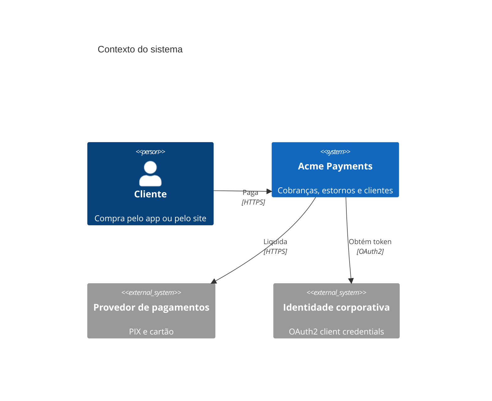
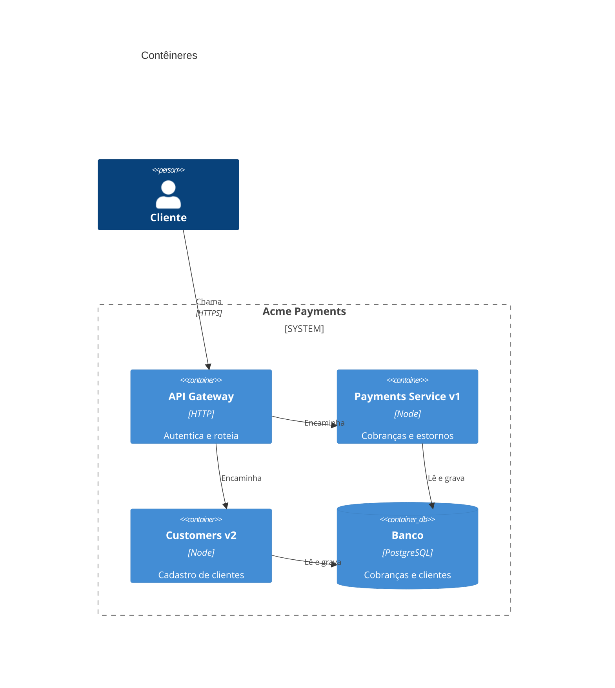

## Contexto do sistema

A Acme Payments recebe cobranças PIX e cartão dos canais de venda e conversa com o provedor de
pagamentos. Todo serviço herda a autenticação OAuth2 da base corporativa.

## Contêineres

Mapa das integrações do projeto (conectores, herança, endpoints e fluxos):

{{> map}}

## Como integrar

{{> include docs/guia-de-integracao.md}}

## Componentes

{{> connector connector.payments.v1}}

{{> connector connector.customers.v2}}

## Dinâmica

O checkout encadeia login, cliente, carrinho e cobrança:

{{> diagram docs/diagramas/cobranca.mmd}}

{{> flows}}

## Implantação

{{> environments}}

{{> variables}}

## Decisões de arquitetura

| # | Decisão | Status | Data |
| --- | --- | --- | --- |
| 1 | Auth OAuth2 herdada da base corporativa em todos os conectores | aceita | 2026-10-01 |
| 2 | Cobranças idempotentes pelo `customer_id` e valor | proposta | 2026-10-20 |
